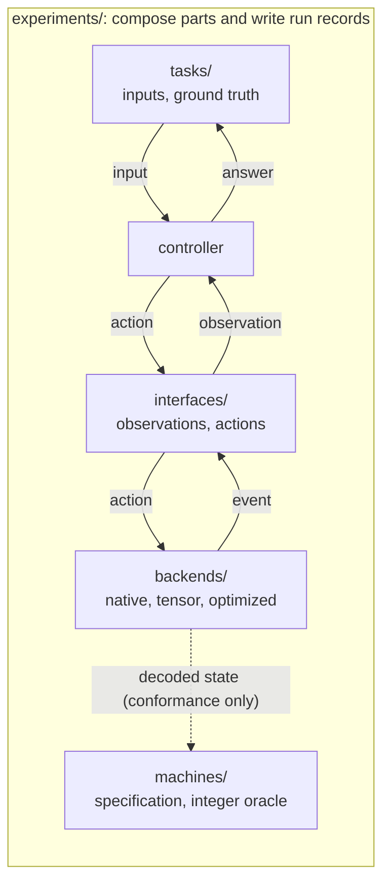

# Experiment program

> **TL;DR:** Validate executors before comparing learned interfaces; E00-E08 all have initial results.

Status, 2026-11-18: every experiment, E00-E08, has a first recorded run and report under [results/](results/); each experiment's **Results** line summarizes it. These are initial results with one or a few seeds, not completed studies. [E09](#e09---state-in-the-machine-not-the-context) is pre-registered and not run; [E10](#e10---a-machine-layer-inside-the-model) and [E11](#e11---learning-to-use-the-machine-from-outcomes) are proposals. [RESEARCH.md](RESEARCH.md) records sources and evidence boundaries. [CONTRIBUTING.md](CONTRIBUTING.md) defines code style, tooling, integration, and verification standards.

## Questions and priorities

> **TL;DR:** Separate what runs, how it runs, how it is controlled, and what it is for; start with E00.

Separate the following axes:

| Axis | Meaning | Example |
|---|---|---|
| Machine | Specified state transitions | Addressable memory, bounded stack, finite transducer |
| Backend | Implementation of those transitions | Conventional code, delta-rule tensors, structured indexed attention |
| Interface | Controller's observations and actions | Textual tool, typed internal actions, latent feedback |
| Task | Workload and evaluation distribution | Record updates, nested scopes, graph reachability |

Do not treat every combination as valid. A backend must declare supported semantics and limits, and reject unsupported configurations explicitly. An approximate optimizer or filter can participate only with its own stated numerical contract, not under an exact-RAM label.

Recommended order:

```text
E00 executor conformance
  -> E01 exact streaming machines
       -> E02 learned interface comparison
            -> E03 latent feedback
```

E04-E08 are independent follow-on branches after their prerequisites pass, not requirements for the first implementation. Report failed hypotheses before adding a larger model or compiler.

## Repository organization

> **TL;DR:** Where code lives: one folder per part, plus curated results and ignored raw runs.

Keep the current research documents at the root. Add implementation directories only when they contain a working experiment; the following is a target layout, not a list of existing files:

```text
README.md
RESEARCH.md
EXPERIMENTS.md
pyproject.toml                  # add with the first executable experiment
uv.lock
src/latent_machines/
  machines/                    # specifications and independent integer oracles
  backends/                    # native, tensor, then optimized implementations
  interfaces/                  # controller observations and action transport
  tasks/                       # generators, trace labels, splits, task metrics
  experiments/                 # small runnable E00, E01, ... entry points
tests/
  machines/                    # semantics, bounds, faults, snapshot/restore
  backends/                    # stepwise conformance and backend differences
  interfaces/                  # observation/action parity and feedback behavior
configs/                       # small versioned settings, when variation requires them
results/                       # curated reports and compact run manifests
runs/                          # ignored raw runs, traces, snapshots, local checkpoints
assets/
```

### Ownership boundaries

> **TL;DR:** Keep machine semantics, execution, observations, and task answers separate; use decoded state only for validation.



Solid edges are the execution path. The dotted edge exists only for validation: decoded backend state is compared against the oracle and never reaches the controller.

- `machines/` defines legal actions, canonical state, numerical domain, transition order, exits, capacity, and work accounting without depending on a model family or tensor backend.
- `backends/` owns state encoding, layer-specific lowering, kernels, and conversion to canonical state for conformance and snapshots. Decoding the full state for validation must not leak it to a controller.
- `interfaces/` owns what the controller can observe, how it requests actions, and how results return. It does not own task answers or executor arithmetic.
- `tasks/` owns input generation, ground truth, trace supervision, and split construction. It cannot change machine semantics for a backend.
- `experiments/` composes those parts and writes results. Do not duplicate the machine or metric implementations in notebooks or one-off benchmark scripts.
- `tests/` contains bounded regression and conformance checks. Long precision sweeps and performance measurements are explicit experiments, not default unit tests.

Use Python and an integer reference implementation for the first harness, with PyTorch only when the tensor backend is added. Pin the actual dependencies and interpreter requirements then. A Python oracle is not an optimized native-performance baseline; introduce and label a suitable conventional implementation before claiming speed advantages.

Do not start with a general compiler, plugin registry, training framework, Rust runtime, or a full ISA. Two concrete machines and backends should establish which abstractions are worth sharing. Keep differences in state semantics visible rather than hiding them behind one overly permissive `step`.

### First implementation slice

> **TL;DR:** All six steps are implemented and have recorded results, ending with the E02 learned-controller study; E03-E08 followed.

1. Add the uv-managed package and lockfile, focused tests, an integer memory oracle, pinned pre-commit hooks, and fast CPU CI.
2. Specify fixed capacity, word domain, reads/writes, invalid-address behavior, event ordering, and non-mutating faults.
3. Implement an explicit eager delta-rule tensor backend with the same observations and actions. Validate every step, not just the final answer.
4. Add an E00 entry point, a small default run, and the result records described below.
5. Add one compiled finite-state transducer and a bounded stack for E01.
6. Only then add a small LM, a frozen-base/learned-action-head baseline, and E02. Record exactly what is trained; unfreeze more only as a separate ablation.

Keep CPU runs small by default. GPU sweeps, model downloads, paid jobs, and long training runs must be explicit and separately budgeted.

## Shared execution and evidence contracts

> **TL;DR:** Rules every machine, interface, and number format must follow for a result to count.

These are semantic requirements, not a frozen public Python API.

### Machine transitions

> **TL;DR:** Every machine states exactly what each action does, including errors and costs.

Specify `(state, action) -> (next_state, event, work)` with:

- A finite action set or typed argument schema and validation rules.
- Canonical state and a representation/version identifier.
- `continue`, `output`, `halt`, `fault`, `host_exit`, and `budget_exhausted` where applicable. A machine may support a smaller explicit set.
- The order of reads, computation, writes, and faults. Invalid actions cannot silently clamp or mutate state unless that behavior is explicitly the specification.
- Capacity and overflow behavior, integer widths or fixed-point scales, and the meaning of each work unit.
- Snapshot/restore at declared boundaries, including pending work if an operation spans ticks.

A tick is an execution step, not necessarily a logical operation or CPU instruction. Budget enforcement must say whether an operation can be interrupted, resumed, or rejected when insufficient budget remains.

Reference, dense tensor, and fused backends should produce the same canonical transitions within their shared contract. A native shortcut may implement equivalent semantics; it is not evidence that the actual emitted checkpoint has executed correctly. Test emitted layers separately when they exist.

### Controller and interface

> **TL;DR:** Match observations, action semantics, and resource budgets across interface variants.

Hold constant across interface variants:

- The information available, action semantics, value precision, capacity, stopping rules, and error messages.
- Task data, split definitions, base-model initialization, training-data budget, trainable-parameter accounting, and search/tuning budget.
- Logical machine-work limits; text-token and internal-tick limits must be recorded separately.

Interfaces can have different encodings, but compare them over the same underlying observations. State dumps, reference answers, teacher-forced actions, or privileged scratch variables cannot be supplied only to the internal interface.

Use oracle action replay to isolate executor cost, and free-running learned control to measure the full system. Label teacher forcing and oracle routing clearly; neither establishes autonomous reliability.

### Numerical conformance

> **TL;DR:** Check the actual numerical path and record residue before decoding can hide it.

Record weights, activations, accumulators, stored state, and index/key precision separately. Check:

- Gate endpoints, long idle retention, repeated overwrite, and untouched-slot preservation.
- Read-after-write ordering and key collisions.
- Query/key and output normalization, including one-, two-, four-, and eight-hot cases where the backend permits them.
- Reductions, cancellation, intermediate casts, overflow, and fixed-point scaling.
- Recurrent versus chunked kernels and eager versus optimized execution.
- Batch composition and supported devices.

The pass condition for an exact backend is zero canonical-state, event, and output mismatches on the declared suite. Numerical residue should also be recorded before canonicalization so thresholding cannot conceal a shrinking safety margin. Passing this finite suite is conformance evidence, not a universal proof.

An approximate backend must declare a reference, error metric, tolerance, horizon, and failure policy before running. Report it separately.

## Experiments

> **TL;DR:** E00 to E08, from basic memory checks to search with an exact checker.

### E00 - Memory and transition conformance

> **TL;DR:** Does neural-network memory behave exactly like real memory?

**Question:** which layer families actually implement the required storage semantics on the chosen execution path?

**Prerequisites:** none. Begin with the integer oracle and explicit GDN-style recurrence; a full pretrained model is unnecessary.

**Variants:** delta replacement; KDA channel gates; RWKV-7; Mamba-2/SSD-style scalar-decay SSM with and without explicit read-modify-write; Mamba-3 complex-valued state evolution as a separate SSM variant; LSTM/GRU gated vector state as a small register file; append-only history with dense lookup. Add Percepta-style indexed hard-max lookup as a distinct variant only when its key, query, tie, and update assumptions are specified. Report each SSM variant separately; a scalar-decay result does not characterize other SSMs.

**Workloads:** overwrite the same slot repeatedly, alternate addresses, preserve untouched slots, idle for long horizons, clear selected regions, hit capacity, and request invalid addresses. For histories, include duplicate keys, equal-score ties, and repeated latest-write queries.

**Acceptance:** zero mismatches against the matching reference semantics; snapshot/resume agrees with uninterrupted execution. Unsupported reset or overwrite behavior must be reported, not emulated invisibly or scored against the wrong contract.

**Measurements:** first mismatch, pre-canonicalization residue, state and index bytes, retained history, memory traffic estimates, ticks per action, and latency versus capacity and horizon. Compare the actions and work KDA needs to clear a selected region against GDN delta replacement; channel-wise retention is a hypothesized saving, not an assumed one. Start with small bounded tests; run named longer sweeps at 10^3, 10^5, and 10^6 actions only as resources permit.

**Discriminator:** a layer that cannot preserve unaddressed state or expose a value through its real normalization path is not a conforming RAM backend, even if a toy update equation works.

**Results:** [results/E00](results/E00/README.md). Delta replacement matched the oracle exactly up to 10^6 actions on CPU; the other variants are untested.

### E01 - Exact streaming machines and transition algebras

> **TL;DR:** Can simple exact machines, like counters and parsers, run directly in layers?

**Question:** can useful specified algorithms run directly without a general-purpose CPU?

**Prerequisite:** E00 for each stateful backend used. A backend used here only for state tracking, not as addressed memory, needs E00's retention, idle, and snapshot checks for its declared state rather than RAM conformance.

**Targets:** one-hot finite transducers, parity and modular counters, mutable-record assignment, permutation tracking, and one bounded stack parser. Test simple cyclic groups before larger permutation tasks; do not assume theory implies a particular low-precision encoding.

**Variants:** ordinary transition code; compiled lookup circuits with explicit feedback; direct signed, reflection, and rotation recurrences where representable (DeltaProduct, Complex KDA, RWKV-7, Mamba-3); and LSTM/GRU cells as compiled finite transducers. Build lookup circuits with piecewise-linear (ReLU/ReGLU) and smooth (SwiGLU) activations as separately labeled constructions. Compare constrained gate ranges with extended ones only as separately labeled architectures.

**Acceptance:** full state/output equivalence, explicit stack overflow and underflow, correct boundary behavior, and identical snapshot/resume. Compare the same input sequence and transition semantics across variants.

**Measurements:** circuit width/depth, nonzero and stored weights, state bytes, ticks, total work, and the smallest margin between a smooth or saturating activation and its intended discrete value. Test longer input sequences within fixed capacity separately from increasing stack depth or number of states.

**Discriminator:** establish whether a backend executes assignment, self-referential updates, or permutations directly, or pays for additional nonlinear feedback steps. Count a transition as supported only when it executes exactly at the tested precision and horizon, not because the architecture can represent it in theory.

**Results:** [results/E01](results/E01/README.md). ReLU lookup circuits for parity, a mod-5 counter, and S3 tracking, and a delta-rule stack, matched their oracles exactly up to 10^6 actions on CPU; the other variants are untested.

### E02 - Learned interface comparison

> **TL;DR:** Does a model do better with an internal machine than with a tool, and why?

**Question:** does an internal machine interface help a learned controller, and does compiling the machine add anything beyond native integration?

**Prerequisites:** E00 and E01. This is the first learned-controller study, not a prerequisite for executor research.

Compare:

| Arm | Interface | Executor |
|---|---|---|
| A | No machine | Model only |
| B | Textual tool requests and replies | Conventional in-process implementation |
| C | Typed internal observations and actions | Conventional in-process implementation |
| D | Same internal interface as C | Conforming compiled tensor implementation |

Use the same small memory or bounded stack in B-D. Do not penalize B with unnecessary subprocess or network overhead. Separate any optional remote-tool comparison.

**Tasks:** nested scopes or record updates; supervised action traces first, then free-running control. Separate in-distribution evaluation, longer sequences at fixed capacity, unseen operation compositions, and explicit capacity changes.

**Validity constraints:** action masking or another mechanism that restricts learned actions to valid machine states is a separately labeled ablation. Apply it identically across B-D, using constrained decoding over the same action set for B. Report its effect on invalid-action rate, task accuracy, and training cost.

**Acceptance:** report executor equivalence independently from task and action accuracy. Invalid-action rate, recovery, halting, and budget exhaustion are outcomes, not examples to discard. Multiple training seeds and paired held-out task instances are required before comparative conclusions.

**Measurements:** task accuracy, action accuracy, executor mismatches, trainable parameters, training examples/steps, generated tokens, internal actions, machine work, wall time, and peak memory.

**Discriminator:** C versus B tests the interface; D versus C tests the implementation. A positive D-versus-A result alone does not identify either cause. A native-interface win is still useful.

**Results:** [results/E02](results/E02/README.md). With a frozen SmolLM2-135M and trained heads, C beat B on every split and seed, clearly beyond the training length and on held-out pairs; D matched C exactly. All arms degraded on long programs.

### E03 - Latent ticks and explicit events

> **TL;DR:** Compare non-text feedback with token feedback and a native loop at matched information and work budgets.

**Question:** does an explicit non-text feedback path improve cost or control without changing the available information or permitted computation?

**Prerequisites:** E01 and E02, including the native internal baseline.

**Variants:** token feedback, repeated latent transitions, and a conventional in-process loop over the same machine. Declare where late-computed control reenters the next tick, whether learned context is frozen, and which recurrent caches update.

**Acceptance:** bounded stepping, deterministic events, precise faults, and snapshot/resume during multi-tick actions. Hiding trace tokens without a new feedback path is not a latent-execution implementation.

**Measurements:** embedding/unembedding cost, controller and executor time, context/cache growth, internal state, ticks, and total logical work. Match observation and work budgets rather than declaring non-text computation free.

**Discriminator:** improvements must survive comparison with an efficient native loop and cannot come solely from providing hidden privileged state.

**Results:** [results/E03](results/E03/README.md). On copy programs that need a read then a write, latent feedback (one trained adaptor vector per tick through a frozen SmolLM2-135M) beat token feedback, head-only feedback, and a native loop by 0.08 to 0.49 task accuracy. A steering control with the same trained positions but no feedback in them matched it up to 32 statements, and latent feedback led only at 64 statements (+0.05), so the gain is mostly trained steering at unmatched model work. Zero executor mismatches; mid-copy snapshots resumed identically.

### E04 - Dataflow, specialization, and conditional units

> **TL;DR:** Is computing a whole pipeline at once better than one instruction at a time?

**Question:** is direct scheduling a better fit than scalar interpretation?

**Prerequisites:** E00 and E01; no learned controller required for replayed workloads.

**Targets:** an arithmetic expression DAG, a bounded integer dot product, and a small gather/map/reduce/scatter workload.

**Variants:** conventional algorithm; scalar-machine implementation; direct compiled graph; optional vector units, sparse expert dispatch, and program-specialized weights. Keep specialization and dispatch as separate ablations.

**Acceptance:** identical arithmetic domain, overflow rules, ties, outputs, and fault/work semantics. No expert may drop a required operation. Fused blocks need precise exits or explicit supported safepoints.

**Measurements:** construction and compilation time, checkpoint bytes including padding, runtime state, dispatch cost, work units, throughput, latency, and the invocation count needed to amortize specialization.

**Discriminator:** compare against optimized conventional arithmetic, not just a deliberately slow interpreter. QwenPU and Percepta specialization are precedents, not results from this repository.

**Results:** [results/E04](results/E04/README.md). In float32 and float64, level-by-level tensor graphs, program-specialized weights, and capacity-limited expert dispatch matched the `dataflow/v1` oracle exactly on CPU, faults included. Batched, they were no faster than the same schedule in int64 tensors, and slower than Python for single inputs. The bfloat16 and float16 probes mismatched with zero residue.

### E05 - Graph, semiring, and logic execution

> **TL;DR:** Can exact graph and logic engines replace step-by-step instructions?

**Question:** can a small exact relational/message-passing machine replace scalar instruction dispatch for suitable workloads?

**Prerequisites:** E00 plus a declared bounded Boolean or integer arithmetic contract.

**Targets:** Boolean reachability first; then bounded min-plus shortest paths; finally a small positive finite-domain Datalog program.

**Variants:** conventional sparse algorithms, direct tensor/sparse reductions, and scalar-machine execution where available. Keep learned GNNs or embedding-space reasoning separate from exact kernels.

**Acceptance:** all relation entries or distances match the oracle, including disconnected vertices and ties. Define infinity sentinels, negative-cycle policy if applicable, fixed-point stopping, and exhaustion limits.

**Measurements:** graph density, edges processed, iterations, tensor/index bytes, latency, and actual versus padded work.

**Discriminator:** learned approximate answers cannot be counted as exact entailment; dense tensor speedups must be compared at realistic sparse sizes.

**Results:** [results/E05](results/E05/README.md). Dense Boolean and min-plus tensor rounds matched reachability, shortest-path, and Datalog oracles round for round on CPU in float32, float64, and float16, and the Boolean machines also in bfloat16. bfloat16 shortest paths failed once distances passed 256. On sparse graphs, Python BFS and Dijkstra were 20 to 100 times faster than dense tensor rounds; scalar-machine execution is untested.

### E06 - Spatial and structured dynamical machines

> **TL;DR:** Compare local-rule and filter implementations with random-access emulation under their respective exact or approximate contracts.

**Question:** when does local or structured state evolution provide a better substrate than random-access emulation?

**Prerequisites:** an integer local-rule oracle for the exact branch, or a declared numerical error contract for the approximate branch.

**Exact branch:** a compiled cellular rule with specified boundaries and simultaneous updates. Compare conventional code, convolution plus lookup, and scalar-machine execution where available. Use double buffering or a proved equivalent schedule.

**Numerical branch:** a specified finite filter or linear dynamical system using a suitable SSM. Compare against conventional numerical code at matched precision and error tolerance; do not pool it with exact cellular results.

**Acceptance:** cell-for-cell equality for exact rules; predeclared horizon/error limits for numerical simulation. Fixed grids and finite filter state must be reported as bounded resources.

**Measurements:** cells or samples per second, generations, state bytes, communication, and boundary-update costs.

**Discriminator:** test the layer's natural operation, not just its ability to imitate RAM through extra feedback.

**Results:** [results/E06](results/E06/README.md). A 3×3 convolution plus a ReLU lookup matched three cellular rules cell for cell in float32, float64, bfloat16, and float16 over 720,000 CPU actions. Dense and diagonal-SSM filters met their declared tolerances in float64 and float32, while 17 of 18 bfloat16 variants exceeded theirs. Scalar-machine execution is untested.

### E07 - Optimization-defined state updates

> **TL;DR:** Which learning-style memory updates still behave like exact memory?

**Question:** which optimizer settings preserve useful specified memory or adaptation semantics?

**Prerequisite:** E00 reference traces; an independently specified optimizer for non-RAM variants.

**Variants:** sequential quadratic-loss updates, chunk-start/stale gradients, momentum, decay, normalization, and then nonlinear memory. Change one feature at a time.

**Workloads:** repeated writes to one address inside a chunk, alternating keys, idle retention, and a small online-regression task.

**Acceptance:** the sequential one-hot quadratic case must match replacement semantics when configured accordingly. Other optimizers must match their own update reference; a deviation from RAM is a finding, not necessarily an optimizer bug.

**Measurements:** state including optimizer buffers, update count, read/write interference, task loss, and work per sample.

**Discriminator:** distinguish an exact memory primitive from an adaptive approximate learner.

**Results:** [results/E07](results/E07/README.md). On CPU, sequential SGD with one-hot keys and learning rate 1 matched `memory/v1` exactly in float32 and float64. Each single change (learning rate, stale chunk gradients, momentum, decay, gradient normalization, an MLP) departed from RAM, while the tensor backend matched its own float64 reference at every step. bfloat16 failed that reference check, and its decay factor rounded to 1.

### E08 - Heuristic search with an exact verifier

> **TL;DR:** Do neural guesses plus an exact checker find more valid answers for the same budget?

**Question:** can neural or energy-based candidate generation improve verified solution yield at a fixed budget?

**Prerequisite:** an independently tested verifier and conventional search baseline; recurrent backends also need the relevant E00 checks.

**Targets:** one small, explicitly specified constraint problem. Compare conventional search, heuristic proposals plus native verification, and the same proposals plus compiled verification.

**Acceptance:** no invalid candidate is accepted on the verifier conformance suite. Report rejection, timeout, and unknown separately from proved unsatisfiable; search failure is not an unsatisfiability proof.

**Measurements:** verified solutions per budget, proposal quality, verifier mismatches, search work, and total latency.

**Discriminator:** separate better proposals from faster verification, and do not infer efficient global optimization from associative-memory convergence.

**Results:** [results/E08](results/E08/README.md). A compiled CNF verifier matched its oracle on 60,000 candidates within its declared limits and accepted no invalid assignment; past bfloat16's limit, a folded lowering rejected 119 valid ones. At a fixed step budget, energy-based proposals solved 23 of 28 known-satisfiable random 3-SAT instances, against 0 for random proposals and 28 for WalkSAT. Only DPLL proved unsatisfiability.

### E09 - State in the machine, not the context

> **TL;DR:** Pre-registered: a controller that sees one statement at a time, with the machine holding all state, should beat full-context controllers on long programs and fall only as fast as its own errors compound.

**Status:** pre-registered 2026-11-25, before any code or run. After the first run, changes go in a dated amendment below this section, not in an edit of it.

**Question:** E02 found that every controller loses accuracy on programs longer than its training programs, and that the executors are exact, so the loss is in the chosen actions. Is that a position effect of reading a long context, or the compounding of ordinary per-statement errors?

**Prerequisite:** E02's task, frozen SmolLM2-135M, heads, and test-program generator.

**Arms:** all arms use E02's task, model, head architecture, training data, three training seeds, and the same paired test programs. Splits are E02's 2-8, 32, and 64 statements plus a new 256-statement split. B and C are rerun in the same job, so every arm sees the new split.

| Arm | Context the model reads | Machine |
|---|---|---|
| B | Full program, with text requests and replies (E02 B) | Integer oracle |
| C | Full program (E02 C) | Integer oracle, typed interface |
| S | One statement per forward pass, fresh window each time | Integer oracle, typed interface; the machine is the only carrier of state |
| W | One statement per forward pass | None; the answer head sees only the current question |

W is a floor, not a competitor: with no memory it cannot answer about earlier writes. S trains on features computed from single-statement windows. If S works, repeat with the delta-rule executor as a conformance check, as E02 did for D.

**Compounding baseline** (fixed before the run, computed from the oracle alone): let ε be S's action error rate on the 2-8 split for a seed, and a its task accuracy on questions whose actions were all correct on that split. Replay each test program through the oracle machine, replacing each statement's action with probability ε by a uniformly random write target and value, or read target. The baseline accuracy at a length is a times the fraction of questions the replay answers correctly.

**Predictions:**

1. S's task accuracy at 64 and 256 statements exceeds C's by more than the conservative two-standard-error bound used in the E02 report.
2. S's task accuracy at every length is within 0.05 of the compounding baseline, in the mean over seeds.
3. W's task accuracy stays at or below 0.15 on every split, so the machine, not the window, carries the information.

**Sanity checks, not predictions:** S's action accuracy matches its 2-8 value at every length, since its inputs do not depend on position; a difference points to a bug. Executor mismatches are zero.

**Outcomes that count against the thesis:**

- Prediction 1 fails: S does not beat C beyond the bound at 64 statements. Then the context position is not what limits C, and the controller's own errors are the cause.
- Prediction 2 fails by falling more than 0.05 below the baseline: S's errors are correlated or state-dependent, which per-statement independence does not capture.
- Prediction 3 fails: the answer head recovers state from the question alone, so the task leaks and the comparison is not valid.

**Measurements:** task, action, and answer accuracy per arm and split; the compounding baseline per seed and length; maximum and total model positions per forward pass and per program; executor mismatches; GPU seconds and cost.

**Discriminator:** C versus S at the same task and heads isolates context handling from the machine. The baseline separates an effect of the window from errors that would compound in any controller. An S win says nothing about E03's question of whether feedback should re-enter the model.

**Cost:** E02's one job cost about $0.73 on an `l4x1`; expect the same order. Stay under the $5 limit in [AGENTS.md](AGENTS.md).

**Results:** not run.

### E10 - A machine layer inside the model

> **TL;DR:** Proposed: put the memory inside the layer stack, driven by trained projections of the residual stream, and compare it with an outside machine at matched trainable parameters.

**Status:** proposal; refine and pre-register after E09.

**Question:** E02 and E03 keep the machine outside the model and reach it through heads. Does a machine that lives in a layer, written and read by projections of the residual stream, improve control over the same machine reached through heads?

**Design sketch:** insert one layer at depth k of the frozen model. Trained projections of the residual stream produce a key, a value, a write gate, and a query for a delta-rule state S. The key is selected by argmax with a straight-through gradient so addressing stays one-hot, and the read is added back to the residual stream. A shadow oracle checks S at every action. Before building a new layer, check whether a small Gated DeltaNet hybrid listed in [RESEARCH.md](RESEARCH.md) lets the memory occupy reserved heads of an existing layer instead.

**Discriminator:** E03 showed that trained positions inside the model can account for most of a gain. The machine layer must beat arm S and arm H of E03, which have the same trained-parameter budget, before any benefit is attributed to the machine living in the layer.

**Results:** not run.

### E11 - Learning to use the machine from outcomes

> **TL;DR:** Proposed: train the controller from answer loss alone, through the machine, to test whether a model can discover how to use it.

**Status:** proposal; refine and pre-register after E09.

**Question:** E02 and E03 train heads on gold action traces, so the controller imitates a known procedure. If gradients pass through the machine, can a controller learn to write and read from the answer loss alone, which an external tool cannot support?

**Design sketch:** compare imitation of gold actions (E02 arm C) with outcome-only training using straight-through estimators on the discrete address and value. Both use the same model, heads, and training programs.

**Discriminator:** outcome-only training must beat the no-machine arm A and show writes before reads in its action traces; otherwise the answer head may be solving the task without the machine. A failure to learn is a result about discoverability in this setting.

**Results:** not run.

## Research coverage

> **TL;DR:** Every idea in RESEARCH.md points to the experiment that tests it, or says why not yet.

Every claim, proposal, and open question in [RESEARCH.md](RESEARCH.md) maps to an experiment, a [scope gate](#gates-for-expanding-scope) that defers it, or context only. When RESEARCH.md gains one, add a row here in the same change.

Layer families appear under the experiments that test their natural primitive, not in one shared experiment. Testing every family against RAM conformance alone would score filters, optimizers, and spatial operators against the wrong contract.

| RESEARCH.md item | Coverage |
|---|---|
| Terms, findings, closest systems, foundations, adjacent work | Context, not reproduced here. Specific limits feed experiments: Qwenputer kernel residues → numerical conformance; Percepta indexed lookup → E00; Percepta specialization and QwenPU → E04; Coconut → E03 |
| QwenFX: a compiled CPU driving its own LM | Context; the machine-to-model call stays tool-shaped, the interface E02 arms B-D and E03 compare |
| chipformer: a compiled CHIP-8 transformer | E00 append-only history and Percepta-style indexed lookup; E01 exact ReGLU lookup circuits |
| Weight-Space Programming: LLM-authored weight edits | Context: edits judged by task metrics, not specified transitions |
| Parity tracked in GDN state with beta up to 2 | E01 parity with signed transitions; E03 latent computation, not yet tested on parity |
| Reduction-order device fingerprints | Numerical conformance: supported devices and deterministic options; E00 GPU variants |
| Delta-rule memory and its optimization interpretation | E00 delta replacement; E07 sequential one-hot quadratic acceptance |
| DeltaNet / Gated DeltaNet | E00 reference tensor backend; E01 |
| Kimi Delta Attention | E00, including clearing cost versus GDN |
| RWKV-7 | E00 storage; E01 state tracking |
| DeltaProduct / Complex KDA | E01 signed, reflection, and rotation transitions |
| Mamba-2 / SSD | E00 with and without read-modify-write; E06 numerical branch |
| Mamba-3 | E00 separate SSM variant; E01 state tracking |
| LSTM / GRU | E00 register file; E01 finite transducers |
| Full attention | E00 append-only history; Percepta indexed variant once specified |
| MLP / ReGLU / SwiGLU | E01 piecewise-linear versus smooth lookup circuits; E04 arithmetic |
| Mixture of experts | E04 dispatch ablation |
| Convolution | E06 exact branch |
| TTT / Titans | E07 |
| Frozen MLP "key-value memory" | Context: not writable runtime RAM, so not an E00 variant |
| Transition algebra | E01 |
| Streaming transducers, stacks, and parsers | E01 has initial CPU results for ReLU transducers and a delta-rule stack; other backend comparisons remain proposed |
| Dataflow, vector, and conditional functional units | E04, with initial CPU results |
| Graph, semiring, and finite-domain logic | E05, with initial CPU results |
| Cellular automata, systolic arrays, and signal processing | E06 cellular rules and filters, with initial CPU results; systolic arrays have no separate target yet |
| Optimizers as machines | E07, with initial CPU results |
| Energy-based search with an exact verifier | E08, with initial CPU results |
| Latent execution feedback contract | E03, with initial GPU results; a steering control explains most of the latent arm's gain |
| Compiler target and proof-oriented compilation | Deferred: [scope gates](#gates-for-expanding-scope) 4 (shared compiler) and 5 (exactness guarantee) |
| Numerical and resource limits | Numerical conformance; E00 measurements; correct requests → E02 executor versus action accuracy |
| First controller experiment | E02 |

| Open question | Coverage |
|---|---|
| 1. Typed actions without text serialization | E02 arms C and D, free-running |
| 2. Benefit over external tools | E02 C versus B |
| 3. Compiled versus native implementation | E02 D versus C |
| 4. Constraining learned writes to valid states | E02 validity-constraint ablation |
| 5. Semantics-preserving dtypes, kernels, and devices | E00; numerical conformance |
| 6. Joint checkpoint contents | E03 snapshot during multi-tick actions; run-record snapshot artifacts; E07 shows canonical memory snapshots omit optimizer buffers |
| 7. Transition algebra fit | E00, E01, E06 |
| 8. Alternatives to scalar instruction execution | E01, E04, E05, E06; E04 compares with a scalar machine, E05 and E06 only with conventional algorithms so far |
| 9. Compiler-generated numerical obligations | Deferred: [scope gate](#gates-for-expanding-scope) 5 (exactness guarantee) |
| 10. Indexed lookup, specialization, or feedback versus placement | E00 indexed variant; E04 specialization; E03 feedback; E02 D versus C |

## Run records and results

> **TL;DR:** Record each run's source, configuration, environment, outcomes, and failure evidence.

Each runner must write a unique directory under ignored `runs/` containing:

| File | Required content |
|---|---|
| `run.json` | Schema version, experiment ID, exact command, source revision and dirty-tree fingerprint, resolved configuration, seeds, input/split digests, model/tokenizer/adaptor identifiers and hashes when present |
| `metrics.json` | Declared metrics with units, denominators, run status, failures, budgets, and correctness/approximation classification |
| `trace.jsonl` | Per-transition evidence for bounded validation runs; long sweeps may retain failures plus declared sampling and aggregate checks |
| `failure.json` | When a failure occurs: reproducible input, action index, expected/actual state difference and event, relevant numerical metadata |
| Snapshot artifacts | When tested: versioned machine state, controller state, RNG state, pending work, and backend/environment metadata needed to resume |

Environment metadata includes device, library/runtime versions, kernel implementation, compiler settings, deterministic/reduction options, batch shape, and each relevant dtype. Distinguish cold initialization/compilation from steady-state timing and end-to-end time; synchronize asynchronous device work before measuring. Record actual peak memory separately from logical state size.

Write a terminal status even when a run fails; do not emit success-shaped partial results. A replay verifies the declared observations, not the identity or trustworthiness of whoever ran it.

Commit curated summaries and small manifests to `results/`, including failed hypotheses and links to larger artifacts where appropriate. Keep raw traces, downloaded models, generated weights, caches, and local checkpoints out of Git. Do not add a hosted tracking service until there is a concrete need.

Each curated report should state the hypothesis, evidence class, matched controls, source/configuration identifiers, correctness outcomes, uncertainty across task and training seeds where relevant, costs, and the decision made. Report first-mismatch horizons and capacity limits, not just average task accuracy.

## Gates for expanding scope

> **TL;DR:** Require specific evidence before adding learned control, performance claims, model families, compilers, guarantees, or runtime integration.

1. **Before learned control:** the executor passes bounded conformance and snapshot tests.
2. **Before speed claims:** correctness passes on the exact timed path, and the conventional baseline and budgets are credible.
3. **Before adding another model family:** a concrete capability gap or hypothesis justifies it.
4. **Before a shared compiler:** multiple working machines/backends expose a useful common lowering. Preserve an independent oracle.
5. **Before an exactness guarantee:** distinguish finite testing from proof; define the checker, floating-point assumptions, and trusted runtime. Compiler-generated range/representation obligations are a later research target, not certificates that already exist.
6. **Before Shem integration:** identify a workload that benefits. Adapt execution/snapshot APIs without forcing graph or spatial state into RV32 registers, or expanding this repository into another container runtime.

The executor milestone requires a conforming memory backend, an exact streaming machine, and reproducible evidence. E02 then tests interface benefits separately from implementation benefits, whether the result is positive or negative.
