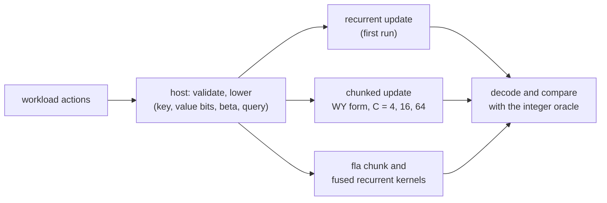

# E00 results: delta-rule memory conformance

> **TL;DR:** Delta-rule memory matched its reference on the tested CPU traces, up to 10^6 actions per variant.

The eager Gated DeltaNet recurrence stored 16 slots of 8 bits and matched an integer oracle after each checked action. The recorded CPU runs had no event, work, or decoded-state mismatches and zero stored-state residue in float32, float64, bfloat16, and float16. The results cover only the declared workloads and implementation. They do not cover other sizes, kernels, or neural networks. A later [follow-up](#follow-up-chunked-and-fused-kernels) checked a chunked form of the update, larger capacities, and flash-linear-attention's fused kernels.

## Question and hypothesis

> **TL;DR:** Test whether the explicit Gated DeltaNet recurrence implements the specified memory transitions at the chosen precisions.

[E00: memory](../../EXPERIMENTS.md#e00---memory-and-transition-conformance) asks which layer families implement the required storage semantics on the chosen execution path. This first run tests one variant, delta replacement:

> The explicit Gated DeltaNet recurrence, with one-hot address keys, bit-plane values, and gates set to their endpoints (`α = 1`, `β ∈ {0, 1}`), implements [`memory/v1`](../../src/latent_machines/machines/README.md#memoryv1) exactly in float32, float64, bfloat16, and float16 on CPU.

## Evidence class

> **TL;DR:** These are project-run conformance tests, not independent validation or a proof.

Local conformance on a finite, declared suite, run by this project and not independently checked. Every action is compared with the integer oracle: event, work, and decoded state, plus residue before decoding. Passing is evidence for the tested configuration. It is not a proof of exactness for other inputs, sizes, or kernels. The method is described in the [runner for E00: memory](../../src/latent_machines/experiments/README.md#e00-memory-conformance).

## Setup

> **TL;DR:** 16 slots of 8 bits, 8 workloads, and 4 number formats, on CPU.

| Item | Value |
|---|---|
| Source | [`ad888ad`](https://github.com/JGalego/latent-machines/commit/ad888ad5bb357ae245aef946ce576bf02139a5f6), clean tree; `uv.lock` sha256 `7e49ea11…` |
| Machine | `memory/v1`, capacity 16, 8-bit words |
| Backend | `delta-eager`: eager PyTorch 2.15.0+cpu, one matmul and two outer products per action, key norm `x / max(‖x‖, 1e-6)`, output thresholded at 0.5 |
| Number formats | float32, float64, bfloat16, float16 |
| Workloads | overwrite, alternate, untouched, idle, clear_region, capacity, invalid, random_mix ([generators](../../src/latent_machines/tasks/memory_workloads.py)) |
| Snapshot check | At the midpoint, decoded state → JSON → restore; the restored tensor must equal the live one exactly |

A variant is one workload in one number format: 32 per run.

## Results

> **TL;DR:** The recorded runs had no mismatches or stored-state residue, and every snapshot restored exactly.

| Horizon per variant | Seed | Where | Actions checked | Mismatches | Max residue | Snapshots | Status | Record |
|---|---|---|---|---|---|---|---|---|
| 10^3 | 0 | local, Intel i7-1365U | 32,000 | 0 | 0 | 32/32 agree | passed | [69f9](e00-20261117T000402Z-ad888ad-69f9/metrics.json) |
| 10^3 | 1 | local, Intel i7-1365U | 32,000 | 0 | 0 | 32/32 agree | passed | [18bf](e00-20261117T000446Z-ad888ad-18bf/metrics.json) |
| 10^3 | 2 | local, Intel i7-1365U | 32,000 | 0 | 0 | 32/32 agree | passed | [7b73](e00-20261117T000500Z-ad888ad-7b73/metrics.json) |
| 10^5 | 0 | HF Jobs `cpu-upgrade`, AMD EPYC 7R13 | 3,200,000 | 0 | 0 | 32/32 agree | passed | [9581](e00-20261117T000412Z-ad888ad-9581/metrics.json) |
| 10^6 | 0 | HF Jobs `cpu-upgrade`, AMD EPYC 7R13 | 32,000,000 | 0 | 0 | 32/32 agree | passed | [7742](e00-20261117T000713Z-ad888ad-7742/metrics.json) |

Every variant in every run is classified `exact`: no first mismatch exists up to 10^6 actions, and no state entry ever left {0, 1}. Each action took one tick. The state tensor holds 128 entries, 512 bytes in float32, for 128 logical bits.

## Costs

> **TL;DR:** Local short runs took under 25 seconds each; the cloud sweeps cost about $0.02.

- Local 10^3 runs: under 25 s each.
- HF job [`6afb99e5…`](https://huggingface.co/jobs/jgalego/6afb99e5186b78cad7b6ceb9): 2,236 s running on `cpu-upgrade` at $0.03/h, about $0.02, with 8 worker processes.
- End-to-end time on HF was 0.3–0.7 ms per action, including oracle stepping and checks. This is not a backend latency measurement.

## Limits

> **TL;DR:** One layer type in one setup; GPUs, fast kernels, and learning are untested.

- **Not tested:** other word widths, multi-hot or learned keys, gates away from their endpoints; the [follow-up](#follow-up-chunked-and-fused-kernels) tested other capacities, kernel-style normalization (eps inside the square root), chunked and fused kernels, and a GPU. Still untested here: output normalization and gating of a full layer, the KDA, RWKV-7, SSM, and LSTM/GRU variants, and learned control.
- **One seed for the long sweeps:** the 10^5 and 10^6 sweeps used seed 0 only.
- **Not measured:** latency versus capacity, memory traffic.
- **Validation is host-side:** ordinary Python checks actions and tracks halting, not the tensor. The result covers storage and readout in the tensor.

## Artifacts

> **TL;DR:** Manifests are committed here; cloud-run traces and snapshots are in the linked public dataset.

Run manifests (`run.json`, `metrics.json`) are in this directory. Raw traces (first 1,000 transitions per variant) and snapshots from the HF runs are in the public Hub dataset [`jgalego/latent-machines-runs`](https://huggingface.co/datasets/jgalego/latent-machines-runs) at commit `4b00d50e`. The local runs' raw directories exist only on the machine that ran them, in the ignored `runs/` directory.

Reproduce a run with, for example:

```bash
git checkout ad888ad && uv sync --locked --extra torch-cpu
uv run --locked python -m latent_machines.experiments.e00 --horizon 100000 --jobs 8 --trace-limit 1000
```

## Decision

> **TL;DR:** The backend met its conformance and snapshot criteria, so the next step was E01: streaming machines.

For this backend and configuration, the result meets the conformance and snapshot condition of [scope gate 1](../../EXPERIMENTS.md#gates-for-expanding-scope). The next steps at the time were:
- **Slice:** continue with step 5 (E01: streaming machines), which now has [results](../E01/README.md).
- **Variants:** test kernel-style key normalization next. An informal backend check left reads correct in float32 while state residue reached about 5e-7. This is not a recorded result.

## Follow-up: chunked and fused kernels

> **TL;DR:** A chunked form of the delta rule and flash-linear-attention's fused kernels stored and read one-hot addressed memory with no mismatch on every variant that ran, but the fused chunk kernel cannot hold more than 256 slots in one head, and its job timed out before it finished the plan.

The first run stepped a recurrent update once per action on 16 slots. Real Gated DeltaNet layers process many actions at once. This follow-up asks whether the same exactness holds when the recurrence runs in chunks, at 64 to 4,096 slots, and in the fused GPU kernels. The question and the predictions were fixed before any code ran, in the [amendment to E00: memory](../../EXPERIMENTS.md#amendment-2026-11-25-chunked-and-fused-kernels-pre-registered).

### Design

> **TL;DR:** The same eight workloads and the same integer oracle, with kernels that expose their state only at chunk or segment ends.



- **Chunked update:** [`delta_chunked.py`](../../src/latent_machines/backends/delta_chunked.py) implements the WY form of the delta rule in PyTorch, with `W` and `U` built by forward substitution in the working dtype. Tests check it against the recurrent update for general keys (float64, agreement to 1e-10) and against the oracle on every workload.
- **Checks:** every action's event is compared with the oracle. The decoded state is compared at the end of each chunk (4, 16, or 64 actions) or fused-kernel segment (4,096 actions); the state inside a chunk does not exist. A variant reports counts of mismatched events and mismatched states, not just the first.
- **Residue** is the largest distance of any state entry or read output from 0 and 1, before thresholding.
- **fla kernels:** [`fla_kernels.py`](../../src/latent_machines/backends/fla_kernels.py) calls `chunk_gated_delta_rule` and `fused_recurrent_gated_delta_rule` from flash-linear-attention 0.6.0 (`fla-core` 0.6.0) with one head, `K = capacity`, `V = word_bits`, `g = 0` (log of `alpha = 1`), `scale = 1` so the output is `S q`, and a float32 state carried from one segment to the next. Keys and queries are one-hot, so they are already unit length and are passed unnormalized by the kernel (`use_qk_l2norm_in_kernel=False`). A second variant sets `use_qk_l2norm_in_kernel=True`, the kernel's own normalization with epsilon inside the square root. The first variant matches the E00 encoding as closely as the kernels' interface allows. Gates, normalization, and state layout follow the kernels' conventions, and this follow-up tried no other settings.

### Setup

> **TL;DR:** Chunked runs on CPU at three capacities, fused kernels on one L4 GPU, 8-bit words, seed 0.

| Item | Value |
|---|---|
| Source | [`48869da`](https://github.com/JGalego/latent-machines/commit/48869da92f4baa146ef3485d0547c797392cebad), clean tree |
| Machine | `memory/v1`, 8-bit words, capacity 64, 512, or 4,096 |
| Chunked runs | PyTorch 2.15.0+cpu on an Intel i7-1365U, float64, float32, and bfloat16, chunk sizes 4, 16, and 64, 3 worker processes |
| Fused runs | HF Jobs `l4x1` (NVIDIA L4, CUDA 13.2), PyTorch 2.15.0, Triton 3.9.0, flash-linear-attention 0.6.0, float32 and bfloat16 |
| Workloads | The eight of the first run ([generators](../../src/latent_machines/tasks/memory_workloads.py)), seed 0 |
| Horizon | 100,000 actions per variant at 64 and 512 slots; 10,000 at 4,096 slots on CPU (see Limits) |

### Results

> **TL;DR:** No mismatch on any chunked variant, in any number format, at any capacity, and none on any fused variant that completed.

Chunked PyTorch update and recurrent reference. Each row covers the eight workloads. Mismatches are event and state mismatches summed over the workloads, and the residue is the maximum over them:

| Kernel | Number format | Slots | Actions per workload | Mismatches | Max residue |
|---|---|---|---|---|---|
| chunked, C = 4, 16, 64 | float64 | 64, 512 | 100,000 | 0 for each of the 6 cells | 0 |
| chunked, C = 4, 16, 64 | float32 | 64, 512 | 100,000 | 0 for each of the 6 cells | 0 |
| chunked, C = 4, 16, 64 | bfloat16 | 64, 512 | 100,000 | 0 for each of the 6 cells | 0 |
| chunked, C = 4, 16, 64 | float64, float32, bfloat16 | 4,096 | 10,000 | 0 for each of the 9 cells | 0 |
| recurrent (first run's backend) | float64, float32, bfloat16 | 64, 512 | 10,000 | 0 for each of the 6 cells | 0 |

In all, 216 chunked and 48 recurrent variants ran on CPU, and all were exact. They checked 14,400,000 actions at 64 and 512 slots, 720,000 at 4,096 slots, and 480,000 for the recurrent reference.

Fused kernels, from the job logs (the runs have no `metrics.json`; see Limits). A variant is one workload:

| Kernel | Key normalization | Format | Slots | Variants that ran | Result |
|---|---|---|---|---|---|
| `fla-chunk` | outside | float32 | 64 | 8 of 8 | exact, 100,000 actions each |
| `fla-chunk` | outside | float32 | 128 | 1 of 8 (`idle`) | exact, 100,000 actions |
| `fla-chunk` | outside | bfloat16 | 64 | 8 of 8 | exact |
| `fla-chunk` | in kernel | float32 | 64 | 8 of 8 | 0 mismatches, with residue |
| `fla-chunk` | in kernel | bfloat16 | 64 | 8 of 8 | exact |
| `fla-chunk` | either | float32, bfloat16 | 512, 4,096 | 0 of 16 per capacity and normalization | all failed: `AssertionError: current kernel does not support head dimension larger than 256` |
| `fla-recurrent` | outside | float32 | 64, 512 | 8 of 8 each | exact |
| `fla-recurrent` | outside | float32 | 4,096 | 1 of 8 (`overwrite`) | exact |
| `fla-recurrent` | outside | bfloat16; in kernel, both formats | all | not reached at 100,000 actions | see below |

A smoke job on the same code ran 3,000 actions of the `overwrite` and `random_mix` workloads through every fused kernel, format, normalization, and capacity (fla-chunk at 64 slots only; the rest failed as above). It also had no mismatch. Its logs record the residue: 0 for both kernels with normalization outside; 9.5e-7 for `fla-recurrent` with normalization in the kernel, in both formats; and 0.0039 and 0.0024 for `fla-chunk` with normalization in the kernel in float32 (0 in bfloat16). These are the distances that the in-kernel normalization (epsilon inside the square root) and the chunk kernel's float32 arithmetic leave in the state. 0.0039 is 2^-8, which is the size of the rounding step of TF32 arithmetic. We did not check whether the kernel uses TF32. Thresholding at 0.5 removes all of it.

#### Predictions

> **TL;DR:** The first held, the second and third did not: no variant, in bfloat16 or otherwise, had a mismatch.

1. **The chunked PyTorch form is exact in float64 and float32 at every chunk size and capacity: met.** All 144 variants (3 chunk sizes, 2 formats, 3 capacities, 8 workloads) had zero mismatches.
2. **The chunked form in bfloat16 has at least one mismatch at 10^5 actions: not met.** All 48 bfloat16 variants at 100,000 actions (64 and 512 slots) were exact. At 4,096 slots the horizon was 10,000, below the prediction's, and they were exact as well. The prediction's own rule applies: the bfloat16 chunked form is exact on this suite.
3. **The fused kernels in bfloat16 have at least one mismatch: not met.** The 16 `fla-chunk` bfloat16 variants at 64 slots (100,000 actions each) and the 12 `fla-recurrent` bfloat16 variants in the smoke job (3 capacities, 2 workloads, 2 normalizations, 3,000 actions each) had none. The evidence is partial: `fla-recurrent` in bfloat16 did not reach 100,000 actions, and `fla-chunk` has no result above 256 slots.

### Interpretation

> **TL;DR:** With one-hot keys and bit values, the intermediate values of the chunked update are small integers, so rounding has nothing to change; that is a reading of the result, not a measured cause.

With one-hot keys, the products inside a chunk are 0 or 1 and the corrections are differences of bits, so the intermediate values should be small integers that float64, float32, and bfloat16 all store exactly. That would explain why bfloat16 shows no mismatch and why the predicted rounding failure did not appear. We did not record the intermediate values, so this is a reading, not a measurement. It would not carry over to keys that are not one-hot; the general-key tests pass in float64 only. The chunk kernel's residue in float32 shows that its arithmetic is not exact for every input, but the state it leaves still decodes correctly.

The 256 limit on `fla-chunk`'s head dimension means a 512-slot or 4,096-slot memory with a one-slot-per-column layout cannot run as one head in this kernel. A layer built on it would have to split addresses across heads, which changes what a key means. We did not test that.

### Costs

> **TL;DR:** About $0.27 of GPU time, with a worst-case commitment of $0.39, and a few hours of shared CPU.

- Smoke job [`6b06ecc5…`](https://huggingface.co/jobs/jgalego/6b06ecc5d91f621b9307f98d): `l4x1` at $0.80/h, timeout 8 minutes, 337 s running, about $0.07.
- Main job [`6b06ef7b…`](https://huggingface.co/jobs/jgalego/6b06ef7bd91f621b93080a65): `l4x1` at $0.80/h, timeout 21 minutes, 895 s running (it ended in the job's `ERROR` state because its commands hit their own `timeout`), about $0.20. Worst case for the two jobs together: 29 minutes at $0.80/h, about $0.39, under the $0.40 plan.
- CPU: the three recorded CPU runs took 8,196 s, 987 s, and 607 s of summed variant time on a shared machine; two earlier launches were stopped and relaunched at a smaller scale before finishing.

### Limits

> **TL;DR:** The fused-kernel evidence is a job log, not a full record, and the largest chunked runs are shorter than planned.

- **The main fused job did not finish.** Its two commands were cut by their `timeout` after 113 of the 192 planned variants of the first command and one of the 32 planned for the second (`fla-chunk` at 128 and 256 slots). The runs wrote their `run.json` headers but no `metrics.json`. The evidence is the per-variant lines in the job log, kept in [`controls/e00-kernels-fla-jobs-20261125/`](controls/e00-kernels-fla-jobs-20261125/) with a parsed `summary.json`. The log lines carry the outcome and mismatch count, not the residue or the split into event and state mismatches. The upload of the smoke job failed (the package that uploads was not installed), so its log is also its only record. No further job was launched: the plan's budget was spent.
- **Not run:** `fla-recurrent` in bfloat16 and with normalization in the kernel at 100,000 actions; `fla-recurrent` at 4,096 slots except `overwrite`; `fla-chunk` at 256 slots.
- **Shorter horizons on CPU:** 10,000 actions instead of 100,000 at 4,096 slots, and for the recurrent reference at every capacity, because the runs were slow on a shared CPU. Prediction 2's horizon (100,000) was met at 64 and 512 slots only.
- **One seed, one device per kernel:** seed 0 throughout, one CPU model, one GPU model. Fused kernels on other GPUs or Triton versions may differ.
- **Host-side validation, unchanged:** ordinary Python still checks addresses, values, and the halted flag before the tensor update; this follow-up does not test whether a neural layer could do it.
- **Not tested:** keys that are not one-hot, gates away from their endpoints, `alpha` below 1, other kernels (KDA, RWKV-7, Mamba), backward passes, and kernel speed. The end-to-end seconds in the manifests include the oracle and checks.

### Artifacts

> **TL;DR:** CPU manifests are committed here and uploaded; the fused-kernel logs are committed here.

Run manifests are in [`controls/`](controls/): chunked at [64 and 512 slots](controls/e00-kernels-20261125T144026Z-48869da-2b35/metrics.json), chunked at [4,096 slots](controls/e00-kernels-20261125T152818Z-48869da-2fc2/metrics.json), and the [recurrent reference](controls/e00-kernels-20261125T150208Z-48869da-e471/metrics.json). They are kept out of the site's results tables, which read only the run directories directly under `results/E00/`. The CPU run directories are also in the Hub dataset [`jgalego/latent-machines-runs`](https://huggingface.co/datasets/jgalego/latent-machines-runs) at commit `74445b57`. Reproduce a chunked run with:

```bash
git checkout 48869da && uv sync --locked --extra torch-cpu
uv run --locked python -m latent_machines.experiments.e00_kernels --kernels chunked-16 --capacities 512 --jobs 3
```

The fused kernels need a GPU and `uv pip install --no-deps flash-linear-attention==0.6.0 fla-core==0.6.0 einops` after `uv sync --locked --extra torch-cuda`, then `--kernels fla-chunk,fla-recurrent --device cuda`.

### Decision

> **TL;DR:** The exactness result extends to chunked evaluation and to fla's kernels within their size limits; a full record of the fused kernels is still missing.

For one-hot addressed memory, the chunked update and the fused kernels that ran met the conformance condition of [scope gate 1](../../EXPERIMENTS.md#gates-for-expanding-scope) on this suite. The next steps are a complete fused-kernel run with `metrics.json`, which needs a faster host-side check or a longer budget, and a test of a layer with more than 256 slots split over heads.
