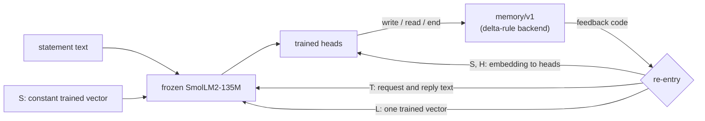
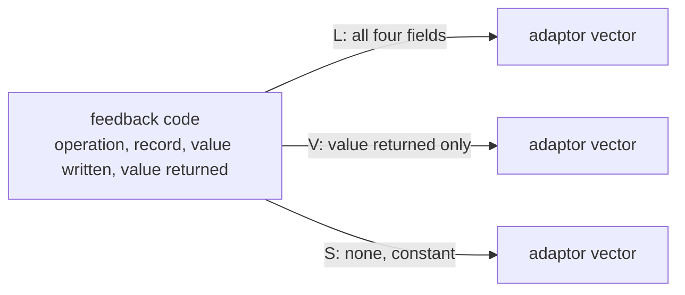

# E03 results: latent ticks and explicit events

> **TL;DR:** Trained vectors passed through the frozen model raised accuracy far above the other arms, but a control with no feedback in those vectors did about as well, so most of the gain comes from the trained vectors, not the feedback.

A frozen language model with small trained heads ran programs whose copy statements need two memory steps: a read, then a write of the value read. Feeding each step's result back into the model as one trained vector (L) gave the best accuracy on long programs. It beat feeding the result back as text (T), giving it only to the heads (H), and running the copy in a conventional loop (N). The control S inserts the same kind of trained vector but carries no feedback in it. S matched L on short and 32-statement programs and trailed it only at 64 statements. Most of L's advantage therefore comes from the extra trained positions in the model, not from the feedback. Every arm drove the delta-rule memory with no mismatch against its oracle, and mid-copy snapshots resumed identically. A later control, V, whose vector carries only the value read, matched S and trailed L at 64 statements; see [reply-only vectors](#e03-latent-feedback-reply-only-vectors).

## Question and design

> **TL;DR:** Five arms make the same per-tick decisions on the same programs and differ only in how a step's result returns to the controller.

[E03: latent feedback](../../EXPERIMENTS.md#e03---latent-ticks-and-explicit-events) asks whether a non-text feedback path improves control without adding information or computation. The task adds `Copy x to y.` to the record programs of E02: learned interfaces. The controller must read `x`, then write the returned value to `y`. The value is not in the text ([task](../../src/latent_machines/tasks/copies.py)). Each statement runs as ticks on [`memory/v1`](../../src/latent_machines/machines/README.md#memoryv1) with 8 records of 4 bits. At every tick the controller picks `write`, `read`, or `end`, with a record and value; after `TICK_BUDGET` = 3 actions without `end` the statement stops as `budget_exhausted` ([interface](../../src/latent_machines/interfaces/ticks.py)). Gold control needs at most two actions.

After each tick, the action and the machine's reply form a feedback code of four small integers. The arms differ in where the code goes:



| Arm | Feedback path | Model positions per tick | Trainable parameters |
|---|---|---|---|
| T | Request and reply appended as text, e.g. ` [read c] [7]` | several tokens | 308,779 |
| L | Code embedded by a trained adaptor into one input vector at the next position, through every layer and kept in the cache | 1 | 335,275 (26,496 adaptor) |
| S | Constant trained vector at the same positions as L; the code goes to the heads as in H | 1 | 354,731 (26,496 adaptor) |
| H | Code embedded and concatenated to the heads' input; the model never sees it | 0 | 328,235 |
| N | One macro per statement (`write`, `read`, or `copy`); `NativeLoop` passes the read value to the write | 0 | 320,563 |

S was added after the pilot and before the recorded run. It separates two effects: trained input vectors that change the model's features, and feedback that reaches the model. L versus S isolates feedback content at matched positions. S versus H isolates the trained positions at matched information. N is the conventional baseline that the [discriminator](../../EXPERIMENTS.md#e03---latent-ticks-and-explicit-events) requires.

In T, L, and S, the first decision of a statement reads the last-layer feature at the statement's last token, and each later decision reads it at the position the tick added. H and N reuse statement features computed once. L and S train end to end: the gradient passes through the frozen model into the adaptor.

## Evidence class

> **TL;DR:** One GPU run, three training seeds, paired test programs, seed ranges and a conservative bound, no significance tests.

All arms share the training and test programs, so comparisons are paired by program. Evaluation is free-running: predicted actions drive the machine, so a wrong write affects later answers. This is one experiment with one model, one task, and one training recipe. This project ran it and nobody has reproduced it independently. The executor and snapshot checks are conformance evidence on these programs, not proofs.

## Setup

> **TL;DR:** Committed revision, one L4 GPU job, three test splits by program length.

| Item | Value |
|---|---|
| Source | [`fe9db1c`](https://github.com/JGalego/latent-machines/commit/fe9db1c65c5b485256bf3c2f6d63c0bfc3e8badb), clean tree |
| Model | [SmolLM2-135M](https://huggingface.co/HuggingFaceTB/SmolLM2-135M), revision `93efa2f`, frozen |
| Hardware | HF Jobs `l4x1` (NVIDIA L4, CUDA 13.2, PyTorch 2.15.0); heads and executors on the same job |
| Executor | Delta-rule tensor backend ([E00: memory](../E00/README.md)) with a shadow integer oracle checked at every action |
| Training | 2,000 programs of 2-8 statements (22,984 decision and 3,084 answer examples; N has 10,005 macro decisions), 30 epochs, seeds 0-2 |
| Test splits | 300 programs of 2-8 statements (471 questions per seed); 100 of 32 (937); 100 of 64 (1,920); statement weights set 0.4, copy 0.3, question 0.3 |
| Snapshots | 20 programs per arm, interrupted between the read and the write of a copy; machine, controller history, and pending work through JSON |

## Results

> **TL;DR:** L and S beat T, H, and N on every split and seed. S leads up to 32 statements and L leads at 64.

Task accuracy, mean over three seeds with the range in brackets:

| Arm | 2-8 statements | 32 statements | 64 statements |
|---|---|---|---|
| T | 0.829 [0.824, 0.837] | 0.337 [0.321, 0.347] | 0.212 [0.205, 0.222] |
| L | 0.981 [0.972, 0.987] | 0.824 [0.784, 0.902] | 0.615 [0.556, 0.732] |
| S | 0.998 [0.994, 1.000] | 0.867 [0.816, 0.933] | 0.566 [0.473, 0.688] |
| H | 0.898 [0.892, 0.904] | 0.393 [0.385, 0.402] | 0.252 [0.251, 0.253] |
| N | 0.881 [0.870, 0.890] | 0.344 [0.338, 0.348] | 0.245 [0.243, 0.247] |

Paired differences in task accuracy, per seed. The bound is a conservative two-standard-error bound for a difference of two proportions at that split's question count:

| Comparison | Split | Seeds 0, 1, 2 | Mean | Bound |
|---|---|---|---|---|
| L − S (feedback content) | 2-8 | −0.021, −0.017, −0.013 | −0.017 | 0.065 |
| L − S | 32 | −0.066, −0.031, −0.031 | −0.043 | 0.046 |
| L − S | 64 | +0.020, +0.044, +0.083 | +0.049 | 0.032 |
| S − H (trained positions) | 2-8 | +0.102, +0.102, +0.096 | +0.100 | 0.065 |
| S − H | 32 | +0.448, +0.547, +0.424 | +0.473 | 0.046 |
| S − H | 64 | +0.286, +0.437, +0.220 | +0.315 | 0.032 |
| L − N (versus native loop) | 2-8 | +0.102, +0.100, +0.098 | +0.100 | 0.065 |
| L − N | 32 | +0.436, +0.564, +0.440 | +0.480 | 0.046 |
| L − N | 64 | +0.315, +0.485, +0.310 | +0.370 | 0.032 |
| H − T (typed versus text) | 2-8 | +0.055, +0.070, +0.081 | +0.069 | 0.065 |
| H − T | 32 | +0.060, +0.038, +0.072 | +0.057 | 0.046 |
| H − T | 64 | +0.030, +0.040, +0.047 | +0.039 | 0.032 |
| H − N | 2-8 | +0.021, +0.015, +0.015 | +0.017 | 0.065 |
| H − N | 32 | +0.054, +0.047, +0.047 | +0.049 | 0.046 |
| H − N | 64 | +0.008, +0.004, +0.007 | +0.006 | 0.032 |

Action accuracy (statements whose actions all matched gold) and copy fidelity (copies whose read and write both targeted the right records), means over seeds:

| Arm | Action, 2-8 | Action, 32 | Action, 64 | Copy fidelity, 2-8 | Copy fidelity, 64 |
|---|---|---|---|---|---|
| T | 0.792 | 0.439 | 0.329 | 0.910 | 0.772 |
| L | 0.972 | 0.827 | 0.670 | 0.997 | 0.932 |
| S | 0.995 | 0.831 | 0.607 | 0.997 | 0.975 |
| H | 0.777 | 0.383 | 0.266 | 1.000 | 0.998 |
| N | 0.726 | 0.317 | 0.220 | 1.000 | 1.000 |

Execution and acceptance checks, all splits and seeds:

- **Executor:** no mismatches between the delta-rule memory and its shadow oracle on any action of any arm, and no faults (the heads can only emit valid records and values).
- **Bounded stepping:** `budget_exhausted` occurred 15 times for L (3 at 32 statements, 12 at 64) and once for T; never for S, H, or N.
- **Snapshot/resume:** for every arm, 20 of 20 programs interrupted mid-copy and resumed through JSON matched the uninterrupted run, with a maximum feature difference of 0.

## Interpretation

> **TL;DR:** The gain comes from trained vectors in the model's input, with or without feedback in them. Feedback content matters only at 64 statements.

- **Steering, not feedback.** S carries no feedback through the model. It still beat H, which has the same information, by 0.10 to 0.47, and matched or beat L up to 32 statements. Trained vectors in the frozen model's input therefore explain most of L's advantage. The vectors give each tick a fresh, trained readout of the context and leave markers in the cache that later statements attend to. Which of these matters is untested.
- **Feedback content.** L beat S at 64 statements in every seed (+0.049, above the bound) and trailed it at 2-8 and 32 statements (−0.017 and −0.043, within or at the bound). Feedback that enters the model helps only on the longest programs, and by much less than the trained positions.
- **Native loop.** L and S beat N by 0.10 to 0.48, so the gain survives comparison with an efficient conventional loop. N has perfect copy fidelity but the lowest action accuracy. Its errors are in choosing records and values for statements, not in routing the read value. H's typed feedback adds 0.006 to 0.049 over N.
- **Text feedback.** T was the weakest arm and the only one with copy errors at the training length: copy fidelity 0.910 against 1.000 for H. Typed feedback beat text feedback again, by smaller margins than in E02: learned interfaces.
- **Length.** Every arm degraded with program length. T, H, and N fell to about the long-program accuracy of E02: learned interfaces (0.21-0.25 at 64 statements). L and S kept 0.57-0.62, with wide seed ranges (0.47 to 0.73).

The [discriminator](../../EXPERIMENTS.md#e03---latent-ticks-and-explicit-events) asks that improvements survive an efficient native loop and not come from hidden privileged state. L's gain survives N, and L sees only the feedback code that the other arms see. But L and S spend extra model positions and train through the model, so the work budget is not matched with H and N. The S control shows that this extra trained computation, not latent feedback, is the main effect.

## E03: latent feedback, reply-only vectors

> **TL;DR:** A vector that carries only the value a read returned did no better than the constant-vector control S and fell below L at 64 statements, so the reply alone does not explain L's lead there.

The [amendment of 2026-11-25](../../EXPERIMENTS.md#e03---latent-ticks-and-explicit-events) added arm V. It uses L's adaptor, but the operation, record, and value-written fields of the feedback code are constants. Its vector depends only on the value the machine returned, or on its absence for a write. S was rerun in the same job so that V is compared with an S from the same code.



### Setup

> **TL;DR:** The recorded run's configuration, one `l4x1` job, arms V and S only.

The command was `python -m latent_machines.experiments.e03 --arms V,S --device cuda` with every other setting at its default, which is the recorded run's configuration: SmolLM2-135M at revision `93efa2f`, seeds 0-2, data seed 0, the same 2,000 training programs and 300, 100, and 100 test programs, 30 epochs. The source was commit [`d525d59`](https://github.com/JGalego/latent-machines/commit/d525d5929fda092d7389093b3a463362fbafce6c), clean tree. The arm code is in [`bfb0867`](https://github.com/JGalego/latent-machines/commit/bfb08677d46cea951ddab6f6c0ed3cb7f600c67a); the commits between them do not touch E03. The tiny-model results of arms L and S were identical before and after adding V.

The rerun S matched the recorded S exactly: every one of its nine task accuracies equals the recorded value, and so do its trainable parameters (354,731) and example counts. The comparisons with the recorded L below are therefore on the same programs, seeds, and code path.

### Results

> **TL;DR:** V and S are indistinguishable at every length; V trails the recorded L by 0.049 at 64 statements.

Task accuracy, mean over three seeds with the range in brackets. L and S rows are from the recorded run:

| Arm | 2-8 statements | 32 statements | 64 statements |
|---|---|---|---|
| V (reply only) | 0.999 [0.998, 1.000] | 0.826 [0.743, 0.915] | 0.566 [0.442, 0.706] |
| S (rerun) | 0.998 [0.994, 1.000] | 0.867 [0.816, 0.933] | 0.566 [0.473, 0.688] |
| S (recorded) | 0.998 [0.994, 1.000] | 0.867 [0.816, 0.933] | 0.566 [0.473, 0.688] |
| L (recorded) | 0.981 [0.972, 0.987] | 0.824 [0.784, 0.902] | 0.615 [0.556, 0.732] |

Paired differences in task accuracy, per seed, with the same conservative two-standard-error bound as above:

| Comparison | Split | Seeds 0, 1, 2 | Mean | Bound |
|---|---|---|---|---|
| V − S (reply content) | 2-8 | +0.006, −0.002, −0.002 | +0.001 | 0.065 |
| V − S | 32 | −0.031, −0.018, −0.074 | −0.041 | 0.046 |
| V − S | 64 | +0.013, +0.018, −0.031 | 0.000 | 0.032 |
| V − L (action echo) | 2-8 | +0.028, +0.015, +0.011 | +0.018 | 0.065 |
| V − L | 32 | +0.035, +0.013, −0.043 | +0.002 | 0.046 |
| V − L | 64 | −0.007, −0.026, −0.114 | −0.049 | 0.032 |

Action accuracy at 64 statements, mean over seeds: V 0.607, S 0.607, L 0.670. Copy fidelity at 64 statements: V 0.960, S 0.974, L 0.932. `budget_exhausted` occurred 4 times for V, all in seed 0 at 64 statements, and never for S. Executors had zero mismatches, and 20 of 20 mid-copy snapshots per arm resumed identically.

### Predictions

> **TL;DR:** Neither prediction was met.

1. **V beats S at 64 statements by more than the bound: not met.** The mean difference was 0.000 against a bound of 0.032. The reply content did not help beyond the constant vector.
2. **V is within the bound of L at 64 statements: not met.** V was 0.049 below L, against a bound of 0.032. The comparison was made, since the rerun S matched the recorded S. V was within the bound of L at 2-8 and 32 statements.

### Interpretation

> **TL;DR:** The value returned by a read does not carry L's gain over S at 64 statements. Whether L's gain comes from the action fields, or is seed noise, is untested.

- **No reply effect.** V tracks S at every length, in every seed within 0.074. Feeding the returned value into the model's input as a vector gave no measurable benefit over a constant vector at 2-8, 32, or 64 statements.
- **L's lead.** The recorded L − S difference at 64 statements was +0.049. V − L is −0.049, so V recovers none of it. Two readings fit: the lead depends on the action fields (the operation, record, and value written), or it is smaller than seed variation. Per-seed L − V was +0.007, +0.026, and +0.114, and the ranges of V and L overlap (0.442 to 0.706 against 0.556 to 0.732). Three seeds and a conservative bound cannot separate the two.
- **Consequence for the earlier reading.** E03's main finding is unchanged and stronger: most of the gain comes from trained vectors in the model's input, and a vector with no action and the reply only does as well as one with no feedback. The remaining feedback effect, L at 64 statements, is the only one left to explain.

### Costs

> **TL;DR:** The V and S job cost about $1.32 on an `l4x1`.

- HF job [`6b06e8fd…`](https://huggingface.co/jobs/jgalego/6b06e8fdb6a90bbe997d6e56): 5,930 s running on `l4x1` at $0.80/h, about $1.32, under the 2 h timeout and its $1.60 worst case. Training took about 343 s per arm per seed.
- Peak memory: 2,323 MB RSS and 2,959 MB GPU.
- The run manifest is in [controls/e03-20261125T135649Z-d525d59-3f9a](controls/e03-20261125T135649Z-d525d59-3f9a/), with the prediction evaluation in `predictions.json`. It sits under `controls/` so that the project page's tables keep showing the recorded five-arm run. The full run directory is in the Hub dataset [`jgalego/latent-machines-runs`](https://huggingface.co/datasets/jgalego/latent-machines-runs) under `runs/`, at commit `cde62397`.

## Costs

> **TL;DR:** The recorded run cost about $2.11. L and S used less than half of T's model positions and took about 65 times as long as H to evaluate.

Seed 0, 64-statement split, 100 programs:

| Arm | Model positions | Feedback positions | Controller decisions | Machine actions | Evaluation seconds |
|---|---|---|---|---|---|
| T | 102,451 | 67,826 | 14,648 | 8,248 | 601.7 |
| L | 42,644 | 8,019 | 14,409 | 8,019 | 356.3 |
| S | 42,910 | 8,285 | 14,685 | 8,285 | 362.6 |
| H | 34,625 | 0 | 14,973 | 8,573 | 5.5 |
| N | 34,625 | 0 | 6,400 | 8,359 | 3.2 |

- L and S add one model position per machine action; T adds 8.2 per action. H and N add none.
- Evaluation seconds are not comparable across arms. T, L, and S call the model incrementally during evaluation, while H and N reuse statement features computed once. Executor time was 3 to 4 seconds per arm on this split.
- Training L or S took about 345 s per seed on the GPU, against 5 to 11 s for T, H, and N on cached features.
- HF job [`6afd0b75…`](https://huggingface.co/jobs/jgalego/6afd0b754643bac7ac630e55): 9,484 s running on `l4x1` at $0.80/h, about $2.11. The pilot job (958 s) cost about $0.21.
- Peak memory: 2,449 MB RSS and 2,959 MB GPU.

## Limits

> **TL;DR:** One frozen small model, one task, only heads and adaptor trained, unmatched model work, and an arm added after a pilot.

- **Controller:** a frozen 135M-parameter model; only heads and a small adaptor train. No fine-tuning and no other model sizes.
- **Matched work:** L and S use more model positions than H and N and train through the model. No arm gives H or N the same extra positions without trained vectors.
- **Feedback ablations:** S's adaptor sees one constant code, so most of its parameters are unused. Latent feedback without the action fields was run later as arm V; see [reply-only vectors](#e03-latent-feedback-reply-only-vectors).
- **Task:** one record task with copies, 8 records, and 4-bit values; programs need at most two actions per statement.
- **Timing:** per-tick latency on matched hardware was not measured; evaluation times mix GPU model calls with reuse of cached features.
- **Statistics:** three seeds and a conservative unpaired bound; L and S have wide seed ranges on long programs.
- **Exploration:** a pilot at [`9c4ec97`](https://github.com/JGalego/latent-machines/commit/9c4ec97ff0318ce8b62d41edf1d150d442b34253), before S existed (seed 0, data seed 1, 100 and 20 test programs per split, not this run's test programs) showed L well above T, H, and N. Arm S was added after it in `fe9db1c`. No other method or setting changed.

## Artifacts

> **TL;DR:** The manifest is here and the full run directory is in the public Hub dataset.

The run manifest (`run.json`, `metrics.json`) is in [e03-20261118T022125Z-fe9db1c-ff00](e03-20261118T022125Z-fe9db1c-ff00/). The full run directory, including traces of the first programs per split, is in the public Hub dataset [`jgalego/latent-machines-runs`](https://huggingface.co/datasets/jgalego/latent-machines-runs) under `runs/`, at commit `580cd89a`.

```bash
git checkout fe9db1c && uv sync --locked --extra torch-cuda --extra lm
uv run --locked python -m latent_machines.experiments.e03 --device cuda
```

## Decision

> **TL;DR:** Latent feedback is not the main effect here, and trained in-model positions are.

E03: latent feedback meets its acceptance criteria: bounded stepping, deterministic events, zero executor mismatches, and exact snapshot/resume between the ticks of a copy. In this setting, trained vectors in the model's input improve control, and latent feedback does not. Next steps, not run:

- A matched-work control that gives H and N the same extra positions with untrained or fixed vectors, to separate trained readout from added positions.
- An unfrozen or larger model, before claiming any benefit of feedback through the model. Observation-only latent feedback has since been run; see [reply-only vectors](#e03-latent-feedback-reply-only-vectors).
