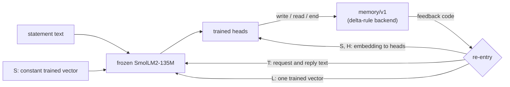

# E03 results: latent ticks and explicit events

> **TL;DR:** Trained vectors that pass through the frozen model raised accuracy far above every other arm, but a control with no feedback in those vectors did about as well, so the gain is mostly steering, not latent feedback.

In plain terms: a frozen language model with small trained heads ran programs whose copy statements need two memory steps, a read and then a write of the value read. Feeding each step's result back into the model as one trained vector (L) gave the best accuracy on long programs, well above feeding it back as text (T), handing it only to the heads (H), or running the copy in a conventional loop (N). The steering control (S) inserts the same kind of trained vector but carries no feedback in it, and it matched L on short and 32-statement programs and trailed it only at 64 statements. Most of L's advantage therefore comes from extra trained positions in the model, not from the feedback entering the model. Every arm drove the delta-rule memory without a single mismatch against its oracle, and mid-copy snapshots resumed identically.

## Question and design

> **TL;DR:** Five arms make the same per-tick decisions on the same programs; only the path of the step's result back to the controller changes.

[E03](../../EXPERIMENTS.md#e03---latent-ticks-and-explicit-events) asks whether a non-text feedback path improves control without adding information or computation. The task extends E02's record programs with `Copy x to y.`: the controller must read `x`, then write the returned value to `y`, and the value is not in the text ([task](../../src/latent_machines/tasks/copies.py)). Each statement runs as ticks on [`memory/v1`](../../src/latent_machines/machines/README.md#memoryv1) with 8 records of 4 bits. At every tick the controller picks `write`, `read`, or `end`, with a record and value; after `TICK_BUDGET` = 3 actions without `end` the statement stops as `budget_exhausted` ([interface](../../src/latent_machines/interfaces/ticks.py)). Gold control needs at most two actions.

After each tick, the action and the machine's reply form a feedback code of four small integers. The arms differ in where that code goes:



| Arm | Feedback path | Model positions per tick | Trainable parameters |
|---|---|---|---|
| T | Request and reply appended as text, e.g. ` [read c] [7]` | several tokens | 308,779 |
| L | Code embedded by a trained adaptor into one input vector at the next position, through every layer and kept in the cache | 1 | 335,275 (26,496 adaptor) |
| S | Constant trained vector at the same positions as L; the code goes to the heads as in H | 1 | 354,731 (26,496 adaptor) |
| H | Code embedded and concatenated to the heads' input; the model never sees it | 0 | 328,235 |
| N | One macro per statement (`write`, `read`, or `copy`); `NativeLoop` passes the read value to the write | 0 | 320,563 |

S was added after the pilot, before the recorded run, to separate "trained input vectors change the model's features" from "feedback reaches the model". L versus S isolates feedback content at matched positions; S versus H isolates the trained positions at matched information. N is the conventional baseline that the [discriminator](../../EXPERIMENTS.md#e03---latent-ticks-and-explicit-events) requires.

In T, L, and S, the first decision of a statement reads the last-layer feature at the statement's last token, and each later decision reads it at the position the tick added. H and N reuse statement features computed once. L and S train end to end: the gradient passes through the frozen model into the adaptor.

## Evidence class

> **TL;DR:** One GPU run with three training seeds on paired test programs; seed ranges and a conservative bound, no significance tests.

All arms share the training programs and the test programs, so comparisons are paired by program. Evaluation is free-running: predicted actions drive the machine, so a wrong write affects later answers. This is a single experiment with one model, one task, and one training recipe, run by this project and not independently reproduced. The executor and snapshot checks are conformance evidence on these programs, not proofs.

## Setup

> **TL;DR:** Committed revision, one L4 GPU job, three test splits by program length.

| Item | Value |
|---|---|
| Source | [`fe9db1c`](https://github.com/JGalego/latent-machines/commit/fe9db1c65c5b485256bf3c2f6d63c0bfc3e8badb), clean tree |
| Model | [SmolLM2-135M](https://huggingface.co/HuggingFaceTB/SmolLM2-135M), revision `93efa2f`, frozen |
| Hardware | HF Jobs `l4x1` (NVIDIA L4, CUDA 13.2, PyTorch 2.15.0); heads and executors on the same job |
| Executor | Delta-rule tensor backend ([E00](../E00/README.md)) with a shadow integer oracle checked at every action |
| Training | 2,000 programs of 2-8 statements (22,984 decision and 3,084 answer examples; N has 10,005 macro decisions), 30 epochs, seeds 0-2 |
| Test splits | 300 programs of 2-8 statements (471 questions per seed); 100 of 32 (937); 100 of 64 (1,920); statement weights set 0.4, copy 0.3, question 0.3 |
| Snapshots | 20 programs per arm, interrupted between the read and the write of a copy; machine, controller history, and pending work through JSON |

## Results

> **TL;DR:** L and S beat T, H, and N on every split and seed; L and S are close, with S ahead up to 32 statements and L ahead at 64.

Task accuracy, mean over three seeds with the range in brackets:

| Arm | 2-8 statements | 32 statements | 64 statements |
|---|---|---|---|
| T | 0.829 [0.824, 0.837] | 0.337 [0.321, 0.347] | 0.212 [0.205, 0.222] |
| L | 0.981 [0.972, 0.987] | 0.824 [0.784, 0.902] | 0.615 [0.556, 0.732] |
| S | 0.998 [0.994, 1.000] | 0.867 [0.816, 0.933] | 0.566 [0.473, 0.688] |
| H | 0.898 [0.892, 0.904] | 0.393 [0.385, 0.402] | 0.252 [0.251, 0.253] |
| N | 0.881 [0.870, 0.890] | 0.344 [0.338, 0.348] | 0.245 [0.243, 0.247] |

Paired differences in task accuracy, per seed. The bound is a conservative two-standard-error bound for a difference of two proportions at that split's question count:

| Comparison | Split | Seeds 0, 1, 2 | Mean | Bound |
|---|---|---|---|---|
| L − S (feedback content) | 2-8 | −0.021, −0.017, −0.013 | −0.017 | 0.065 |
| L − S | 32 | −0.066, −0.031, −0.031 | −0.043 | 0.046 |
| L − S | 64 | +0.020, +0.044, +0.083 | +0.049 | 0.032 |
| S − H (trained positions) | 2-8 | +0.102, +0.102, +0.096 | +0.100 | 0.065 |
| S − H | 32 | +0.448, +0.547, +0.424 | +0.473 | 0.046 |
| S − H | 64 | +0.286, +0.437, +0.220 | +0.315 | 0.032 |
| L − N (versus native loop) | 2-8 | +0.102, +0.100, +0.098 | +0.100 | 0.065 |
| L − N | 32 | +0.436, +0.564, +0.440 | +0.480 | 0.046 |
| L − N | 64 | +0.315, +0.485, +0.310 | +0.370 | 0.032 |
| H − T (typed versus text) | 2-8 | +0.055, +0.070, +0.081 | +0.069 | 0.065 |
| H − T | 32 | +0.060, +0.038, +0.072 | +0.057 | 0.046 |
| H − T | 64 | +0.030, +0.040, +0.047 | +0.039 | 0.032 |
| H − N | 2-8 | +0.021, +0.015, +0.015 | +0.017 | 0.065 |
| H − N | 32 | +0.054, +0.047, +0.047 | +0.049 | 0.046 |
| H − N | 64 | +0.008, +0.004, +0.007 | +0.006 | 0.032 |

Action accuracy (statements whose actions all matched gold) and copy fidelity (copies whose read and write both targeted the right records), means over seeds:

| Arm | Action, 2-8 | Action, 32 | Action, 64 | Copy fidelity, 2-8 | Copy fidelity, 64 |
|---|---|---|---|---|---|
| T | 0.792 | 0.439 | 0.329 | 0.910 | 0.772 |
| L | 0.972 | 0.827 | 0.670 | 0.997 | 0.932 |
| S | 0.995 | 0.831 | 0.607 | 0.997 | 0.975 |
| H | 0.777 | 0.383 | 0.266 | 1.000 | 0.998 |
| N | 0.726 | 0.317 | 0.220 | 1.000 | 1.000 |

Execution and acceptance checks, all splits and seeds:

- **Executor:** zero mismatches between the delta-rule memory and its shadow oracle on every action of every arm; zero faults (the heads can only emit valid records and values).
- **Bounded stepping:** `budget_exhausted` occurred 15 times for L (3 at 32 statements, 12 at 64) and once for T; never for S, H, or N.
- **Snapshot/resume:** for every arm, 20 of 20 programs interrupted mid-copy and resumed through JSON matched the uninterrupted run, with a maximum feature difference of 0.

## Interpretation

> **TL;DR:** The model-side gain comes from trained vectors in the model's input, which help with or without feedback; feedback content in them matters only at 64 statements.

- **Steering, not feedback.** S carries no feedback through the model, yet it beat H, which has the same information, by 0.10 to 0.47, and matched or beat L up to 32 statements. Inserting trained vectors into the frozen model's input therefore explains most of L's advantage. The vectors give each tick a fresh, trained readout of the context and leave markers in the cache that later statements attend to; which of these matters is untested.
- **Feedback content.** L beat S at 64 statements in every seed (+0.049, above the bound) and trailed it at 2-8 and 32 statements (−0.017 and −0.043, within or at the bound). Feedback that enters the model helps only on the longest programs here, and by much less than the trained positions.
- **Native loop.** L and S beat N by 0.10 to 0.48, so the gain survives comparison with an efficient conventional loop. N has a perfect copy fidelity yet the lowest action accuracy: its errors are in choosing statements' records and values, not in routing the read value. H's typed feedback adds 0.006 to 0.049 over N.
- **Text feedback.** T was the weakest arm and the only one with copy errors at the training length: copy fidelity 0.910 against 1.000 for H. Typed feedback beat text feedback again, by smaller margins than in E02.
- **Length.** Every arm degraded with program length. T, H, and N fell to about E02's long-program accuracy (0.21-0.25 at 64 statements), while L and S kept 0.57-0.62, though with wide seed ranges (0.47 to 0.73).

The [discriminator](../../EXPERIMENTS.md#e03---latent-ticks-and-explicit-events) asks that improvements survive an efficient native loop and not come from hidden privileged state. L's gain survives N, and L sees only the feedback code that the other arms see. But L and S spend extra model positions and train through the model, so the work budget is not matched with H and N; the S control shows that this extra trained computation, not latent feedback, is the main effect.

## Costs

> **TL;DR:** About $2.11 for the recorded run; L and S used less than half of T's model positions but ran about 65 times longer than H.

Seed 0, 64-statement split, 100 programs:

| Arm | Model positions | Feedback positions | Controller decisions | Machine actions | Evaluation seconds |
|---|---|---|---|---|---|
| T | 102,451 | 67,826 | 14,648 | 8,248 | 601.7 |
| L | 42,644 | 8,019 | 14,409 | 8,019 | 356.3 |
| S | 42,910 | 8,285 | 14,685 | 8,285 | 362.6 |
| H | 34,625 | 0 | 14,973 | 8,573 | 5.5 |
| N | 34,625 | 0 | 6,400 | 8,359 | 3.2 |

- L and S add one model position per machine action; T adds 8.2 per action. H and N add none.
- Evaluation seconds are not comparable across arms on equal terms: T, L, and S call the model incrementally during evaluation, while H and N reuse statement features computed once. Executor time was 3 to 4 seconds per arm on this split.
- Training L or S took about 345 s per seed on the GPU, against 5 to 11 s for T, H, and N on cached features.
- HF job [`6afd0b75…`](https://huggingface.co/jobs/jgalego/6afd0b754643bac7ac630e55): 9,484 s running on `l4x1` at $0.80/h, about $2.11. The pilot job (958 s) cost about $0.21.
- Peak memory: 2,449 MB RSS and 2,959 MB GPU.

## Limits

> **TL;DR:** One frozen small model, one task, heads and adaptor only, unmatched model work, and an arm added after a pilot.

- **Controller:** a frozen 135M-parameter model; only heads and a small adaptor train. No fine-tuning, no other model sizes.
- **Matched work:** L and S use more model positions than H and N and train through the model. No arm gives H or N the same extra positions without the trained vectors.
- **Feedback ablations:** latent feedback without the action fields (observation only) was not run. S's adaptor sees one constant code, so most of its parameters are unused.
- **Task:** one record task with copies, 8 records, and 4-bit values; programs need at most two actions per statement.
- **Timing:** per-tick latency on matched hardware was not measured; evaluation times mix GPU model calls with reuse of cached features.
- **Statistics:** three seeds and a conservative unpaired bound; L and S have wide seed ranges on long programs.
- **Exploration:** a pilot at [`9c4ec97`](https://github.com/JGalego/latent-machines/commit/9c4ec97ff0318ce8b62d41edf1d150d442b34253), before S existed (seed 0, data seed 1, 100 and 20 test programs per split, not this run's test programs) showed L well above T, H, and N. Arm S was added after it in `fe9db1c`, and no other method or setting changed.

## Artifacts

> **TL;DR:** The manifest is here; the full run directory is in the public Hub dataset.

The run manifest (`run.json`, `metrics.json`) is in [e03-20261118T022125Z-fe9db1c-ff00](e03-20261118T022125Z-fe9db1c-ff00/). The full run directory, including traces of the first programs per split, is in the public Hub dataset [`jgalego/latent-machines-runs`](https://huggingface.co/datasets/jgalego/latent-machines-runs) under `runs/`, at commit `580cd89a`.

```bash
git checkout fe9db1c && uv sync --locked --extra torch-cuda --extra lm
uv run --locked python -m latent_machines.experiments.e03 --device cuda
```

## Decision

> **TL;DR:** Record a negative result for latent feedback as the main effect, and a positive one for trained in-model positions.

E03 meets its acceptance criteria: bounded stepping, deterministic events, zero executor mismatches, and exact snapshot/resume between the ticks of a copy. The scientific result is that latent feedback is not, in this setting, what improves control: trained vectors in the model's input are. Next steps, not run:

- A matched-work control that gives H and N the same extra positions with untrained or fixed vectors, to separate trained readout from added positions.
- Observation-only latent feedback, and an unfrozen or larger model, before claiming any benefit of feedback through the model.
