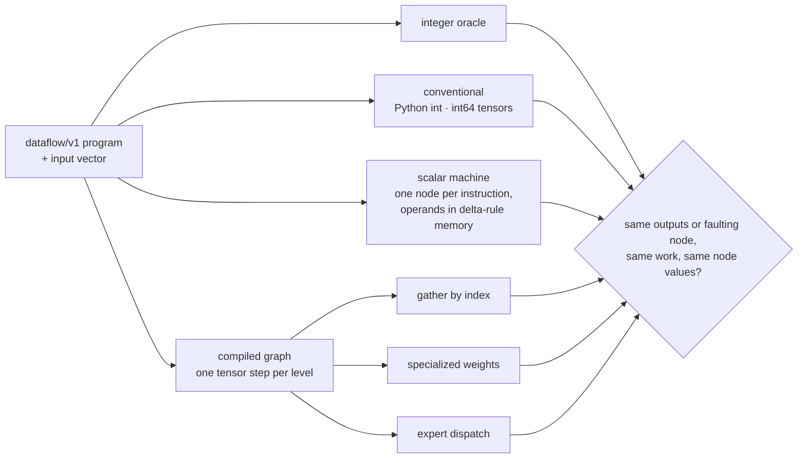

# E04 results: dataflow, specialization, and conditional units

> **TL;DR:** Compiled tensor graphs matched an integer dataflow oracle exactly in float32 and float64, faults included, but were no faster than int64 tensor code and slower than plain Python for one input.

In plain terms: small integer programs (arithmetic graphs, a dot product, and a gather/map/reduce/scatter pipeline) were run as ordinary Python, as a one-instruction-at-a-time machine whose operands live in the E00 neural memory, and as tensor programs that compute one whole level of the graph per step. Every float32 and float64 tensor version gave exactly the oracle's answers, and overflow stopped at the same node. Half-precision formats got most answers wrong. Computing level by level paid off only when many inputs were batched, and then it was about as fast as the same schedule in plain integer tensors, not faster.

## Question and hypothesis

> **TL;DR:** Test whether direct level-by-level scheduling preserves integer dataflow semantics and beats scalar interpretation.

[E04](../../EXPERIMENTS.md#e04---dataflow-specialization-and-conditional-units) asks whether direct scheduling is a better fit than scalar interpretation. This run tests:

> A program lowered to one batched tensor step per level matches [`dataflow/v1`](../../src/latent_machines/machines/README.md#dataflowv1) exactly in float32 and float64, including the node at which overflow faults, and costs fewer backend steps and less time than a scalar machine that executes one node per instruction. Program-specialized weights and capacity-limited expert dispatch, as separate ablations, preserve the same semantics.



## Evidence class

> **TL;DR:** Project-run conformance tests and single-machine timings; not independent validation or a proof.

Local conformance on finite, seeded workloads, run by this project and not independently checked. Every evaluation is compared with the oracle on its event (output values, or the faulting node), its work, and the value of every evaluated node. Timings come from one shared laptop CPU with other jobs present; they show orders of magnitude and crossovers, not precise speedups.

## Setup

> **TL;DR:** Three workloads, eight accepted variants each, plus half-precision probes.

| Item | Value |
|---|---|
| Source | [`96681b5`](https://github.com/JGalego/latent-machines/commit/96681b58b5cc74fc393d3fb6d5581749391f71e2), clean tree |
| Machine | `dataflow/v1`, 16-bit signed words; overflow faults at the first out-of-range node in evaluation order (level, then node index); `sum` checked on its final value |
| Workloads | `expression-dag`: 8 inputs, 2 constants, 30 random `add`/`sub`/`mul`/`max` nodes (40 nodes, 8.6 levels on average); `dot-product`: 64 inputs × 64 constant weights, then one `sum` (193 nodes, 3 levels); `gather-map-reduce-scatter`: gather 24 of 32 inputs, `x·c + d`, 6 segment sums, `max` and `sub`, shuffled outputs (128 nodes, 5 levels). About 10% of input vectors are wide-range and 2% carry an out-of-range element ([generators](../../src/latent_machines/tasks/dataflow_workloads.py)) |
| Backends | `python-int` (conventional), `torch-int64` (optimized conventional: one batched op per op type per level), `scalar-delta` (one node per instruction, operands in the E00 delta-rule memory, host ALU), `compiled-graph` (gather by index, all units per node, masked select), `specialized-weights` (dense wiring and constant matrices), `expert-dispatch` (static routing to five op experts, capacity 4 per round, padded) ([backends](../../src/latent_machines/backends/README.md#dataflow-backends)) |
| Formats | Accepted: Python int, int64, float32, float64. Precision probes, outside the acceptance: bfloat16 and float16 |
| Snapshot check | On the first evaluation without a fault: decode at the middle level (or instruction), JSON round trip, restore, resume; the restored state must equal the live one and the resumed outcome the uninterrupted one |
| Timing | First 5 programs per workload: compile, first call after compiling (cold), median of 30 batch-1 calls, median of 5 calls on a batch of 256 input vectors; 2 torch threads; Intel i7-1365U, PyTorch 2.15.0+cpu |

A variant is one backend, format, and workload: 36 per run.

## Results

> **TL;DR:** All 24 accepted variants were exact, faults included; the half-precision probes mismatched on 37-100% of evaluations with zero residue.

| Evaluations per variant | Seed | Evaluations checked | Mismatches, accepted variants | Mismatches, probes | Max residue | Snapshots | Status | Record |
|---|---|---|---|---|---|---|---|---|
| 1,000 (20 programs × 50 inputs) | 0 | 36,000 | 0 | 9,390 | 0 | 33/33 agree, 3 not applicable | passed | [8288](e04-20261118T020315Z-96681b5-8288/metrics.json) |
| 5,000 (50 programs × 100 inputs) | 1 | 180,000 | 0 | 46,084 | 0 | 33/33 agree, 3 not applicable | passed | [f4dd](e04-20261118T020923Z-96681b5-f4dd/metrics.json) |

Every accepted variant in both runs is classified `exact`. The oracle faulted on 381 of 1,000 evaluations in `expression-dag`, 88 in `dot-product`, and 102 in `gather-map-reduce-scatter` in the seed-0 run (2,005, 492, and 514 of 5,000 in the seed-1 run); every accepted variant reported the same faulting node and work for each.

Mismatching evaluations in the precision probes, seed 0 out of 1,000 and seed 1 out of 5,000; `compiled-graph` and `specialized-weights` gave identical counts:

| Workload | bfloat16, seed 0 | float16, seed 0 | bfloat16, seed 1 | float16, seed 1 |
|---|---|---|---|---|
| `expression-dag` | 768 | 441 | 3,807 | 1,854 |
| `dot-product` | 1,000 | 524 | 5,000 | 2,624 |
| `gather-map-reduce-scatter` | 1,000 | 962 | 5,000 | 4,757 |

The first probe mismatch is typical: an expected output of −5538 came back as −5536, because float16 and bfloat16 round integers above 2,048 and 256 to their nearest representable value. The residue, the distance from the nearest integer before rounding, stayed at zero: the wrong values are integers. Residue cannot detect this failure; only the oracle comparison does.

## Cost measurements

> **TL;DR:** Level-by-level execution needs 3-9 steps instead of 123-605, but for one input plain Python is 2-35 times faster.

Mean per program, seed-0 run. Times in microseconds per evaluation; batched time is the batch-of-256 call divided by 256.

| Workload | Backend (format) | Steps per evaluation | Units computed | Program bytes | Compile (µs) | Batch-1 (µs) | Batched (µs) |
|---|---|---|---|---|---|---|---|
| `expression-dag` | `python-int` | – | 40 | 0 | – | 25 | 26 |
| | `torch-int64` | 8.6 levels | 40 | 1,120 | 410 | 824 | 5.9 |
| | `scalar-delta` (float32) | 123 ticks | 40 | 0 | – | 5,690 | 8,000 |
| | `compiled-graph` (float32) | 8.6 levels | 100 | 1,580 | 270 | 821 | 6.8 |
| | `specialized-weights` (float32) | 8.6 levels | 100 | 14,972 | 800 | 757 | 6.9 |
| | `expert-dispatch` (float32) | 8.6 levels | 88 (48 padded) | 1,874 | 460 | 883 | 6.2 |
| `dot-product` | `python-int` | – | 193 | 0 | – | 103 | 115 |
| | `torch-int64` | 3 levels | 193 | 5,136 | 510 | 253 | 8.6 |
| | `scalar-delta` (float32) | 605 ticks | 193 | 0 | – | 26,993 | 22,341 |
| | `compiled-graph` (float32) | 3 levels | 323 | 4,762 | 420 | 239 | 6.3 |
| | `specialized-weights` (float32) | 3 levels | 323 | 185,742 | 1,320 | 218 | 6.6 |
| | `expert-dispatch` (float32) | 3 levels | 196 (3 padded) | 4,880 | 540 | 376 | 7.0 |
| `gather-map-reduce-scatter` | `python-int` | – | 128 | 0 | – | 66 | 71 |
| | `torch-int64` | 5 levels | 128 | 3,232 | 380 | 349 | 5.2 |
| | `scalar-delta` (float32) | 374 ticks | 128 | 0 | – | 13,760 | 16,105 |
| | `compiled-graph` (float32) | 5 levels | 240 | 3,896 | 300 | 393 | 5.2 |
| | `specialized-weights` (float32) | 5 levels | 240 | 96,592 | 1,100 | 320 | 5.1 |
| | `expert-dispatch` (float32) | 5 levels | 136 (8 padded) | 3,136 | 470 | 483 | 5.5 |

"Units computed" counts unit results per evaluation, including the product and max units a dense level computes and discards and the padded expert slots; the oracle's work is the node count. "Program bytes" counts index tensors, masks, constants, and weights, padding included. Runtime state is one value per node: 4 bytes per node in float32 for one input vector; the scalar machine's delta-rule state is 64 bytes per node.

- **Batch 1:** every tensor path was slower than Python by 2-35 times, because each level costs several tensor calls with fixed overhead. None of the compiled variants ever repays its compile time against Python at batch 1.
- **Batched:** at 256 input vectors, the float32 compiled graph was 4-18 times faster than Python per evaluation, and within about 30% of the int64 baseline in both directions: slower on `expression-dag`, faster on `dot-product`, equal on `gather-map-reduce-scatter`. The recorded amortization counts against int64 (190-10,400 evaluations where positive) come from these small, noisy differences and are not a stable finding.
- **Scalar machine:** 210-260 times slower than Python per evaluation, from 3-4 ticks per node on the delta-rule memory plus Python overhead per tick.
- **Specialization:** dense weights made programs 10-40 times larger than index tensors, took 3-4 times longer to compile, and gave no consistent speedup. In bfloat16 and float16 the dense matrix products ran up to 8 times slower than float32 on this CPU.
- **Dispatch:** routing only the needed op cut units computed by 12-43% relative to the dense level, at the cost of padded slots (48 of 88 in `expression-dag`, where levels are small); wall time did not improve on CPU.

## Interpretation

> **TL;DR:** Direct scheduling preserves the semantics and removes interpretation steps; its time advantage over conventional integer code is not shown.

- **Semantics.** In float32 and float64, every compiled lowering matched the oracle on outputs, faulting node, work, and every node value. This holds because 16-bit words, products of two words, and the workloads' sums stay below 2^24, where float32 holds integers exactly. The level-wise overflow check reports the first bad row of a level, which equals the oracle's first fault because the specification orders evaluation by level.
- **Scalar interpretation versus direct scheduling.** The compiled graph replaces 123-605 scalar ticks with 3-9 level steps, and is 2-3 orders of magnitude faster than the scalar machine. That comparison is against a slow interpreter whose ALU is host Python; it is not evidence of an advantage over conventional arithmetic.
- **Against optimized conventional code.** The int64 tensor schedule is the fair baseline: the same level structure with integer arithmetic. The float32 graph matched its cost within noise. Floating-point execution therefore adds no measured speed here, and it adds a precision obligation int64 does not have.
- **Precision.** bfloat16 and float16 are not conforming backends for 16-bit words. Their errors produce valid-looking integers, so a residue check before rounding misses them; only comparison with the oracle exposes them.
- **Ablations.** Program-specialized weights traded size and compile time for nothing measurable at these program sizes. Static expert dispatch reduced computed units but not time on CPU; any benefit would need hardware where skipped units save time.

## Limits

> **TL;DR:** Small programs, one CPU, static routing, and no fused or learned units.

- **Scale:** programs of 40-193 nodes and batches up to 256; larger graphs, wider words, and GPUs were not tested.
- **Timing:** one shared laptop CPU with 2 torch threads, during other jobs; medians over few calls. Peak memory was not measured.
- **Fusion:** a dot product fused into one `Linear` layer would skip the per-product overflow checks the specification requires, unless input bounds were declared; it was not built.
- **Dispatch:** routing is static per program, not learned or input-dependent; capacity 4 only.
- **Scalar machine:** arithmetic runs in a host Python ALU; only operand storage is on the tensor path.
- **Snapshots:** checked once per variant per run, at the middle level, on an evaluation without a fault.

## Artifacts

> **TL;DR:** Manifests are here; full run directories are in the public Hub dataset.

The run manifests (`run.json`, `metrics.json`) are in this directory. The full run directories, with `trace.jsonl` and `failure.json` holding the first mismatching evaluation of each probe, are in the public Hub dataset [`jgalego/latent-machines-runs`](https://huggingface.co/datasets/jgalego/latent-machines-runs) under `runs/`.

```bash
git checkout 96681b5 && uv sync --locked --extra torch-cpu
uv run --locked python -m latent_machines.experiments.e04                                      # seed 0, 20 programs × 50 inputs
uv run --locked python -m latent_machines.experiments.e04 --seed 1 --programs 50 --inputs 100
```

## Decision

> **TL;DR:** Record exact direct scheduling with no speed advantage over int64 code; keep half precision out of integer dataflow.

For these integer dataflow workloads, direct level-by-level compilation is a conforming backend in float32 and float64 and replaces scalar instruction dispatch with a few batched steps, but on CPU it does not beat the same schedule in integer tensors, and it loses to plain Python for single inputs. Speed claims stay closed under [scope gate](../../EXPERIMENTS.md#gates-for-expanding-scope) 2. Next steps, if pursued:

- Time the compiled graph on a GPU against an equally optimized integer baseline, with fused levels, before any speed claim.
- Add a fused dot product with declared input bounds, to test whether fusion can keep precise exits.
