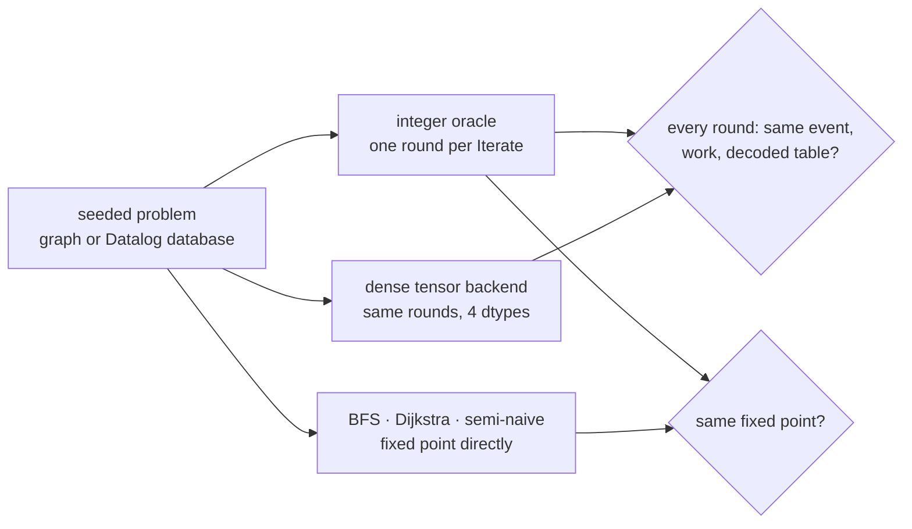

# E05 results: graph, semiring, and logic execution

> **TL;DR:** Dense tensor kernels reproduced reachability, shortest paths, and Datalog round for round, except bfloat16 shortest paths above 256. On sparse graphs every tensor path was slower than Python BFS or Dijkstra.

Matrix products and min-plus broadcasts computed transitive closure, all-pairs shortest paths, and a recursive Datalog program. Each ran in lockstep with an integer oracle, one synchronous round at a time. In float32, float64, and float16, and for the Boolean machines also in bfloat16, every round matched. In bfloat16, shortest-path distances above 256 rounded to the wrong integer in every long-path problem. On larger sparse graphs, conventional BFS and Dijkstra in plain Python beat dense tensor iteration by 20 to 100 times at 4,096 vertices. A sparse tensor product came within a factor of about 2 of BFS.

## Question and hypothesis

> **TL;DR:** Do dense Boolean and min-plus reductions execute exact fixed-point graph and logic machines?

[E05: graphs and logic](../../EXPERIMENTS.md#e05---graph-semiring-and-logic-execution) asks whether a small exact relational or message-passing machine can replace scalar instruction dispatch for suitable workloads. This run tests:

> Dense tensor rounds (Boolean products clamped to 1, min-plus by broadcast and minimum) implement [`reach/v1`, `minplus/v1`, and `chain-datalog/v1`](../../src/latent_machines/machines/README.md#reachv1-minplusv1-chain-datalogv1) exactly in float32, float64, bfloat16, and float16 on CPU, including unreachable entries, bound faults, and the fixed-point round. They are also competitive with conventional sparse algorithms on sparse graphs.



## Evidence class

> **TL;DR:** Project-run conformance tests on finite seeded workloads and one CPU timing benchmark, with no proof or independent validation.

Local conformance on finite, declared workloads, run by this project and not independently checked. Each tensor round is compared with the oracle through the shared [lockstep check](../../src/latent_machines/experiments/README.md#e05-graph-semiring-and-logic-execution): event, work, and the full decoded relation or distance table, with residue recorded before decoding. Conventional algorithms are an independent check of the oracles' fixed points. Timings come from one laptop CPU and are indicative only.

## Setup

> **TL;DR:** Three machines, eleven workloads, four number formats, and 40 or 200 problems per variant.

| Item | Value |
|---|---|
| Source | [`f06e4ee`](https://github.com/JGalego/latent-machines/commit/f06e4eeb989a1e603ff0821235439c3f643aa9bf), clean tree |
| Machines | `reach/v1` (reflexive transitive closure), `minplus/v1` (weights 0-63, `max_distance` 2047, `None` as infinity), `chain-datalog/v1` with an ancestry and same-generation program over `par` |
| Tensor backend | `dense-tensor`: `R' = clamp(R + R·A, max=1)`; `D' = min(D, min_k D[:, k] + W[k, :])`; chain rules as clamped 0/1 matrix products; eager PyTorch 2.15.0+cpu |
| Conventional | BFS from every vertex, Dijkstra from every vertex, semi-naive Datalog ([graph_native.py](../../src/latent_machines/backends/graph_native.py)) |
| Workloads | reach: sparse (48 vertices), dense (32), 64-vertex chain, 4 disconnected clusters; minplus: unit weights with ties, weights 0-15, 64-vertex long path (distances to about 1,950), 64-vertex path that exceeds the bound; Datalog: 5-generation forest, 40-deep lineage, cyclic random `par` ([generators](../../src/latent_machines/tasks/graph_workloads.py)) |
| Snapshot check | One problem per variant, at its middle round: decoded state → JSON → restore; the restored tensors must equal the live ones |
| Hardware | local Intel i7-1365U; variants in 4 worker processes with 1 torch thread each; benchmark with 2 threads |

A variant is one machine, workload, and number format, plus one conventional (`python-int`) variant per machine and workload: 55 per run.

## Results

> **TL;DR:** 53 of 55 variants were exact. bfloat16 shortest paths failed in every long-path problem.

| Problems per variant | Seed | Rounds checked | Problems with a mismatch | Max residue | Snapshots | Status | Record |
|---|---|---|---|---|---|---|---|
| 40 | 0 | 36,690 | 80 (all bfloat16 `long` and `bound`) | 0 | 42/44 agree, 2 not reached | failed | [f83a](e05-20261118T021741Z-f06e4ee-f83a/metrics.json) |
| 200 | 1 | 182,853 | 400 (all bfloat16 `long` and `bound`) | 0 | 42/44 agree, 2 not reached | failed | [f158](e05-20261118T022611Z-f06e4ee-f158/metrics.json) |

Classification by machine, workload, and number format (both runs agree):

| Machine · workload | float32 | float64 | bfloat16 | float16 | conventional |
|---|---|---|---|---|---|
| reach · sparse, dense, chain, components | exact | exact | exact | exact | exact |
| minplus · unit, weighted | exact | exact | exact | exact | exact |
| minplus · long | exact | exact | **mismatch** | exact | exact |
| minplus · bound | exact | exact | **mismatch** | exact | exact |
| chain-datalog · forest, lineage, cyclic | exact | exact | exact | exact | exact |

- **bfloat16 distances.** bfloat16 represents every integer only up to 256. In the seed-0 run, the first wrong entry appeared at round 8 (`long`) and round 4 (`bound`) of the first problem. For example, an expected distance of 257 decoded as 256, and 267 as 268. All 40 problems of both workloads failed, and all 200 in the seed-1 run (first wrong entry at rounds 6 and 4). Snapshots were not reached because the snapshot problem failed first. The backend has no format-specific range check, so it neither rejected nor flagged the configuration. A conforming backend would have to declare this limit and refuse it.
- **float16** was exact on the same workloads, as expected from its exact integer range of 2048, which covers `max_distance` 2047. In the `bound` workload it raised the distance-bound fault in the same round as the oracle in all 240 problems across the two runs.
- **Boolean machines** were exact in every format. Clamping a count of witnesses to 1 needs only "zero or not zero", which every format represents exactly at these sizes.
- **Fixed points and boundaries.** Chain closures needed exactly `n = 64` rounds, the declared budget, and the 40-deep lineage 40 rounds. Both halted on the last permitted round. Unreachable entries, isolated vertices, self-loops, parallel edges, zero-weight edges, and tie-rich unit-weight graphs all matched. Conventional algorithms agreed with every oracle fixed point. Every `bound` fault had a true shortest distance above the bound, and no fault came from a tentative distance alone.

## Measurements

> **TL;DR:** Dense rounds do one to four orders of magnitude more work than sparse algorithms and lose on time.

Work in the seed-0 run (40 problems per row; dense work counts `n³` multiply-adds or add-mins per round; sparse work counts edges scanned or relaxed, or tuples joined, by the conventional algorithm):

| Machine · workload | Vertices | Density | Mean rounds | Dense padded work | Conventional sparse work | Tensor state + operands (float32) |
|---|---|---|---|---|---|---|
| reach · sparse | 48 | 0.033 | 12.6 | 55.7 M | 50.2 k | 18 KB |
| reach · chain | 64 | 0.016 | 64.0 | 671 M | 85.9 k | 32 KB |
| minplus · weighted | 40 | 0.099 | 10.6 | 27.2 M | 244 k | 13 KB |
| minplus · long | 64 | 0.017 | 42.9 | 450 M | 88.3 k | 32 KB |
| chain-datalog · lineage | 40 | 0.024 | 40.0 | 410 M | 34.2 k | 19 KB |

In the lockstep runs, bfloat16 and float16 kernels took 1 to 5 times as long as float32 on this CPU, never less (for example 1.12 s against 0.24 s for the chain closures). Reduced precision saved memory but not time here.

Single-source timing benchmark on random sparse digraphs with average out-degree 4 and weights 1-8, seed-0 run (median of three; every timed answer matched BFS or Dijkstra). The graphs of the seed-1 run gave the same ordering at every size, with dense Bellman-Ford at 558 ms and Dijkstra at 3.6 ms for 4,096 vertices:

| Vertices | Rounds (reach, shortest) | Python BFS | Dense frontier | Sparse tensor frontier | Python Dijkstra | Dense Bellman-Ford |
|---|---|---|---|---|---|---|
| 256 | 9, 13 | 0.05 ms | 0.15 ms | 0.32 ms | 0.20 ms | 0.55 ms |
| 1,024 | 10, 13 | 0.24 ms | 0.96 ms | 0.81 ms | 0.93 ms | 9.05 ms |
| 4,096 | 10, 14 | 1.22 ms | 24.4 ms | 2.64 ms | 4.08 ms | 401 ms |

At 4,096 vertices the dense frontier processes 168 M padded entries in its 10 rounds, and dense Bellman-Ford 235 M, against 16,128 edge relaxations for Dijkstra.

## Interpretation

> **TL;DR:** Exactness holds where the number format covers the values. Dense execution is no speedup for sparse graphs.

- **Exactness.** Dense semiring rounds implement these fixed-point machines exactly at the tested sizes whenever every stored value is exactly representable. For Boolean relations that holds in all four formats; for distances it holds only while distances stay within the format's exact integer range. A tensor backend for min-plus must therefore declare its range and reject configurations beyond it, as the [shared contract](../../EXPERIMENTS.md#shared-execution-and-evidence-contracts) requires. This one did not.
- **Cost.** The [discriminator](../../EXPERIMENTS.md#e05---graph-semiring-and-logic-execution) asks that dense speedups be compared at realistic sparse sizes. Here there were none. Interpreted Python BFS beat the dense PyTorch frontier at every size, and the gap grew with `n` because dense work grows as `n²` per round while sparse work grows with edges. A sparse tensor product narrowed the gap to about 2 times. Dense rounds may still pay off on dense graphs, in batches of many problems, or on accelerators. This run measured none of these.
- **Scalar dispatch.** No scalar-machine implementation exists yet, so this run does not compare relational execution with instruction-by-instruction execution. It compares only with conventional algorithms.

## Limits

> **TL;DR:** Small graphs, one CPU, eager kernels, no scalar machine, and no batching.

- **Sizes:** lockstep problems have at most 64 vertices; the benchmark reaches 4,096 vertices from one source.
- **Execution path:** eager PyTorch on one CPU; no GPU, compiled, fused, or batched kernels. The sparse tensor path is timed but not run in lockstep; its final answers were checked.
- **Baselines:** the conventional algorithms are interpreted Python, not optimized native code, so the timing comparison is conservative toward the tensors. Per [scope gate 2](../../EXPERIMENTS.md#gates-for-expanding-scope) it is not a speed claim either way.
- **Machines:** linear-round closure only (no repeated squaring); chain-rule Datalog over binary relations only; no negative weights by specification.
- **Not implemented:** scalar-machine execution, learned GNNs (out of scope for exact kernels).

## Artifacts

> **TL;DR:** The manifests are here and the full run directories, with traces and snapshots, are in the public Hub dataset.

Each run directory holds `run.json` and `metrics.json` here. The full directories, with `trace.jsonl`, `failure.json`, and snapshots, are in the public Hub dataset [`jgalego/latent-machines-runs`](https://huggingface.co/datasets/jgalego/latent-machines-runs) under `runs/`.

```bash
git checkout f06e4ee && uv sync --locked --extra torch-cpu
uv run --locked python -m latent_machines.experiments.e05 --jobs 4                         # 40 problems per variant
uv run --locked python -m latent_machines.experiments.e05 --jobs 4 --horizon 200 --seed 1  # larger run
```

## Decision

> **TL;DR:** Semiring execution is exact except for the bfloat16 range failure, and dense kernels are not worth pursuing for sparse graphs.

The dense tensor backends are exact for these machines and workloads in float32, float64, and float16, and for the Boolean machines in bfloat16. bfloat16 min-plus fails beyond 256. Next steps, if E05: graphs and logic continues:
- Add a declared value range to the min-plus backend so it rejects formats that cannot represent `max_distance`.
- Run the sparse tensor kernel in lockstep, and measure batched and GPU execution before judging dense execution on cost.
- Add a scalar-machine baseline to answer the question of relational versus instruction-level execution directly.
