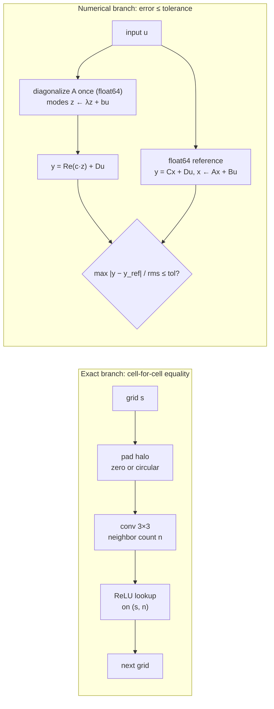

# E06 results: cellular rules and linear-filter SSMs

> **TL;DR:** A convolution-plus-lookup circuit matched three cellular rules cell for cell in four number formats; SSM filters met float32 tolerances, and every bfloat16 variant but one exceeded its tolerance.

E06 has two branches with different contracts, and this report keeps them apart. In the exact branch, a grid of live and dead cells updates all at once from neighbor counts. A compiled network (a 3x3 convolution that counts neighbors, then a small ReLU circuit) reproduced the integer reference exactly, on every grid and in every number format tested. In the numerical branch, linear filters ran as diagonal state-space models (SSMs). They stayed within the declared error tolerance in float64 and float32. In bfloat16, 17 of 18 variants exceeded theirs, because bfloat16 cannot hold the filters' poles and states precisely enough.

## Question and hypothesis

> **TL;DR:** Test each layer on its natural operation: local rules for convolution, linear recurrences for SSMs.

[E06](../../EXPERIMENTS.md#e06---spatial-and-structured-dynamical-machines) asks when local or structured state evolution is a better substrate than random-access emulation. This run tests two hypotheses, each against its own contract:

> **Exact branch.** A 3x3 convolution followed by a ReLU lookup on (cell, neighbor count) implements [`cellular/v1`](../../src/latent_machines/machines/README.md#cellularv1) exactly for the B3/S23, B36/S23, and B2/S rules, with zero and toroidal boundaries, in float32, float64, bfloat16, and float16.
>
> **Numerical branch.** A diagonal SSM implements the [`lds/v1`](../../src/latent_machines/machines/README.md#ldsv1) filters within declared tolerances (maximum error relative to the reference RMS of 1e-9 in float64, 1e-4 in float32, and 1e-2 in bfloat16), over 10^4 and 10^5 samples, and no worse than the dense recurrence at the same precision.



## Evidence class

> **TL;DR:** These are local conformance and tolerance tests run by this project, not proofs or independent validation.

These are local tests on finite, declared workloads, run by this project and not independently checked. The exact branch uses the shared [lockstep check](../../src/latent_machines/experiments/README.md#e06-spatial-and-dynamical-machines): after every action it compares the grid, generation, event, and work with the integer oracle, and records residue before decoding. The numerical branch compares every output sample with a float64 reference under tolerances fixed in the code before the recorded runs. Its results are classified "within tolerance" or "exceeds tolerance", never "exact". The tolerances were chosen before any code ran, but an unrecorded pilot on the same systems preceded the recorded runs; no tolerance or setting changed after it.

## Setup

> **TL;DR:** Three rules, four grid workloads, five backends; three filters, two inputs, three implementations, three precisions.

| Item | Value |
|---|---|
| Source | [`2ff9272`](https://github.com/JGalego/latent-machines/commit/2ff927246ae233bcff0af350c65a3a872b0805f1), clean tree |
| Hardware | local Intel i7-1365U, PyTorch 2.15.0+cpu, Python 3.13.13, one torch thread per variant |
| Rules | B3/S23, B36/S23, B2/S on a 32×32 grid |
| Grid workloads | 15% soup on a torus; 50% soup with dead edges; four gliders crossing the torus seams plus a blinker across the corner; a 40% soup in the two outer rings with dead edges ([generators](../../src/latent_machines/tasks/cellular_workloads.py)). About 5% of actions are `Set` perturbations, about 5% of those invalid |
| Cellular backends | `torch-int`: conventional int16 neighbor sums and a uint8 table lookup. `conv-lookup`: pad, 3×3 convolution, hat-function one-hot of the count, ReLU alive/dead units, weighted sum ([backend](../../src/latent_machines/backends/cellular.py)), in float32, float64, bfloat16, float16 |
| Filters | oscillator: pole radius 0.999, period 100 samples; second-order Butterworth low-pass, cutoff 0.05 cycles/sample; random stable 8-dimensional system, spectral radius 0.98 |
| Inputs | Gaussian white noise (seed 0); unit step |
| Filter backends | `direct`: dense recurrence. `ssm-sequential`: diagonal modes, one sample at a time. `ssm-chunked`: chunks of 64 with a lower-triangular kernel of mode powers computed in float64, then cast ([backend](../../src/latent_machines/backends/ssm.py)) |
| Snapshot check | Exact: at the midpoint, the decoded grid is saved to JSON and restored, and must equal the live tensor. Numerical: the state is saved to JSON at a chunk boundary near the midpoint, then resumed in a fresh backend, and must reproduce the uninterrupted outputs bit for bit |

## Results: exact branch

> **TL;DR:** 720,000 checked actions across three runs, with zero mismatches, zero residue, and every snapshot restored.

| Actions per variant | Seed | Actions checked | Mismatches | Max residue | Snapshots | Status | Record |
|---|---|---|---|---|---|---|---|
| 10^3 | 0 | 60,000 | 0 | 0 | 60/60 agree | passed | [74ba](e06-exact-20261117T222601Z-2ff9272-74ba/metrics.json) |
| 10^3 | 1 | 60,000 | 0 | 0 | 60/60 agree | passed | [b59b](e06-exact-20261118T021628Z-2ff9272-b59b/metrics.json) |
| 10^4 | 0 | 600,000 | 0 | 0 | 60/60 agree | passed | [f1e2](e06-exact-20261118T021905Z-2ff9272-f1e2/metrics.json) |

A variant is one backend, number format, rule, and workload: 60 per run. Every variant in every run is classified `exact`. The 10^4 run covers 569,975 generations and 30,025 `Set` actions summed over its variants. Summed over the 12 rule-and-workload pairs of the seed-0 10^3 run, the action streams held 577 valid `Set`s, 23 out-of-range cells, and 17 out-of-range values, so both fault kinds occurred; the five backends see the same streams.

The circuit is fixed and small: 4 layers, 45 hidden units per cell, 36 stored weights, and 17 nonzero. Every intermediate is an integer from −8 to 9, which is why it is exact in all four formats.

## Results: numerical branch

> **TL;DR:** float64 and float32 met their tolerances at 10^5 samples; bfloat16 failed in 17 of 18 variants, least badly with the chunked SSM.

Maximum error relative to the reference RMS over 10^4 samples ([ee7b](e06-numerical-20261117T223048Z-2ff9272-ee7b/metrics.json)). Tolerances are 1e-9 (float64), 1e-4 (float32), and 1e-2 (bfloat16):

| System, input | direct f32 | ssm-seq f32 | ssm-chunk f32 | direct bf16 | ssm-seq bf16 | ssm-chunk bf16 |
|---|---|---|---|---|---|---|
| oscillator, noise | 1.6e-5 | 1.2e-5 | 9.5e-7 | 0.96 | 1.7 | 0.045 |
| oscillator, step | 1.9e-5 | 1.9e-5 | 2.1e-6 | 1.7 | 2.3 | 0.12 |
| Butterworth, noise | 3.0e-6 | 8.0e-7 | 5.6e-7 | 0.12 | 0.047 | 0.032 |
| Butterworth, step | 1.2e-6 | 2.5e-7 | 1.2e-7 | 0.035 | 0.010 | **0.0078** |
| random-stable-8, noise | 1.7e-6 | 2.2e-6 | 1.0e-6 | 0.084 | 0.15 | 0.028 |
| random-stable-8, step | 1.0e-6 | 1.6e-6 | 2.5e-7 | 0.048 | 0.069 | 0.014 |

All 18 float64 variants were within 1e-9: the largest error was 5.3e-14 for the SSMs, and the dense recurrence matched the reference to within 2.2e-15. All 18 float32 variants were within 1e-4. Of the bfloat16 variants, only the chunked SSM on the Butterworth step response (bold) stayed within 1e-2. The first sample over tolerance came between sample 4 and sample 407. Snapshot and resume reproduced the uninterrupted outputs bit for bit in all 54 variants.

Error growth with horizon, from the 10^5-sample run ([a29b](e06-numerical-20261118T020444Z-2ff9272-a29b/metrics.json)), worst prefix error up to each length:

| Variant | 10^2 | 10^3 | 10^4 | 10^5 |
|---|---|---|---|---|
| direct f32, oscillator, step | 6.4e-6 | 3.9e-5 | 4.5e-5 | 9.9e-5 |
| ssm-seq f32, oscillator, step | 1.2e-5 | 4.5e-5 | 4.5e-5 | 8.0e-5 |
| ssm-chunk f32, oscillator, step | 3.5e-6 | 4.6e-6 | 5.1e-6 | 6.4e-6 |
| direct bf16, oscillator, noise | 7.7e-3 | 0.32 | 0.88 | 1.5 |
| ssm-chunk bf16, oscillator, noise | 2.1e-3 | 0.014 | 0.041 | 0.062 |

The float32 dense and sequential oscillators came within 1% and 20% of the 1e-4 tolerance at 10^5 samples and were still growing. A longer horizon would probably cross it; this was not run. The pass/fail classification at 10^5 is the same as at 10^4 for every variant. The relative metric divides by the RMS over the whole horizon, so the same sample's relative error differs slightly between the two runs.

Rounding the poles explains much of the bfloat16 failure. The oscillator's pole radius 0.999 becomes 0.99805 in bfloat16, shortening its time constant from 1,000 to about 510 samples. The SSM modes of the other systems moved by about 1e-3 in radius (0.8008 → 0.8016, 0.9797 → 0.9811). The chunked schedule computes powers of the poles in float64 before casting, so it accumulates fewer rounding steps than repeated multiplication. That is the most likely reason it erred less than the sequential schedule in bfloat16 on every system and input, by 1.3 times (Butterworth) to 38 times (oscillator).

## Measurements

> **TL;DR:** On CPU, the integer baseline was fastest for cellular rules; Python per-step overhead dominates every timing here.

Median cells per second over the 12 variants per backend in the 10^4 run, from a backend-only timing pass over the same actions, at one thread per variant with four variants in parallel:

| Backend | Cells/s | Halo | Count | Lookup | State bytes (32×32) |
|---|---|---|---|---|---|
| Python oracle | 0.60–0.82 M | | | | (tuples) |
| torch-int (uint8) | 4.2 M | 20% | 62% | 17% | 1,024 |
| conv-lookup float32 | 2.8 M | 14% | 11% | 75% | 4,096 |
| conv-lookup float64 | 2.3 M | 13% | 11% | 76% | 8,192 |
| conv-lookup bfloat16 | 2.2 M | 10% | 11% | 79% | 2,048 |
| conv-lookup float16 | 2.5 M | 11% | 13% | 76% | 2,048 |

- **Boundary and halo:** each generation pads a one-cell halo of 132 cells (1,156 padded cells per 32×32 grid). On a torus these 132 cells are copied from the opposite edges, which models the communication a tiled or multi-device grid would need; with dead edges they are zeros. Halo padding took 10–20% of backend time; nothing was measured across devices.
- **Where the circuit's time goes:** the ReLU lookup (nine hat functions and two unit types per cell) takes three quarters of the conv-lookup time; the convolution itself takes about a tenth.
- **Filters:** on the noise inputs at 10^5 samples, the chunked SSM ran at 0.14–0.33 M samples/s, the dense and sequential tensor recurrences at 16–50 k samples/s, and the plain-Python float64 reference at 0.08–0.65 M samples/s. That the Python reference beats the sequential tensor code shows these timings measure per-step overhead, not arithmetic.
- **Variance:** throughput in the first 10^3 run, made while other jobs loaded the machine, was 2–3 times lower than in the 10^4 run. Treat these numbers as indicative only.

None of these numbers is a speed claim under [scope gate 2](../../EXPERIMENTS.md#gates-for-expanding-scope): they come from eager CPU PyTorch at one thread, with Python dispatch per generation or per sample, and no optimized kernels.

## Interpretation

> **TL;DR:** Convolution executes local rules natively and exactly; diagonal SSMs filter well in float32 but not at bfloat16 precision for slow poles.

- **Exact branch.** The convolution does the rule's natural work, counting neighbors in parallel, and a fixed, rule-independent circuit shape turns counts into next states. The rule enters only as 18 birth and survival weights. Exactness holds for the same reason as in E01's lookup circuits: every value stays a small integer. Unlike emulating the grid on random-access memory, there is no address traffic per cell. Whether that saves time on real hardware was not measured.
- **Numerical branch.** In float32 the sequential SSM was within a factor of two of the dense recurrence, better on some systems and worse on others, and the chunked SSM was more accurate than both on every system and input. In float64 the dense recurrence matches the reference almost bit for bit because it performs the same computation; diagonalization adds errors of at most 5.3e-14 over 10^4 samples and 1.8e-13 over 10^5. bfloat16 fails this contract for these systems. The failure is not specific to SSMs: the conventional dense recurrence failed too, by more than the chunked SSM in every case. A filter with slow poles needs more precision in its poles and state than bfloat16's 8-bit significand provides.
- **Scope.** Spatial rules and linear filters are both natural operations for their layers. Neither result says anything about random-access memory, and the two are not pooled.

## Limits

> **TL;DR:** One grid size, two families of workload, CPU only, no scalar-machine baseline, no optimized kernels.

- **Not tested:** scalar-machine execution of a rule (a rule interpreted cell by cell on an E00 memory backend), 1D elementary rules, non-totalistic or larger neighborhoods, grids other than 32×32, GPUs, multi-device halo exchange, float16 filters, fused or hardware scans, and input-dependent (selective) SSMs.
- **Population readout:** the backends count live cells for the output event in int64 after thresholding. A sum in bfloat16 or float16 would round above 256 or 2,048 cells; that path was not tested.
- **Host checks:** ordinary Python validates `Set` coordinates and values before the tensors run.
- **Numerical horizon:** the float32 oscillator errors were still growing at 10^5 samples, close to the tolerance. Longer horizons were not run.
- **Dying grids:** by the last of 10^4 actions, 5 of the 12 rule-and-workload grids had no live cells, so their late actions exercise only empty-grid updates and `Set` perturbations.
- **Seeds:** the 10^4-action exact run and both numerical runs used seed 0 only.
- **Aborted run:** a first 10^5-sample numerical run (`e06-numerical-20261117T223230Z-2ff9272-71b7`) was killed when the machine ran out of memory and left only `run.json`. It was rerun unchanged as `a29b`.

## Artifacts

> **TL;DR:** The manifests are here; the full run directories are in the public Hub dataset.

Run manifests (`run.json`, `metrics.json`) are in this directory. The full run directories, with traces, failures, and snapshots, are to be uploaded to the public Hub dataset [`jgalego/latent-machines-runs`](https://huggingface.co/datasets/jgalego/latent-machines-runs).

```bash
git checkout 2ff9272 && uv sync --locked --extra torch-cpu
uv run --locked python -m latent_machines.experiments.e06 --horizon 10000 --trace-limit 1000 --jobs 4
uv run --locked python -m latent_machines.experiments.e06 --branch numerical --horizon 100000 --jobs 4
```

## Decision

> **TL;DR:** Record the exact cellular result and the bfloat16 filter failure; precision per pole is the open question.

For the tested rules, grids, and formats, convolution plus lookup is a conforming exact backend for `cellular/v1`. For the tested filters, the diagonal SSM meets float32 tolerances but bfloat16 does not, in either the SSM or the conventional form. Next steps, if E06 is extended:
- A scalar-machine baseline, so that native local updates can be compared with random-access emulation on equal terms.
- Mixed precision for filters: poles and state in float32, inputs and outputs in bfloat16. Declare its tolerance before running.
- Longer float32 horizons for slow poles, and a GPU path checked under the same contracts.
