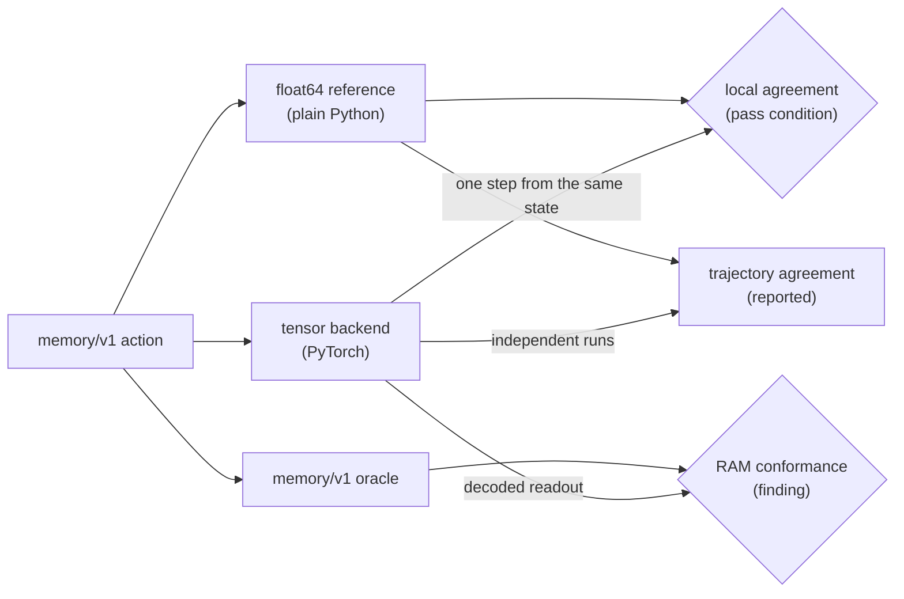

# E07 results: optimizer-defined state updates

> **TL;DR:** Plain one-hot SGD with learning rate 1 is exact memory; every other optimizer setting tested drifts away from RAM in its own predictable way.

A memory written by gradient steps is exact random-access memory in one configuration: sequential updates, one-hot keys, learning rate 1, and nothing else. Changing any single feature produced a specific, reproducible departure from RAM. Lower learning rates left margin or landed values on the decoding threshold, stale chunk gradients summed repeated writes, momentum kept moving stored values, decay forgot during idle stretches, gradient normalization took unit steps, and an MLP made writes interfere. In float32 and float64 the tensor backend agreed with an independent float64 reference at every step. In bfloat16 it did not, and the bfloat16 decay factor rounded to 1.

## Question and hypothesis

> **TL;DR:** Which optimizer settings keep exact memory semantics, and which turn memory into an approximate learner?

[E07](../../EXPERIMENTS.md#e07---optimization-defined-state-updates) asks which optimizer settings preserve useful specified memory semantics. The delta rule is one SGD step on `½‖W k − v‖²`; this run tests that identity and then changes one optimizer feature at a time:

> With one-hot keys, learning rate 1, and sequential updates, an SGD-written linear memory implements [`memory/v1`](../../src/latent_machines/machines/README.md#memoryv1) exactly. Each other setting deviates in the way recorded before the run in `run.json` (`expected_ram_behavior`), and its tensor implementation matches its own float64 reference.



## Evidence class

> **TL;DR:** Local conformance tests on finite workloads, run by this project; RAM deviations are findings about optimizers, not bugs.

Local conformance on declared, finite workloads, run by this project and not independently checked. Each setting is specified by [`optimizer-memory/v1`](../../src/latent_machines/machines/README.md#optimizer-memoryv1), whose plain-Python float64 implementation is the reference. The [tensor backend](../../src/latent_machines/backends/README.md#optimizer-defined-memory) shares only the specification and initial parameters with it: the MLP's gradient comes from autograd, and the reference's is written by hand and checked against finite differences in the tests.

Three comparisons run at every action:

- **Local agreement (pass condition):** one reference step taken from the backend's own state must match the backend's step. Parameters and read outputs must agree within `tol · (1 + |reference|)`, with `tol` = 1e-9 (float64), 1e-4 (float32), or 2e-2 (bfloat16). Read events may differ only at threshold ties, in bits whose reference value lies within tolerance of the 0.5 decoding threshold.
- **Trajectory agreement (reported):** the same comparison between the backend's run and the reference's independent run, where rounding differences can accumulate.
- **RAM conformance (finding):** the backend's decoded readout of every slot against `memory/v1`, with residue before decoding. It is required to be exact only for plain `sgd`.

**Pilot and contract change.** A pilot run on uncommitted code required trajectory agreement. It failed for gradient normalization on `clear_region` in float64 and for momentum on regression in float32. Local checks then showed that the backend computed each step correctly and that the update rules amplified rounding differences. The pass condition was changed to local agreement before this run, and trajectory agreement is reported in full below. The pilot also showed that momentum lands stored values on the 0.5 threshold, which led to the threshold-tie rule.

## Setup

> **TL;DR:** Eight optimizer settings, nine workloads, three number formats, 1,000 actions each.

| Item | Value |
|---|---|
| Source | [`3dc3812`](https://github.com/JGalego/latent-machines/commit/3dc3812f6a5198dfc35ac0a04c1372a43a66a11e), clean tree |
| Memory | 16 keys (slots) × 8 values (bits), the E00 default; one optimizer step per action, faults change nothing |
| Settings | `sgd` (lr 1, sequential, linear); one change each: `lr-0.9`, `lr-0.5`, `chunk-4` (gradients at the chunk-start parameters), `momentum-0.5`, `decay-0.001` (every step, including reads and idles), `grad-norm` (`g / max(‖g‖, 1e-12)`), `mlp` (16 ReLU hidden units, N(0, 1/16) initialization) |
| Workloads | E00's eight `memory/v1` streams ([generators](../../src/latent_machines/tasks/memory_workloads.py)), plus online linear regression with dense keys `x ~ N(0, I/16)` and `y = A x + 0.01 ε` ([generator](../../src/latent_machines/tasks/regression.py)) |
| Runs | float32 and float64 (144 variants); bfloat16 (72 variants); 1,000 actions per variant, seed 0 |
| Snapshot | At action 500, the full optimizer state (parameters, momentum, chunk-start copy, step count) through JSON must equal the live state; linear settings also restart from the decoded `memory/v1` words alone |
| Hardware | local, Intel i7-1365U, eager PyTorch 2.15.0+cpu, 4 worker processes |

## Results

> **TL;DR:** float32 and float64 passed every local check; RAM semantics survived only plain SGD, learning rate 0.9 (with residue), and decay or stale chunks on some workloads.

| Run | Variants | Actions checked | Local mismatches | Status | Record |
|---|---|---|---|---|---|
| float32, float64 | 144 | 144,000 | 0 | passed | [f77a](e07-20261118T021828Z-3dc3812-f77a/metrics.json) |
| bfloat16 | 72 | 72,000 | 192 in 4 variants | failed | [646f](e07-20261118T023023Z-3dc3812-646f/metrics.json) |

Every full-state snapshot in both runs restored exactly.

RAM conformance on the eight `memory/v1` workloads, identical in float32 and float64. "First deviation" is the first action whose decoded state or event differed from `memory/v1`:

| Setting | Exact | With residue | Deviates | First deviation | Mechanism observed |
|---|---|---|---|---|---|
| `sgd` | 8 | 0 | 0 | none | delta replacement; residue 0 |
| `lr-0.9` | 0 | 8 | 0 | none | each write moves 90% of the way; residue up to 0.1 |
| `lr-0.5` | 0 | 0 | 8 | action 0 on every workload | a written 1 lands at exactly 0.5 and decodes as 0 |
| `chunk-4` | 3 | 0 | 5 | 2 to 49 | a slot written twice in one chunk receives the sum of both corrections; stored entries reach 42. `alternate`, `idle`, and `capacity` never write a slot twice in a chunk |
| `momentum-0.5` | 0 | 2 | 6 | 6 to 45 | stored values keep moving after writes, reaching 28 |
| `decay-0.001` | 0 | 6 | 2 | 693 (`idle`), 701 (`untouched`) | a stored 1 falls below 0.5 after 693 decay steps; frequent rewrites hide it elsewhere |
| `grad-norm` | 0 | 0 | 8 | 0 to 4 | a write that changes several bits moves only a unit step, and a repeated write overshoots |
| `mlp` | 0 | 0 | 8 | action 0 on every workload | shared hidden units: a write changes other slots' readouts by up to 163 |

Trajectory agreement in float32 and float64 failed in four variants, all with zero local mismatches:

| Variant | First trajectory mismatch | Largest error | Reading |
|---|---|---|---|
| `grad-norm`/float64/`clear_region` | 164 | 0.58 | the update is discontinuous at zero gradient: a 1e-16 residual becomes a unit step |
| `grad-norm`/float32/`clear_region` | 164 | 0.76 | same |
| `grad-norm`/float32/regression | 552 | 0.031 | normalized steps amplify float32 input rounding |
| `momentum-0.5`/float32/regression | 706 | 8.6e-4 | the regression diverges (loss 4.7 → 1,061 in every dtype), so differences grow |

Momentum in float32 also produced 25 threshold ties along its trajectories: reads whose float64 value was within 1e-4 of 0.5.

**bfloat16.** Local mismatches occurred in `momentum-0.5` on `clear_region` (31), `invalid` (2), and regression (158), and in one step of `mlp` on `clear_region`. In each case, large operands such as momentum near 28 or MLP parameters near 450 cancel to a smaller result. Their bfloat16 rounding then exceeds a tolerance scaled to that result. `decay-0.001` passed every local check and matched `memory/v1` exactly, because `0.999` rounds to `1.0` in bfloat16 and decay never happens. Only the trajectory comparison exposed it, with mismatches on six of nine workloads. The declared bfloat16 tolerance is too loose to catch a disabled decay one step at a time.

## Measurements

> **TL;DR:** Optimizer buffers double the state, canonical memory snapshots lose them, and the MLP costs four times as much per step.

| Setting | State (float32) | Canonical restart from decoded words | Max interference on other slots | Tensor time per action |
|---|---|---|---|---|
| `sgd`, `lr-0.9` | 512 B | agrees on 8 of 8 | 0 | 73-98 µs |
| `decay-0.001` | 512 B | agrees on 6 of 8; on `idle` and `untouched` it differs at the live run's RAM deviation, because the restart starts undecayed | 0.001 | 82-87 µs |
| `grad-norm` | 512 B | differs within 60 actions on 6 of 8 | 0 | 126-132 µs |
| `lr-0.5` | 512 B | differs within 13 actions on 7 of 8 | 0 | 95-107 µs |
| `chunk-4` | 512 B + 512 B chunk-start copy | agrees on 7 of 8 | 0 | 82-101 µs |
| `momentum-0.5` | 512 B + 512 B momentum | differs within 13 actions on 6 of 8 | 14 | 82-121 µs |
| `mlp` | 1,632 B | not applicable | 163 | 362-458 µs |

Every action is one optimizer step and one tick. Interference is the largest change, during a valid write, in the readout of any other slot. A `memory/v1` snapshot can describe only the decoded words, so restarting from it drops momentum, the chunk-start copy, and any residue. That is why the momentum and `lr-0.5` restarts diverge. Tensor times are eager per-step calls on a laptop CPU, with the reference running in the same process; they are not optimized latencies.

Online regression (float64; float32 agrees to three significant figures): mean online loss over the first and last 100 samples, and the relative error of `W` against the generating map:

| Setting | Loss, first 100 | Loss, last 100 | Relative parameter error |
|---|---|---|---|
| `sgd` | 0.588 | 0.00090 | 0.013 |
| `lr-0.9` | 0.576 | 0.00080 | 0.012 |
| `lr-0.5` | 0.692 | 0.00056 | 0.0075 |
| `chunk-4` | 0.684 | 0.00107 | 0.016 |
| `decay-0.001` | 0.588 | 0.00287 | 0.024 |
| `grad-norm` | 0.690 | 0.144 | 0.215 |
| `momentum-0.5` | 4.66 | 1,061 | 34.0 (diverged) |
| `mlp` | 7.92 | 6.33 | not applicable |

## Interpretation

> **TL;DR:** Exact memory is a single point in optimizer space; elsewhere, the same rule is an adaptive learner with a measurable error.

- **Exact primitive versus learner.** Only `sgd` with one-hot keys implements `memory/v1` exactly. The settings that help regression work by damping or averaging updates, and these are exactly the settings that break replacement. `lr-0.5` has the lowest final regression loss and fails RAM at the first write. Decay trades idle retention for faster adaptation. An optimizer-written memory is an exact primitive only at the delta-rule point; elsewhere it is an approximate learner whose deviation has to be declared, not assumed away.
- **Graceful versus abrupt.** `lr-0.9` and short-horizon decay keep decoding correct with a shrinking margin, which residue measures. `lr-0.5`, chunking, normalization, and the MLP fail at specific, predictable actions. For every setting, the observed behavior matched the mechanism recorded before the runs.
- **Stale chunks.** Chunk-start gradients are exact whenever no slot is written twice within a chunk. A chunked kernel that skips intra-chunk correction is therefore exact only under that access pattern.
- **Reproducibility.** Implementations of discontinuous or unstable rules, such as gradient normalization near zero and divergent momentum, can agree at every step and still disagree along a trajectory. Exact agreement on such settings needs a declared policy for the discontinuity, for example an epsilon or threshold, not just a tolerance.
- **Checkpoints.** For momentum and chunked settings, the machine's canonical state is not the full state. A joint checkpoint must carry optimizer buffers ([open question 6](../../RESEARCH.md)).

## Limits

> **TL;DR:** Small memories, one seed, one change at a time, CPU only, and a finite test suite.

- **Scope:** 16 × 8 memories, 1,000 actions, seed 0. Longer horizons, other capacities, and other seeds were not run.
- **One feature at a time:** combinations such as momentum with decay, input-dependent learning rates or gates, chunked kernels with intra-chunk correction, and TTT- or Titans-style nonlinear memories trained over many steps were not tested.
- **Contract choices:** the tolerances, the threshold-tie rule, and the local pass condition were set by this project; the pass condition was revised after a pilot (see Evidence class). The bfloat16 tolerance is too loose to detect a disabled decay locally.
- **MLP:** one width and initialization at learning rate 1. Its parameters grew into the hundreds on several workloads, so its RAM result reflects that setting, not nonlinear memory in general.
- **Evidence:** passing finite suites is conformance evidence, not proof. Timing is not a backend benchmark.

## Artifacts

> **TL;DR:** The manifests are here; traces and snapshots are in the public Hub dataset.

Run manifests (`run.json`, `metrics.json`) are in this directory. Each raw run directory adds `trace.jsonl` (first 100 actions per variant), `snapshots/`, and `ram_deviations.json`, which holds the first RAM deviation of each variant with its reproduce command. The full directories are in the public Hub dataset [`jgalego/latent-machines-runs`](https://huggingface.co/datasets/jgalego/latent-machines-runs) under `runs/`.

```bash
git checkout 3dc3812 && uv sync --locked --extra torch-cpu
uv run --locked python -m latent_machines.experiments.e07 --jobs 4
uv run --locked python -m latent_machines.experiments.e07 --jobs 4 --dtypes bfloat16
```

## Decision

> **TL;DR:** Treat only sequential one-hot SGD at learning rate 1 as exact memory; report every other optimizer setting under its own contract.

Optimizer-defined updates count as an exact memory primitive only at the delta-rule point, which matches [E00](../E00/README.md). Every other setting is an adaptive learner. It must be reported against its own update reference, with its RAM deviation stated, never under an exact-RAM label. Next steps:

- **Chunked kernels:** test a chunked delta-rule kernel with intra-chunk correction (the WY or UT form) against `chunk-4`'s failure cases.
- **Checkpoints:** include optimizer buffers in joint snapshots wherever a backend carries them.
- **Low precision:** declare per-setting bfloat16 contracts, including whether a decay factor is representable, before using these settings in bfloat16.
