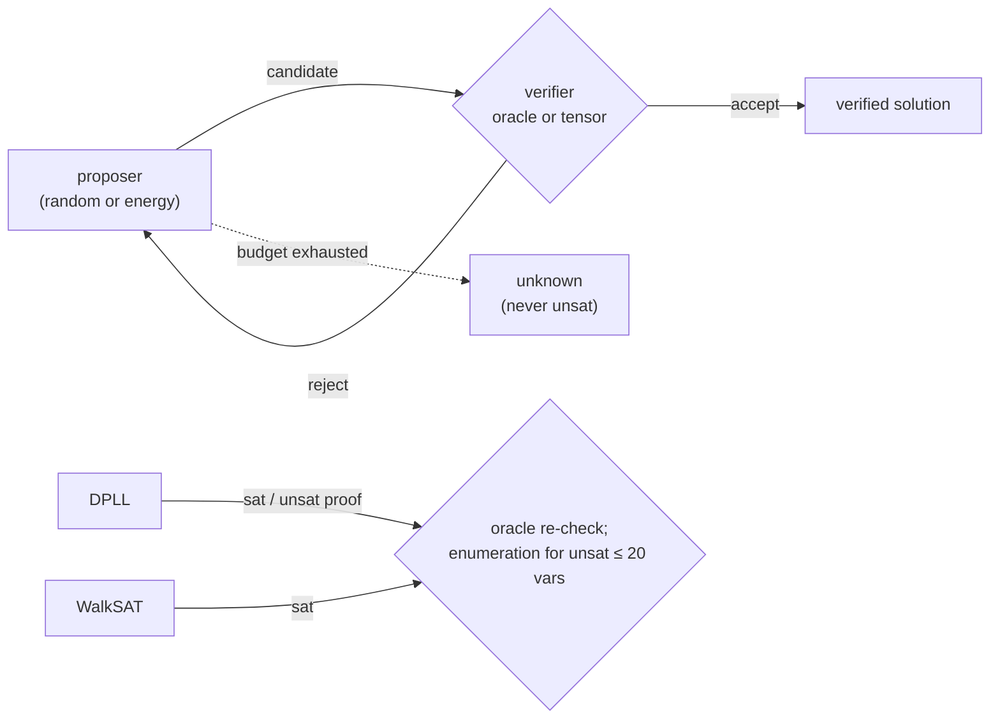

# E08 results: 3-SAT search with an exact verifier

> **TL;DR:** The compiled verifier matched the oracle on every in-range check, and energy proposals beat random guessing, but WalkSAT solved more instances in fewer steps.

In plain terms: a checker built from matrix multiplications gave the same verdict as plain code on 60,000 candidate solutions to logic puzzles, apart from one lowering pushed past its documented number-format limit, where it rejected some valid solutions. It never accepted an invalid one. A search that slides downhill on a smooth version of the puzzle proposed far better candidates than random guessing, and the matrix checker verified them 11 to 18 times faster than the plain-code checker. A standard local search, WalkSAT, still solved more puzzles with fewer steps. Only the complete solver, DPLL, ever declared a puzzle unsolvable.

## Question and hypothesis

> **TL;DR:** Does energy-based proposal generation, checked by an exact verifier, raise verified yield at a fixed budget?

[E08](../../EXPERIMENTS.md#e08---heuristic-search-with-an-exact-verifier) asks whether neural or energy-based candidate generation improves verified solution yield at a fixed budget. This run tests:

> A tensor verifier compiled from clause-literal incidence matrices implements [`cnf/v1`](../../src/latent_machines/machines/README.md#cnfv1) exactly within declared exact-integer limits; and gradient-descent proposals on a continuous relaxation of the clause energy, verified exactly, solve more random 3-SAT instances within a fixed step budget than random proposals and conventional search.

The first part held. The second held against random proposals and failed against WalkSAT.



## Evidence class

> **TL;DR:** One local run of finite conformance checks and a 40-instance search comparison; not independently reproduced.

Verifier results are local conformance on finite, declared workloads: every candidate is checked by the oracle and the tensor verifier, and verdicts (event, unsatisfied-clause count, first unsatisfied clause, work) are compared. Search results come from one seed, 10 instances per class, and fixed solver settings, so they are a small comparison, not a benchmark. The energy proposer's step size and noise were chosen from four settings on six planted 50-variable development instances drawn with a different seed.

## Setup

> **TL;DR:** Two lowerings in three dtypes on five workloads; six search arms on four instance classes, each limited to 20,000 steps per instance.

| Item | Value |
|---|---|
| Source | [`27c3655`](https://github.com/JGalego/latent-machines/commit/27c36559f3195440776ad2910ee99cb82d95325d), clean tree |
| Hardware | local Intel i7-1365U, 2 PyTorch threads, PyTorch 2.15.0+cpu; 188 s end to end, peak RSS 515 MB |
| Verifier backends | `incidence`: `count = P x + N (1 − x)`; `folded`: `count = (P − N) x + N 1`; accept iff every count ≥ 1 ([backend](../../src/latent_machines/backends/README.md#tensor-cnf-verifier)) |
| Declared limits | clause width ≤ the dtype's exact-integer range: 256 (bfloat16), 2048 (float16), 2^24 (float32) |
| Verifier workloads | 2,000 candidates each: random assignments on uniform formulas; planted solutions and their single-flip near misses (exactly one clause unsatisfied); every assignment of 3-10 variable formulas; malformed (short, long, out-of-range values); wide clauses of 300 or 513 literals ([generators](../../src/latent_machines/tasks/sat_instances.py)) |
| Instance classes | `planted-50` and `planted-100`: satisfiable by construction, ratio 4.2; `uniform-40`: ratio 4.26; `uniform-20-dense`: ratio 6.0; 10 instances each |
| Budget | 20,000 steps per instance: a variable assignment for DPLL, a flip for WalkSAT (noise 0.5), a verified candidate for proposers (32 per batch) |
| Search arms | DPLL (unit propagation, no clause learning); WalkSAT; random proposals + oracle; energy proposals (Langevin descent, step 1.0, temperature 0.02) + oracle, + tensor float32, + tensor bfloat16 |

## Verifier conformance

> **TL;DR:** Zero mismatches within declared limits; past bfloat16's range, the folded lowering rejected 119 valid assignments and accepted no invalid ones.

| Lowering | float32 | bfloat16 | float16 |
|---|---|---|---|
| incidence, four in-range workloads | exact | exact | exact |
| incidence, wide clauses | exact | exact (beyond declared limit) | exact |
| folded, four in-range workloads | exact | exact | exact |
| folded, wide clauses | exact | **mismatch**: 119 of 2,000 (beyond declared limit) | exact |

- 30 variants, 60,000 candidates checked: 0 mismatches in every variant within its declared limits, and 0 invalid assignments accepted anywhere. Residue (distance of any clause count from an integer) was 0 throughout.
- The workloads exercised every outcome. Across the five workloads, each lowering and dtype saw 1,366 accepts, 7,134 rejects, 500 value faults, and 1,000 length faults.
- **Folded, bfloat16, wide clauses.** All 119 mismatches rejected a valid assignment, typically one whose only true literal sat in a clause of 300 or more literals: the signed sum rounded that literal's 1 away. The incidence lowering, which adds only nonnegative terms, matched the oracle on the same candidates even beyond the declared limit, though its counts themselves are rounded there. Its decisions survive because a zero count stays zero and a positive count stays positive. Residue did not detect the folded failure, because bfloat16 rounds to other integers, not to fractions.
- The folded lowering stores about half the weights of the incidence lowering (918 versus 1,734 for a 51-clause random formula).

## Search at a fixed budget

> **TL;DR:** WalkSAT solved the most satisfiable instances; energy proposals solved 23 of the 28 known-satisfiable instances and random proposals none; only DPLL proved unsatisfiability.

Instances solved out of 10, with every claimed solution accepted by the oracle (123 claims, 0 invalid):

| Arm | planted-50 | planted-100 | uniform-40 | uniform-20-dense |
|---|---|---|---|---|
| DPLL | 10 | 8 (2 unknown) | 8, plus 2 proved unsatisfiable | 0, 10 proved unsatisfiable |
| WalkSAT | 10 | 10 | 8 (2 unknown) | 0 (10 unknown) |
| random + oracle | 0 | 0 | 0 | 0 |
| energy + oracle, + tensor float32, + tensor bfloat16 | 10 | 7 | 6 | 0 |

DPLL shows that `uniform-40` has 8 satisfiable instances, so WalkSAT solved all 8 and the energy proposer 6. The 10 DPLL unsatisfiability claims on 20-variable instances were confirmed by enumerating all 2^20 assignments; the 2 on 40-variable instances are unchecked. No other arm reported unsatisfiability: every budget exhaustion is recorded as `unknown`.

Median steps to a solution, over solved instances:

| Arm | planted-50 | planted-100 | uniform-40 |
|---|---|---|---|
| DPLL | 427 | 2,528 | 349 |
| WalkSAT | 147 | 328 | 121 |
| energy proposals | 384 | 2,715 | 2,398 |

Proposal quality, the mean number of unsatisfied clauses per verified candidate:

| Proposer | planted-50 (210 clauses) | planted-100 (420) | uniform-40 (170) | uniform-20-dense (120) |
|---|---|---|---|---|
| random | 26.3 | 52.5 | 21.3 | 15.0 |
| energy | 8.7 | 6.5 | 3.7 | 3.1 |

## Verification cost

> **TL;DR:** The same proposals, identical decisions; the tensor verifier cut verification time 11 to 18 times in float32, and 4 to 7 times in bfloat16, against the Python oracle.

The three energy arms made identical accept decisions on every candidate of all 40 instances (matching decision digests), so their solved counts and step counts are identical by construction; they differ only in verification time. Seconds summed over 10 instances:

| Class | Candidates verified | Oracle | Tensor float32 | Tensor bfloat16 | Proposal generation (float32 arm) |
|---|---|---|---|---|---|
| planted-50 | 5,224 | 0.38 | 0.03 | 0.07 | 0.14 |
| planted-100 | 92,607 | 15.71 | 0.87 | 2.12 | 4.25 |
| uniform-40 | 94,444 | 5.00 | 0.32 | 0.82 | 1.63 |
| uniform-20-dense | 200,000 | 8.94 | 0.82 | 2.13 | 4.39 |

With the tensor verifier, proposal generation, not verification, dominates the energy arms' time. bfloat16 verification was slower than float32 on this CPU. The oracle is a plain Python loop over clauses, not an optimized conventional verifier, so these ratios do not establish an advantage over optimized native code.

## Interpretation

> **TL;DR:** Better proposals and faster verification are separate effects; neither made energy descent competitive with WalkSAT here.

- **Better proposals.** Energy descent produced candidates with 3 to 8 times fewer unsatisfied clauses than random guessing, enough to solve 23 instances where random proposals solved none. That is a proposal effect, measured with the same verifier.
- **Faster verification.** At identical decisions, the compiled verifier was 11 to 18 times faster than the Python oracle in float32. That is a verification effect, and it does not change which instances are solved within a step budget.
- **Against conventional search.** WalkSAT solved all 28 known-satisfiable instances, in fewer median steps than the energy proposer, and DPLL also proved the unsatisfiable ones. Energy descent converging to low-energy candidates did not translate into global search efficiency at these sizes; harder or larger instances, learned proposers, or hybrid proposals were not tested.
- **Lowering matters.** Two algebraically equal lowerings diverged beyond the declared limit. The one without subtraction failed safe; the folded one failed by rejecting valid solutions, which would silently cost yield in search, though never soundness on these workloads.

## Limits

> **TL;DR:** Small random 3-SAT, one seed, untuned baselines, and a Python oracle as the timing reference.

- **Instances:** 40 random 3-SAT instances of 20-100 variables from one seed; no structured or industrial instances, and no larger sizes.
- **Baselines:** DPLL without clause learning and WalkSAT with fixed noise; no CDCL solver. The energy proposer's two settings were chosen on separate development instances; the baselines were not tuned.
- **Verification timing:** against a plain Python oracle, on CPU, with no batching across instances and no GPU.
- **Soundness of unsat claims:** confirmed by enumeration only for 20-variable instances.
- **Verifier conformance:** finite workloads; the folded lowering's failure was found only beyond its declared limit, but no test searched for the smallest failing width.

## Artifacts

> **TL;DR:** The manifest is here; the full run directory, with traces and the first failing candidate, is in the public Hub dataset.

The run manifest (`run.json`, `metrics.json`, including per-instance search rows) is in [`e08-20261118T020615Z-27c3655-bae4/`](e08-20261118T020615Z-27c3655-bae4/metrics.json). The full run directory adds `trace.jsonl` and `failure.json`, which holds the first folded-bfloat16 mismatch with its formula and assignment; it is in the public Hub dataset [`jgalego/latent-machines-runs`](https://huggingface.co/datasets/jgalego/latent-machines-runs) under `runs/`.

```bash
git checkout 27c3655 && uv sync --locked --extra torch-cpu
uv run --locked python -m latent_machines.experiments.e08
```

## Decision

> **TL;DR:** Keep the incidence lowering, record the negative search result, and test learned or hybrid proposals before any yield claim.

Record the compiled verifier as conforming within its declared limits, and the incidence lowering as the one to use: it needs twice the weights but failed safe beyond its range. Record that fixed energy-descent proposals did not beat WalkSAT at a matched step budget on these instances. Any later yield claim needs a learned or hybrid proposer, a CDCL baseline, and larger or structured instances.
