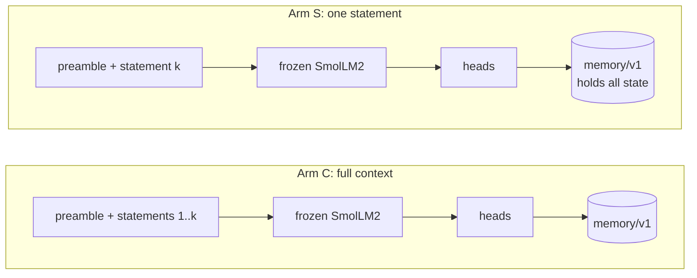

# E09: state in the machine, not the context

> **TL;DR:** A controller that read one statement at a time, with the machine holding the state, made no errors up to 256 statements where full-context controllers fell to 0.11-0.13. On statements it never trained on it was right 7 times out of 8, against 2 out of 8 for a random model.

E02: learned interfaces found that every controller got worse on programs longer than its training programs, while the machine stayed exact. E09: state in the machine asks whether that decline comes from reading a long context or from ordinary per-statement mistakes adding up. It comes from the context. When the same heads read each statement alone (arm S) and the machine remembered, they made no action errors on 2-8, 32, 64, or 256 statements, and every answer was correct. The full-context controllers, rerun on the same programs, fell from 0.87-0.89 to 0.11-0.13 at 256 statements.

Two of three pre-registered predictions held, one of them vacuously. The third failed. A follow-up on unseen statements, also pre-registered, met one of its three predictions as written and left another inconclusive.

## Question and design

> **TL;DR:** Same task, heads, and machine; only the controller's context changes, from the whole program to one statement.

[E09: state in the machine](../../EXPERIMENTS.md#e09---state-in-the-machine-not-the-context) uses the task of [E02: learned interfaces](../E02/README.md). Programs are statements like `Set c to 7.` and `What is c?` over 8 records of 4 bits on [`memory/v1`](../../src/latent_machines/machines/README.md#memoryv1). The model is a frozen [SmolLM2-135M](https://huggingface.co/HuggingFaceTB/SmolLM2-135M), with the trained heads of E02: learned interfaces.



| Arm | Context the model reads | Machine | Trainable parameters |
|---|---|---|---|
| B | Whole program, with text requests and replies (E02 arm B) | Integer oracle | 308,522 |
| C | Whole program (E02 arm C) | Integer oracle, typed interface | 317,290 |
| S | Preamble and the current statement, fresh each time | Integer oracle, typed interface | 317,290 |
| S+delta | S's trained heads | Delta-rule memory ([E00: memory](../E00/README.md)) with a shadow oracle | shared with S |
| W | Preamble and the current statement | None; the answer head sees only the question | 152,976 |

B, C, and the new 256-statement split ran in the same job, so every arm saw the same test programs. A statement's feature depends only on its own text and the preamble, so it is the same wherever the statement sits in a program.

## Evidence class

> **TL;DR:** Two GPU runs with three training seeds each, predictions evaluated as written, plus post-hoc random-model controls.

All arms share training and test programs, so comparisons are paired by program. Evaluation is free-running. The predictions and the compounding baseline were committed in [EXPERIMENTS.md](../../EXPERIMENTS.md#e09---state-in-the-machine-not-the-context) in [`d44e15b`](https://github.com/JGalego/latent-machines/commit/d44e15b), before the code existed. The held-out follow-up was committed in [`03e0b9d`](https://github.com/JGalego/latent-machines/commit/03e0b9d), before its code ran. The random-model control for the length splits was not pre-registered. This project ran everything; nothing was independently reproduced. Executor conformance is finite-test evidence, not proof.

## Setup

> **TL;DR:** Revision `c7d252a` for the length run, `9e279df` for the held-out run, one `l4x1` job each.

| Item | Length run | Held-out run |
|---|---|---|
| Source | [`c7d252a`](https://github.com/JGalego/latent-machines/commit/c7d252ac4ad26b7ffb8a407fd0a113e79bd28ea8), clean tree | [`9e279df`](https://github.com/JGalego/latent-machines/commit/9e279df1ff66e13a1bee7f5a8ab75d012b2d3d5b), clean tree |
| Model | SmolLM2-135M, revision `93efa2f`, frozen | same |
| Hardware | HF Jobs `l4x1`; heads and executors on the same job | same |
| Training | 2,000 programs of 2-8 statements, 30 epochs, hidden size 256, seeds 0-2, data seed 0 | same |
| Test splits | 2-8 statements (300 programs, 769 questions); 32 (100, 1,592); 64 (100, 3,216); 256 (100, 12,935) | 2-8 statements (769 questions); held-out pairs (300 programs, 604 questions) |

## Results: length

> **TL;DR:** S was exact at every length. B and C fell to about 0.11-0.13 at 256 statements. W matched the share of questions about unwritten records.

Task accuracy, mean over three seeds with the range in brackets:

| Arm | 2-8 statements | 32 statements | 64 statements | 256 statements |
|---|---|---|---|---|
| B | 0.871 [0.866, 0.875] | 0.389 [0.380, 0.394] | 0.224 [0.220, 0.228] | 0.111 [0.110, 0.113] |
| C | 0.893 [0.874, 0.908] | 0.461 [0.455, 0.470] | 0.286 [0.273, 0.293] | 0.134 [0.127, 0.144] |
| S | 1.000 [1.000, 1.000] | 1.000 [1.000, 1.000] | 1.000 [1.000, 1.000] | 1.000 [1.000, 1.000] |
| S+delta | 1.000 [1.000, 1.000] | 1.000 [1.000, 1.000] | 1.000 [1.000, 1.000] | 1.000 [1.000, 1.000] |
| W | 0.501 | 0.205 | 0.136 | 0.080 |

B and C match E02: learned interfaces to three decimals on the three shared splits, so this job ran the same training and evaluation. W is identical for all three seeds. Action accuracy is the share of statements whose action matched gold:

| Arm | 2-8 | 32 | 64 | 256 |
|---|---|---|---|---|
| B | 0.949 | 0.728 | 0.593 | 0.368 |
| C | 0.873 | 0.538 | 0.393 | 0.235 |
| S | 1.000 | 1.000 | 1.000 | 1.000 |

### Predictions for the length run

| # | Prediction | Result | Met |
|---|---|---|---|
| 1 | S minus C exceeds the conservative bound at 64 and 256 statements | +0.714 (bound 0.025) at 64; +0.866 (bound 0.012) at 256; every seed above +0.70 and +0.85 | yes |
| 2 | S within 0.05 of the compounding baseline at every length | difference 0.000 at every length; baseline 1.000 | yes, vacuous |
| 3 | W at or below 0.15 on every split | 0.501 at 2-8, 0.205 at 32, 0.136 at 64, 0.080 at 256 | **no** |
| check | S's action accuracy constant across lengths (drift under 0.03) | drift 0.000 | ok |
| check | zero executor mismatches | 0 for S+delta on every split and seed | ok |

- **Prediction 2 is vacuous.** S made no action error on the 2-8 split, so ε = 0. The answer head, given the gold observation, scored a = 1.000. The replay baseline is 1.000 at every length and constrains nothing. The experiment could not test whether S's errors would compound independently.
- **Prediction 3 failed as written.** The pre-registered reading of a failure is that the answer head recovers state from the question alone, so the task leaks and the comparison is invalid. The data point to a ceiling set too low. W's accuracy equals, to four decimals on every split, the share of questions about records that were never written, where the correct answer is the initial value 0 (0.5007, 0.2048, 0.1359, 0.0802, computed from the test programs). W is identical across seeds and falls with length exactly as that share does. It never recovers a written value. About half the questions on 2-8 statement programs concern unwritten records, and I did not account for that when I set 0.15. This reading is mine and was made after seeing the result. The prediction stands as not met. S beats W by 0.50 at 2-8 statements, so the comparison still separates the machine from the question text.

### Random-model control for the length splits

> **TL;DR:** The same pipeline on a random 29,000-parameter model with no pretraining reached 0.85-0.94, so most of S's result is a lookup, and the baseline becomes informative.

I reran the unchanged runner at the same commit on CPU with `tiny-random`, a frozen random 2-layer Llama with hidden size 32 and a byte tokenizer that has seen no text. It was not pre-registered, ran after the main results, and used one seed and 20 programs per long split (303, 640, and 2,543 questions), so only the contrasts mean anything:

| Arm | 2-8 | 32 | 64 | 256 |
|---|---|---|---|---|
| B | 0.492 | 0.135 | 0.097 | 0.088 |
| C | 0.553 | 0.211 | 0.147 | 0.082 |
| S | 0.938 | 0.888 | 0.847 | 0.865 |
| W | 0.501 | 0.195 | 0.128 | 0.083 |
| Compounding baseline | 0.947 | 0.892 | 0.882 | 0.867 |

- S's action accuracy was 0.940, 0.930, 0.937, and 0.937 across lengths, so ε = 0.060 and a = 1.000. S stayed 0.002 to 0.035 from the baseline, inside the pre-registered 0.05, and the delta-rule arm matched S with zero mismatches. With a controller that makes mistakes, prediction 2 holds non-vacuously: errors accumulate as the replay predicts and do not grow with position.
- Prediction 1 also holds (S minus C = +0.700 at 64 and +0.783 at 256; bounds 0.056 and 0.028).
- A model with no pretraining comes within 0.06 of SmolLM2's S on 2-8 statements, and its full-context arms fall as steeply.
- Record: [controls/e09-20261125T093316Z-c7d252a-28de](controls/e09-20261125T093316Z-c7d252a-28de/), local CPU, no cost.

### Model positions

Maximum positions in one forward pass. B and C use the gold transcript, so these are lower bounds for a free-running B.

| Arm | 2-8 | 32 | 64 | 256 |
|---|---|---|---|---|
| B | 132 | 472 | 911 | 3,556 |
| C | 59 | 192 | 359 | 1,383 |
| S, S+delta, W | 17 | 17 | 17 | 17 |

S reads about 17 positions per window at any length. Its total positions per program grow linearly, to 3,878 on average at 256 statements against 1,328 for C. It uses more total model work than C, in shorter windows.

## Results: unseen statements

> **TL;DR:** S chose the right action for 7 of the 8 unseen statements in every seed and scored 0.98 on the held-out-pairs split, against 0.83 for C. The prediction of at least 0.90 was not met.

The length run could not tell reading from lookup, because the training programs contain all 128 distinct statement texts the test programs use. The follow-up tests the 8 statements that never appeared in training: `Set g to 12.` through `Set h to 15.` (record g or h with a value from 12 to 15). The held-out-pairs split has programs with at least one of them. Training is the same as before. All values are means over three seeds:

| Arm | 2-8, task | Held-out pairs, task | Held-out pairs, action |
|---|---|---|---|
| B | 0.871 | 0.727 [0.720, 0.740] | 0.920 |
| C | 0.893 | 0.827 [0.825, 0.831] | 0.770 |
| S | 1.000 | 0.982 [0.982, 0.982] | 0.977 |
| S+delta | 1.000 | 0.982 [0.982, 0.982] | 0.977 |
| W | 0.501 | 0.412 | none |

Action accuracy of S's heads on single statements, computed from each statement's text alone, per seed 0, 1, 2:

| Statements | SmolLM2 | Random model |
|---|---|---|
| 8 unseen | 0.875, 0.875, 0.875 | 0.250, 0.375, 0.125 |
| 128 seen | 1.000, 1.000, 1.000 | 0.875, 0.797, 0.836 |

The random-model runs were three single-seed CPU runs with the same settings, so they cover the same programs and statements. Their held-out-pairs task accuracy for S was 0.741 [0.694, 0.775], against 0.440 for C.

### Predictions for the held-out run

| # | Prediction | Result | Met |
|---|---|---|---|
| 1 | SmolLM2's S gets at least 0.90 of the 8 unseen statements right | 0.875 (7 of 8, every seed) | **no, inconclusive** |
| 2 | S minus C on held-out pairs exceeds the bound | +0.155 (per seed +0.156, +0.151, +0.157; bound 0.058) | yes |
| 3 | SmolLM2's S beats the random model's S on unseen statements by more than 0.10 | 0.875 against 0.250, a difference of 0.625 | yes |
| check | S gets at least 0.99 of the 128 seen statements right | 1.000 | ok |
| check | zero executor mismatches | 0 | ok |

- **Prediction 1 needed 8 of 8.** With 8 statements, 0.875 is the highest score below 0.90. The pre-registered rule says a result between 0.50 and 0.90 is inconclusive, not support. It is not below 0.50, so it does not count as memorization. Each seed got 7 of 8. The record does not say which statement failed or whether it was the same one in each seed.
- **Reading, as far as the data show.** S generalizes to most unseen statements. A model without pretraining gets 2 of 8. The pretrained features seem to carry enough of "record" and "value" to compose a new pair, but not perfectly. This is my reading, not a tested mechanism.

## Interpretation

> **TL;DR:** The length decline in E02 comes from reading long contexts. A bounded-window controller reads most unseen statements correctly, so the result is not only a lookup.

- **Where E02's long-program loss comes from.** The same heads, task, and machine make no mistakes when each statement is read alone. The decline of B and C with length is therefore not a limit of the machine, the typed interface, or the head architecture. It appears when the model must pick out a statement's action inside a long context. This supports the thesis that state belongs in the machine, in this setting.
- **How much is lookup.** On the 128 trained statements S is exact, and a random model gets 0.80 to 0.88 of them right. So part of the length result is a lookup that almost any features can learn. On the 8 unseen statements SmolLM2 is far ahead of the random model (0.875 against 0.250), so pretraining adds something real. The remaining gap to 8 of 8 is one statement.
- **What the compounding baseline showed.** With SmolLM2 it showed nothing, because ε = 0 makes it flat at 1.000. With the random model, where ε = 0.06, S tracked the baseline within 0.035 at every length. That is weak evidence (one seed, small splits) that errors from a bounded window compound independently and do not grow with position.
- **Cost of the design.** S's model work grows linearly with program length, and it needs no context beyond one statement. It assumes that every statement can be read without earlier ones. This task has that property by construction. Tasks where a statement depends on earlier statements, such as references and pronouns, are not measured.

## Costs

> **TL;DR:** About $2.19 on GPU: $1.97 for the length run and $0.22 for the held-out run. The controls ran on local CPU.

- Length run, HF job [`6b062c26…`](https://huggingface.co/jobs/jgalego/6b062c261460ffe1d5e9650b): 8,860 s running on `l4x1` at $0.80/h, about $1.97. B on the 256-statement split took 1,972 s per seed (about 342,000 sequential model positions). C and S took about 5.5 s on the same split because their features are computed once per statement. Peak memory 2,225 MB RSS.
- Held-out run, HF job [`6b06bafb…`](https://huggingface.co/jobs/jgalego/6b06bafb1460ffe1d5ea73ba): 979 s running on `l4x1`, about $0.22, with a 2-hour timeout and a worst case of $1.60. Peak memory 2,053 MB RSS.

## Limits

> **TL;DR:** One small frozen model, one task of independent statements, eight unseen statements, and single runs.

- **Eight unseen statements.** The unseen-statement result is a count out of 8 per seed, and which statement fails is not recorded. The three seeds differ only in the heads' initialization, so they are not independent evidence about the same 8 statements.
- **Independent statements.** Each statement can be read without the earlier ones. References, pronouns, and phrasing that varies are not tested.
- **Gold observation.** The answer head receives the machine's read reply, as in arm C of E02, so answering is a copy and a = 1.000 follows.
- **Prediction 2 was vacuous** in the recorded run. The random-model control that replaces it is post-hoc, with one seed and 20 programs per long split.
- **Free-running B.** B's positions use the gold transcript, not the free-running one.
- **Preamble in the window.** Each S window is the preamble plus the statement, not the statement alone.
- **Scope.** One frozen 135M model, one training recipe, heads only, three seeds, no unfrozen or larger-model baseline.
- **Deviations from the pre-registration.** The 256-statement split has 100 programs. The value a is the answer head's accuracy given the gold observation on the 2-8 questions, not task accuracy on correct-action questions. S+delta ran unconditionally rather than after S passed. The held-out-pairs split was dropped from the first run and added in the follow-up. Each is recorded in a [dated amendment](../../EXPERIMENTS.md#amendment-2026-11-25-first-run).

## Artifacts

> **TL;DR:** Manifests are here; full run directories are in the public Hub dataset.

Manifests (`run.json`, `metrics.json`):

- length run: [e09-20261125T003100Z-c7d252a-bd6a](e09-20261125T003100Z-c7d252a-bd6a/), Hub commit `af0e7609`
- held-out run: [e09-heldout-20261125T104355Z-9e279df-dc9c](e09-heldout-20261125T104355Z-9e279df-dc9c/), Hub commit `424725d7`
- random-model controls, local CPU: [controls/](controls/), one record for the length splits and three single-seed records for the held-out run

The full run directories, with traces, are in the public Hub dataset [`jgalego/latent-machines-runs`](https://huggingface.co/datasets/jgalego/latent-machines-runs) under `runs/`. The controls' full directories are local only.

```bash
git checkout c7d252a && uv sync --locked --extra torch-cuda --extra lm
uv run --locked python -m latent_machines.experiments.e09 --device cuda
git checkout 9e279df
uv run --locked python -m latent_machines.experiments.e09 --held-out --device cuda
uv run --locked python -m latent_machines.experiments.e09 --held-out --model tiny-random --seeds 0 --threads 1   # also seeds 1 and 2
```

## Decision

> **TL;DR:** Record that long context causes the length loss, and that S generalizes to most unseen statements. Next, a task where statements depend on each other.

The acceptance criteria are met: zero executor mismatches, S's action accuracy constant across lengths, and predictions 1 and 2 held in the length run. Prediction 3 failed as written and is recorded as failed. In the follow-up, prediction 1 was inconclusive by its own rule, and predictions 2 and 3 held. Next steps, not run:

- A statement language with varied phrasing and references to earlier statements. It would make ε nonzero for SmolLM2 and test the compounding baseline properly, and it is the setting where a bounded window should cost something.
- More unseen statements per seed, so the unseen-statement accuracy rests on more than 8 items.
- [E10: machine layer](../../EXPERIMENTS.md#e10---a-machine-layer-inside-the-model) and [E11: learning from outcomes](../../EXPERIMENTS.md#e11---learning-to-use-the-machine-from-outcomes) wait on these. E10 must still beat arms S and H of E03: latent feedback.
