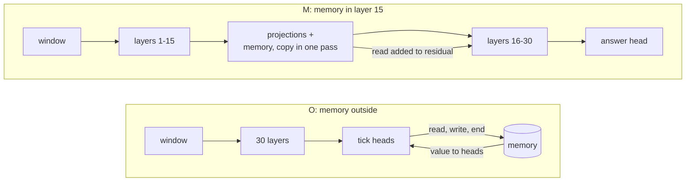

# E10: machine layer

> **TL;DR:** A delta-rule memory inside layer 15 of a frozen SmolLM2 answered every copy-program question correctly, as did the same memory with the read going to the answer head. The outside machine was as good on every length split and trailed by 0.026 on unseen statements. All five predictions held. The accuracy tests were at their ceiling, so this shows parity, not a benefit of putting the memory in the layer. A reject macro learned the invalid statements it was trained on and rejected only 70% of unseen invalid forms.

[E10: machine layer](../../EXPERIMENTS.md#e10---a-machine-layer-inside-the-model) asks whether a memory that lives in a layer of the model, written and read by trained projections of the residual stream, matches the same memory reached through heads. It does, within the resolution of this task. The in-layer memory matched an integer oracle after every statement of every test program, with no mismatch. Both in-layer arms scored 1.000 on 2-8, 32, 64, and 256 statements and on the held-out-pairs split. The outside arm scored 1.000 on the first four and 0.974 on the held-out pairs.

The comparison cannot show an advantage. Every arm was at ceiling on the length splits, so predictions 1 and 2 check non-inferiority and equivalence, not a gain. A second test asked whether the layer can reject invalid commands. It rejected all of the invalid statement forms it was trained on and 70% of the unseen ones. It treated the other 30% as valid statements and wrote to memory.

## Question and design

> **TL;DR:** Same model, task, windows, and supervision. The arms differ in where the memory lives and how a read reaches the answer.

The task is `Copy x to y.` plus the record statements of [E02: learned interfaces](../E02/README.md), as in [E03: latent feedback](../E03/README.md) ([task](../../src/latent_machines/tasks/copies.py)). A copy reads `x` and writes the value read to `y`. As in [E09: state in the machine](../E09/README.md), the frozen [SmolLM2-135M](https://huggingface.co/HuggingFaceTB/SmolLM2-135M) reads the preamble plus one statement per forward pass, so the machine is the only carrier of state.



| Arm | Memory | How a read reaches the answer | Trainable parameters |
|---|---|---|---|
| O | Outside; tick heads on the last layer, typed feedback (E03 arm H on windows) | Typed value to the heads | 328,235 |
| M | In layer 15; a macro (`set`, `get`, `copy`), two records, and a value from the residual stream, one-hot by straight-through argmax; an 8×16 one-hot matrix updated by delta replacement | Projected to model width and added to the residual stream; the answer head reads layer 30 | 320,051 |
| Mh | As M | Embedded value to the answer head; the residual stream does not see it | 319,603 |
| M-reject | As M, with a `reject` macro | As M | 320,308 |

The counts of O, M, and Mh differ by 2.6%, inside the 5% the pre-registration set. O has more training steps (2,700 against 1,200) because it trains on tick rows, including one `end` decision per statement.

Every arm trains on gold actions and gold answers. In M and Mh the memory state used in training follows the gold actions; the straight-through gradient reaches the record projection through the read address of questions. The in-layer memory is the delta rule `S − β(Sk)kᵀ + βvkᵀ` with a one-hot key and β = 1, which replaces one column and leaves the others alone. In evaluation every arm runs free-running on its own choices.

`M-reject` trains on invalid statements as well, each labelled `reject`: records `i` to `k` (`Set i to 3.`, `What is j?`, `Copy a to k.`) and values 16-31 (`Set a to 20.`). 182 of those 227 texts are trained on and 45 are held out. The unseen test forms are record `l` (33 texts) and values 32-47 (128 texts).

## Evidence class

> **TL;DR:** One GPU run, three training seeds, predictions evaluated as written, one deviation in what O's model passes mean.

The predictions were committed in [EXPERIMENTS.md](../../EXPERIMENTS.md#e10---a-machine-layer-inside-the-model) in [`fcc2645`](https://github.com/JGalego/latent-machines/commit/fcc2645), before the code existed. Arms share training and test programs, so comparisons are paired by program. The runner evaluates each prediction in code. The tests and the first run both used the committed code. Nothing was tuned after a result, and there are no post-hoc runs. This project ran it and nobody has reproduced it independently. The in-layer and executor checks are conformance evidence on these programs, not proof.

## Setup

> **TL;DR:** Revision `0d966c6`, one `l4x1` job of 785 s, layer 15 of 30.

| Item | Value |
|---|---|
| Source | [`0d966c6`](https://github.com/JGalego/latent-machines/commit/0d966c634ac8053b42b32282dbf25abf309b6f15), clean tree |
| Model | SmolLM2-135M, revision `93efa2f`, frozen; machine after layer 15 of 30 |
| Hardware | HF Jobs `l4x1` (NVIDIA L4, CUDA 13.2, PyTorch 2.15.0); heads and executors on the same job |
| Training | 2,000 copy programs of 2-8 statements without the held-out pairs, 30 epochs, hidden size 256, learning rate 1e-3, batch 256, seeds 0-2, data seed 0 |
| Test splits | 2-8 statements (300 programs, 471 questions); 32 (100, 937); 64 (100, 1,920); 256 (100, 7,716); held-out pairs (300, 436) |
| Held-out pairs | `Set g to 12.` through `Set h to 15.` never appear in training; the held-out split has at least one in every program |
| Executors | Delta-rule backend with a shadow oracle for every arm; the in-layer memory is also decoded and compared with an oracle after every statement |

## Results

> **TL;DR:** Every in-layer arm was exact on every split. O was exact up to 64 statements, made a few errors at 256 (0.9996), and trailed on the held-out pairs.

Task accuracy, mean over three seeds with the range in brackets:

| Arm | 2-8 | 32 | 64 | 256 | Held-out pairs |
|---|---|---|---|---|---|
| O | 1.000 | 1.000 | 1.000 | 0.9996 [0.999, 1.000] | 0.974 [0.959, 0.982] |
| M | 1.000 | 1.000 | 1.000 | 1.000 | 1.000 |
| Mh | 1.000 | 1.000 | 1.000 | 1.000 | 1.000 |
| M-reject | 1.000 | 1.000 | 1.000 | 1.000 | 1.000 |

Action accuracy is the share of statements whose actions matched gold. It is 1.000 for M, Mh, and M-reject everywhere. For O it is 1.000 on 2-8, 32, and 64 statements, 1.000 at 256 (0.9996-0.9999), and 0.961 on the held-out pairs (0.944, 0.968, 0.970 by seed).

### Predictions

> **TL;DR:** All five held, and the sanity checks passed.

| # | Prediction | Result | Met |
|---|---|---|---|
| 1 | M at least O minus 0.02 on 2-8, 32, 64, 256 | M minus O is 0.000, 0.000, 0.000, and +0.0005 | yes |
| 2 | M and Mh differ by no more than the bound on every split | 0.000 on every split; bounds 0.065, 0.046, 0.032, 0.016, 0.068 | yes |
| 3 | In-layer state equals the oracle, zero mismatches | 0 over all splits, seeds, and statements | yes |
| 4 | M-reject rejects at least 0.95 of trained-form invalid statements, falsely rejects at most 0.01 of valid ones | 1.000 on the 45 held-out texts in every seed; false rejection 0.000 over all 192 valid texts | yes |
| 5 | M-reject rejects under 0.95 of invalid statements with the unseen record and values | 0.698 pooled | yes |
| check | O at least 0.95 on 2-8; zero executor mismatches for O and Mh; parameters within 5% | 1.000; 0 and 0; 2.6% | ok |

Predictions 1 and 2 are met because everything is at ceiling. They show that M is not worse than O and not different from Mh, and nothing more.

### Validity test

> **TL;DR:** M-reject rejected every trained form and every held-out text of a trained form. It rejected 34% of statements about the unseen record `l` and 79% of the unseen values.

Share of each group rejected, by seed (0, 1, 2) and mean:

| Group | Texts | Seed 0 | Seed 1 | Seed 2 | Mean |
|---|---|---|---|---|---|
| Trained forms, trained on | 182 | 1.000 | 1.000 | 1.000 | 1.000 |
| Trained forms, held out | 45 | 1.000 | 1.000 | 1.000 | 1.000 |
| Unseen record `l` | 33 | 0.394 | 0.303 | 0.333 | 0.343 |
| Unseen values 32-47 | 128 | 0.805 | 0.734 | 0.828 | 0.789 |
| Unseen, pooled | 161 | 0.720 | 0.646 | 0.727 | 0.698 |
| Valid statements (all 192) | 192 | 0.000 | 0.000 | 0.000 | 0.000 |
| Unseen valid (the 8 held-out pairs) | 8 | 0.000 | 0.000 | 0.000 | 0.000 |

A statement the layer did not reject was treated as valid. The layer has 8 record outputs and 16 value outputs, so `Set l to 3.` becomes a write to some record, and `Set a to 40.` a write of some value from 0 to 15. The memory is never put in an invalid state. The instruction that reached it was wrong, and nothing flagged it. An outside host check that compares the address and value with the machine's limits rejects all of these by construction.

### Cost of control

> **TL;DR:** M uses one controller decision per statement where O uses 2.3, and the same number of model positions.

| Split | Statements | Copies | O decisions | M decisions | Machine actions (all arms) |
|---|---|---|---|---|---|
| 2-8 | 1,561 | 454 | 3,576 | 1,561 | 2,015 |
| 256 | 25,600 | 7,665 | 58,865 | 25,600 | 33,265 |

O decides read, write, and `end` for a copy: three decisions. M issues the copy as one macro. Model positions are identical across arms, since every arm reads the same windows: at most 17 positions per pass and 79 per program at 2-8 statements. The in-layer arms do not use fewer model passes than O. The pre-registration's table said 2 passes per copy for O. That was wrong for this implementation: O reuses each statement's feature for both ticks, as E03's arm H does. What M saves is controller decisions, not model passes.

## Interpretation

> **TL;DR:** An exact in-layer memory is feasible here. Whether it beats an outside one is untested, because the task was solved by both.

- **Feasibility.** Trained projections of a mid-layer residual stream choose and execute macros on a delta-rule memory, and the memory matched the oracle after every one of about 115,000 statements. The read re-entering the residual stream (M) and going to the head (Mh) gave the same accuracy. This matches E03: latent feedback, where feedback through the model added little to what the heads already had.
- **No benefit shown.** M beat O only on the held-out pairs (+0.026, seeds +0.018, +0.041, +0.018; bound 0.068, so within it, and not a prediction). O's errors there are unseen statements it chose the wrong action for. M and Mh read layer-15 features of the same statements and did not err. The comparison does not separate where the memory lives from which layer the features come from, so this is not evidence for the in-layer machine.
- **Validation.** Trained invalid forms are rejected perfectly, and a form not in training is rejected well under the pre-registered 0.95. A learned reject macro shows the failure that [E02: learned interfaces](../E02/README.md) left untested: the layer silently acts on a command outside its address space. Host-side checks remain necessary.

## Costs

> **TL;DR:** About $0.17 on a GPU job; the cap was $1.20.

- HF job [`6b06edf3…`](https://huggingface.co/jobs/jgalego/6b06edf3d91f621b930804bb): 785 s running on `l4x1` at $0.80/h, about $0.17, with a 90-minute timeout (worst case $1.20). Training took 175-179 s per seed for all four arms. Peak RSS 1.9 GB.
- A local CPU smoke run with the real model was started and stopped, since it was too slow on shared CPUs. The job was launched after the tiny-model tests passed.

## Limits

> **TL;DR:** A ceiling task, one layer, one model, teacher-forced training of the memory, and an unseen-form test that measures one kind of generalization.

- **Ceiling.** All in-layer arms scored 1.000 and O nearly so. A harder task is needed to show a difference between the arms, such as statements with varied phrasing or references to earlier statements, where a statement's meaning depends on state.
- **One layer.** The machine sits after layer 15 of 30. Other depths, or several machine layers, were not tried.
- **Teacher-forced memory.** In training the memory follows gold actions. Only the read address is trained through the straight-through path. Learning the whole loop from outcomes is [E11: learning from outcomes](../../EXPERIMENTS.md#e11---learning-to-use-the-machine-from-outcomes).
- **Cached evaluation.** Evaluation runs the in-layer machine on cached layer-15 features and one forward pass per distinct question and read. A test checks that a live single-pass run with the machine inside the hook gives the same actions, state, and read as the cached path, and that a copy takes one hook call.
- **Validity test.** The unseen forms are one new record letter and one new value range. Other kinds of invalid statement were not tried. Rejection of trained forms is tested on held-out texts of those forms, not on new forms.
- **Parameter matching.** O and the in-layer arms differ in structure, so equal counts do not mean equal capacity, and their step counts differ.
- **Deviations from the pre-registration.** O's model passes equal M's, not twice as many (above). Prediction 2 is evaluated on all five splits, including the held-out pairs. Prediction 5 is evaluated on the pooled unseen texts, with the two kinds reported separately.

## Artifacts

> **TL;DR:** The manifests are here; the full run directory is in the public Hub dataset.

Manifest (`run.json`, `metrics.json`): [e10-20261125T141851Z-0d966c6-f57c](e10-20261125T141851Z-0d966c6-f57c/), Hub commit `19364658`. The full directory, with the trace of the first three programs per arm, is in [`jgalego/latent-machines-runs`](https://huggingface.co/datasets/jgalego/latent-machines-runs) under `runs/`.

```bash
git checkout 0d966c6 && uv sync --locked --extra torch-cuda --extra lm
uv run --locked python -m latent_machines.experiments.e10 --device cuda
uv run --locked python -m latent_machines.experiments.e10 --model tiny-random --train 40 --test 6 --long-test 2 --epochs 2 --seeds 0 --hidden 16   # smoke
```

## Decision

> **TL;DR:** Record that an exact in-layer memory works and that learned validation does not replace the host check. A task that separates the arms comes next.

The acceptance criteria are met: all five predictions and the sanity checks held, and the in-layer memory and the delta-rule backend had no mismatch. The result is parity on a task that every arm solves. Next steps, not run:

- A task with statements that depend on state and vary in phrasing, so the arms can differ, shared with the next follow-up of [E09: state in the machine](../E09/README.md).
- The same arms at other layers, to separate where the machine sits from which features the heads read.
- A held-out-pairs run with more unseen statements, since O's deficit rests on 8 unseen statements.
