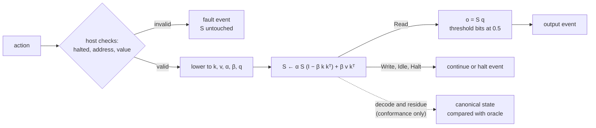

# Backends

> **TL;DR:** Ways to run a machine, each checked step by step against its reference.

Implementations of machine semantics, validated step by step against the integer oracles in [machines/](../machines/). See [ownership boundaries](../../../EXPERIMENTS.md#ownership-boundaries).

## Delta-rule memory

> **TL;DR:** Memory stored inside a neural layer's math: one column per slot, one row per bit.

[delta.py](delta.py) stores [`memory/v1`](../machines/README.md#memoryv1) in a Gated DeltaNet state matrix `S` of shape `(word_bits, capacity)`: one column per slot, one row per bit. The module docstring is the authoritative description.

Every valid action runs one recurrence step with gates at their endpoints:

| Action | Key `k` | Value `v` | `α` | `β` | Query `q` |
|---|---|---|---|---|---|
| `Write(a, x)` | one-hot `a` | bits of `x` | 1 | 1 | none |
| `Read(a)` | zero | zero | 1 | 0 | one-hot `a` |
| `Idle`, `Halt` | zero | zero | 1 | 0 | none |

Conformance requires zero residue: every entry of `S` is exactly 0 or 1, so thresholding never hides drift. Normalization variants, non-endpoint gates, multi-hot keys, and chunked or fused kernels are separate backends to measure, not options of this one.
