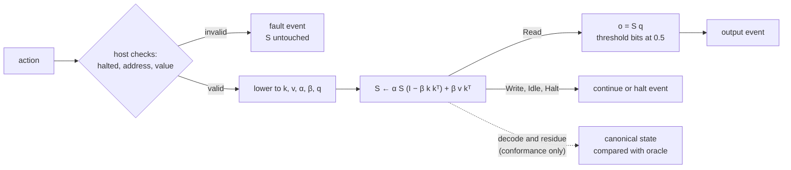
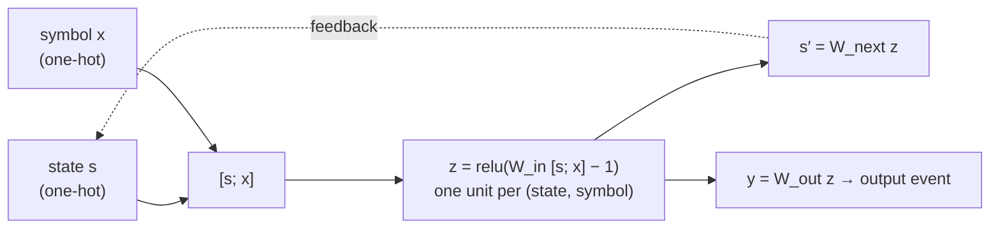
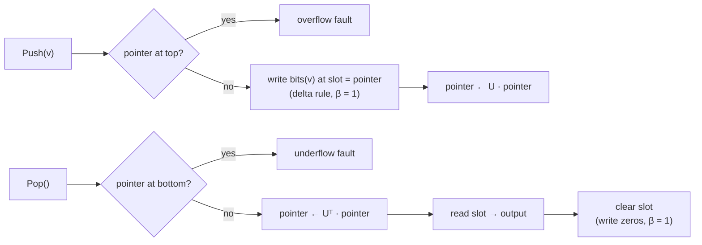
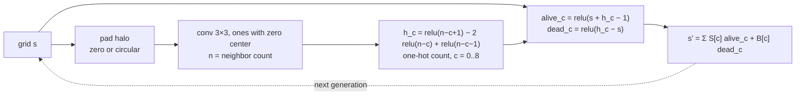

# Backends

> **TL;DR:** Ways to run a machine, each checked step by step against its reference.

Implementations of machine semantics, validated step by step against the integer oracles in [machines/](../machines/). See [ownership boundaries](../../../EXPERIMENTS.md#ownership-boundaries).

## Delta-rule memory

> **TL;DR:** The delta-rule backend stores memory in a state matrix, with one column per slot and one row per bit.

[delta.py](delta.py) stores [`memory/v1`](../machines/README.md#memoryv1) in a Gated DeltaNet state matrix `S` of shape `(word_bits, capacity)`: one column per slot, one row per bit. The module docstring is the authoritative description.

Every valid action runs one recurrence step with gates at their endpoints:

| Action | Key `k` | Value `v` | `α` | `β` | Query `q` |
|---|---|---|---|---|---|
| `Write(a, x)` | one-hot `a` | bits of `x` | 1 | 1 | none |
| `Read(a)` | zero | zero | 1 | 0 | one-hot `a` |
| `Idle`, `Halt` | zero | zero | 1 | 0 | none |

Conformance requires zero residue: every entry of `S` is exactly 0 or 1, so thresholding never hides drift. Normalization variants, non-endpoint gates, multi-hot keys, and chunked or fused kernels are separate backends to measure, not options of this one.

## ReLU lookup circuit

> **TL;DR:** A two-layer ReLU network computes the next state and output from a compiled transition table.

[lookup.py](lookup.py) compiles a [`transducer/v1`](../machines/transducer.py) table into a ReLU network with explicit feedback. Hidden unit `(i, a)` fires only when the state is `i` and the symbol is `a`; its outgoing weights select the next state and the output.

Every intermediate is 0, 1, or 2, so the circuit is exact in float32, float64, bfloat16, and float16. Width is `states × symbols`, depth is 2, and each unit has four nonzero weights. Smooth activations such as SwiGLU are a separate construction, not an option of this one.

## Delta-rule stack

> **TL;DR:** The stack combines delta-rule memory with a one-hot depth pointer moved by shift matrices.

[delta_stack.py](delta_stack.py) stores [`stack/v1`](../machines/stack.py) in a delta-rule matrix, one column per slot, plus a one-hot depth pointer moved by shift matrices. Overflow and underflow come from the pointer's last and first entries, read from the tensor.

Clearing on pop keeps freed slots at zero, so the live tensors always equal a freshly encoded snapshot. Tests require this at every step.

## Convolution plus lookup for cellular rules

> **TL;DR:** A 3x3 convolution counts neighbors and a small ReLU circuit turns each count into the next cell value.

[cellular.py](cellular.py) compiles a [`cellular/v1`](../machines/cellular.py) rule into whole-grid layers. A one-cell halo is padded (zeros, or wrapped for a torus), a convolution with a ones kernel counts neighbors, and hat functions of ReLUs turn each count into a one-hot vector that the rule's birth and survival weights read.

Every intermediate is an integer from −8 to 9, so the circuit is exact in float32, float64, bfloat16, and float16. `TorchIntCellular` in the same file is the conventional integer baseline. Both count the population for the output event in int64 after thresholding.

## Diagonal SSM for linear filters

> **TL;DR:** A linear filter rewritten as independent complex modes, run one sample at a time or in chunks.

[ssm.py](ssm.py) implements [`lds/v1`](../machines/lds.py) three ways: `DirectLDS`, the dense recurrence; and `DiagonalSSM`, which diagonalizes `A` once in float64 and runs the modes `z ← λ z + b u` either sequentially or in chunks with a lower-triangular kernel of powers of `λ`. Complex arithmetic uses separate real and imaginary tensors, so bfloat16 works. None of these is exact; each is measured against the float64 reference under a declared tolerance.
