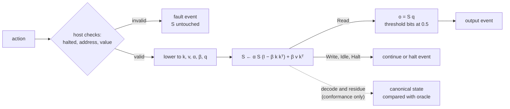
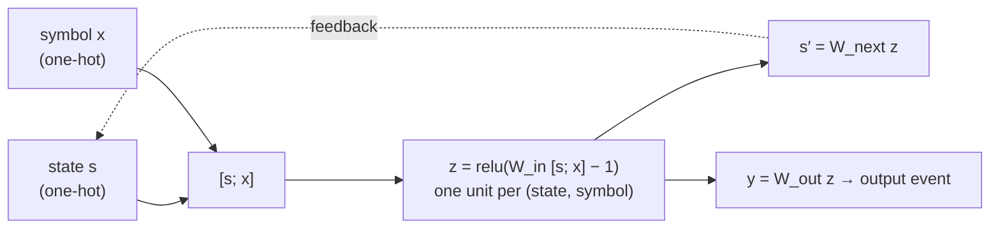
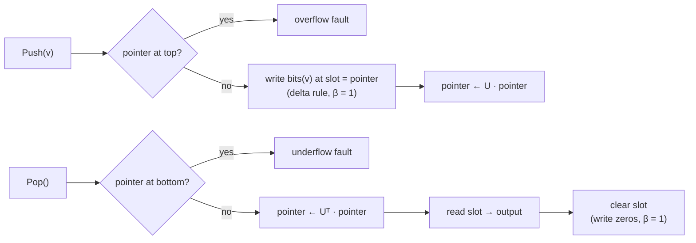
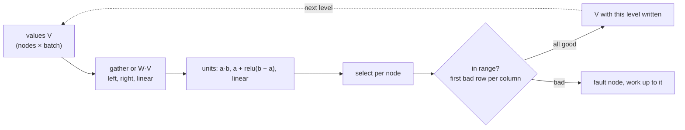
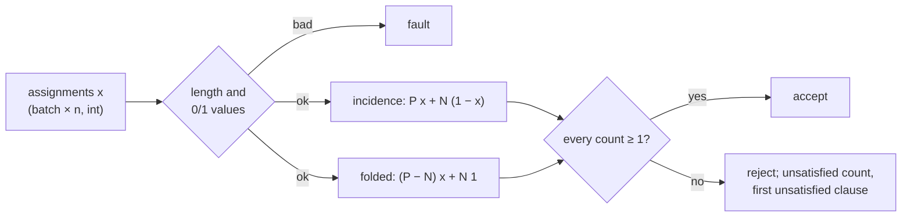
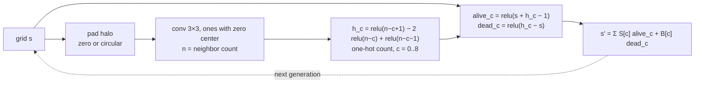
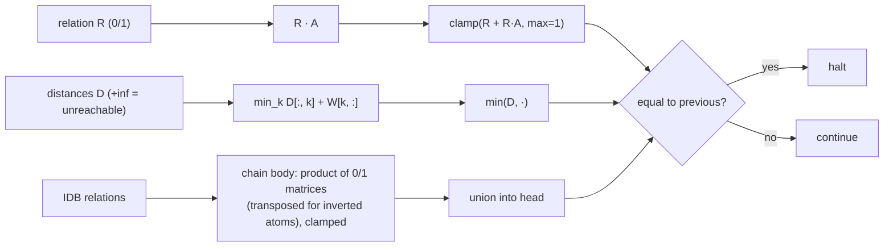
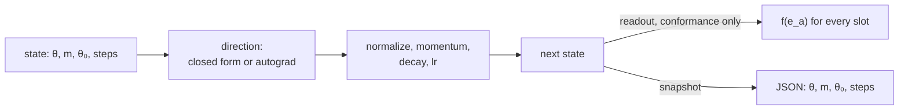

# Backends

> **TL;DR:** Ways to run a machine, each checked step by step against its reference.

Implementations of machine semantics, validated step by step against the integer oracles in [machines/](../machines/). See [ownership boundaries](../../../EXPERIMENTS.md#ownership-boundaries).

## Delta-rule memory

> **TL;DR:** The delta-rule backend stores memory in a state matrix, with one column per slot and one row per bit.

[delta.py](delta.py) stores [`memory/v1`](../machines/README.md#memoryv1) in a Gated DeltaNet state matrix `S` of shape `(word_bits, capacity)`: one column per slot, one row per bit. The module docstring is the authoritative description.

Every valid action runs one recurrence step with gates at their endpoints:

| Action | Key `k` | Value `v` | `α` | `β` | Query `q` |
|---|---|---|---|---|---|
| `Write(a, x)` | one-hot `a` | bits of `x` | 1 | 1 | none |
| `Read(a)` | zero | zero | 1 | 0 | one-hot `a` |
| `Idle`, `Halt` | zero | zero | 1 | 0 | none |

Conformance requires zero residue: every entry of `S` is exactly 0 or 1, so thresholding never hides drift. Normalization variants, non-endpoint gates, multi-hot keys, and chunked or fused kernels are separate backends to measure, not options of this one.

## ReLU lookup circuit

> **TL;DR:** A two-layer ReLU network computes the next state and output from a compiled transition table.

[lookup.py](lookup.py) compiles a [`transducer/v1`](../machines/transducer.py) table into a ReLU network with explicit feedback. Hidden unit `(i, a)` fires only when the state is `i` and the symbol is `a`; its outgoing weights select the next state and the output.

Every intermediate is 0, 1, or 2, so the circuit is exact in float32, float64, bfloat16, and float16. Width is `states × symbols`, depth is 2, and each unit has four nonzero weights. Smooth activations such as SwiGLU are a separate construction, not an option of this one.

## Delta-rule stack

> **TL;DR:** The stack combines delta-rule memory with a one-hot depth pointer moved by shift matrices.

[delta_stack.py](delta_stack.py) stores [`stack/v1`](../machines/stack.py) in a delta-rule matrix, one column per slot, plus a one-hot depth pointer moved by shift matrices. Overflow and underflow come from the pointer's last and first entries, read from the tensor.

Clearing on pop keeps freed slots at zero, so the live tensors always equal a freshly encoded snapshot. Tests require this at every step.

## Dataflow backends

> **TL;DR:** The same integer DAG runs as Python code, as a scalar machine on delta-rule memory, and as one tensor step per level.

[dataflow.py](dataflow.py) implements [`dataflow/v1`](../machines/README.md#dataflowv1) several ways for [E04](../../../EXPERIMENTS.md#e04---dataflow-specialization-and-conditional-units):

| Backend | Lowering | What it tests |
|---|---|---|
| `python_int` | none: unbounded Python ints, then the first out-of-range node | conventional reference path |
| `CompiledGraph(lowering="grouped")`, int64 | one batched op per op type per level | optimized conventional baseline |
| `ScalarDelta` | one node per instruction; operands in the E00 delta-rule memory | scalar interpretation |
| `CompiledGraph(lowering="gather")` | gather operands by index; every node computes linear, product, and max units; a mask selects one | direct compiled graph |
| `CompiledGraph(lowering="weights")` | wiring and constants baked into dense matrices | program-specialized weights |
| `CompiledGraph(lowering="dispatch")` | static routing to op experts with fixed capacity, extra rounds instead of drops | conditional units |

Integers stay exact in float32 while every value and partial sum is below 2^24, which holds for 16-bit words and the declared workloads. bfloat16 and float16 cannot hold every 16-bit word; E04 runs them as precision probes.

## Tensor CNF verifier

> **TL;DR:** Clause-literal incidence matrices count true literals per clause; a clause with a zero count rejects the assignment.

[cnf_tensor.py](cnf_tensor.py) compiles a [`cnf/v1`](../machines/cnf.py) formula into incidence matrices `P` (positive literals) and `N` (negative literals) and checks a batch of 0/1 assignments in one evaluation:

Counts are exact while every partial sum is an integer the dtype represents: up to 256 in bfloat16, 2048 in float16, and 2^24 in float32. The incidence lowering adds only nonnegative terms, so a zero count stays zero and a positive count stays positive even beyond that range; the folded lowering saves one product but adds signed terms, so rounding can cancel a clause's only true literal. Validation runs on the integer input before the cast.

## Convolution plus lookup for cellular rules

> **TL;DR:** A 3x3 convolution counts neighbors and a small ReLU circuit turns each count into the next cell value.

[cellular.py](cellular.py) compiles a [`cellular/v1`](../machines/cellular.py) rule into whole-grid layers. A one-cell halo is padded (zeros, or wrapped for a torus), a convolution with a ones kernel counts neighbors, and hat functions of ReLUs turn each count into a one-hot vector that the rule's birth and survival weights read.

Every intermediate is an integer from −8 to 9, so the circuit is exact in float32, float64, bfloat16, and float16. `TorchIntCellular` in the same file is the conventional integer baseline. Both count the population for the output event in int64 after thresholding.

## Diagonal SSM for linear filters

> **TL;DR:** A linear filter rewritten as independent complex modes, run one sample at a time or in chunks.

[ssm.py](ssm.py) implements [`lds/v1`](../machines/lds.py) three ways: `DirectLDS`, the dense recurrence; and `DiagonalSSM`, which diagonalizes `A` once in float64 and runs the modes `z ← λ z + b u` either sequentially or in chunks with a lower-triangular kernel of powers of `λ`. Complex arithmetic uses separate real and imaginary tensors, so bfloat16 works. None of these is exact; each is measured against the float64 reference under a declared tolerance.

## Semiring tensor kernels

> **TL;DR:** Graph rounds become dense matrix products: Boolean products clamped to 1, or min-plus broadcasts.

[semiring.py](semiring.py) lowers each round of the [E05 machines](../machines/README.md#reachv1-minplusv1-chain-datalogv1) to dense `n × n` tensors; [graph_native.py](graph_native.py) holds the conventional sparse algorithms (BFS, Dijkstra, semi-naive Datalog) that compute the same fixed points directly.

No format-specific range check is made: integers beyond a format's exact range (256 in bfloat16, 2048 in float16) round, and the decoded state then disagrees with the oracle.

## Optimizer-defined memory

> **TL;DR:** A PyTorch implementation of optimizer-written memory, checked step by step against a float64 reference.

[optimizer_memory.py](optimizer_memory.py) implements [`optimizer-memory/v1`](../machines/README.md#optimizer-memoryv1) in eager PyTorch. The linear model uses the closed form `(y − W k) kᵀ`; the MLP uses autograd, so it shares no gradient code with the hand-written reference. State is the parameters plus the optimizer's buffers: momentum and, for stale chunk gradients, the chunk-start copy.

`snapshot` and `restore` carry the full optimizer state; `from_words` rebuilds the state a `memory/v1` snapshot can describe, which drops the buffers. `readout` decodes every slot for conformance and must not reach a controller.
