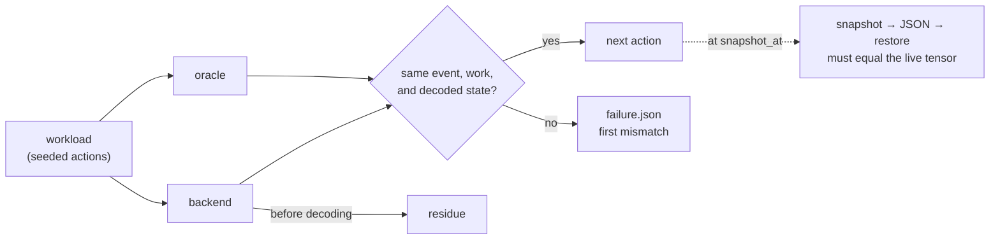
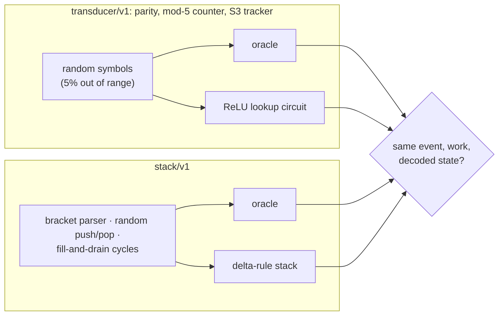
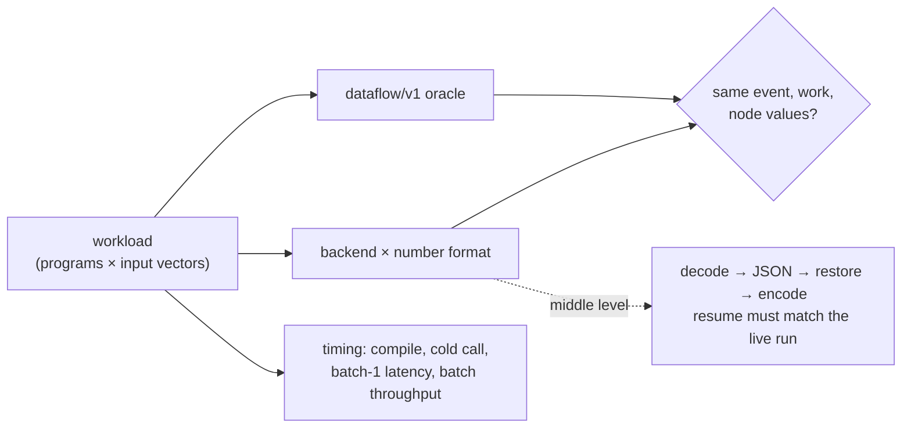

# Experiments

> **TL;DR:** Experiment runners compose machines, backends, and workloads, then record conformance results.

See the [experiment program](../../../EXPERIMENTS.md#experiments) and the [run-record contract](../../../EXPERIMENTS.md#run-records-and-results).

## E00: memory conformance

> **TL;DR:** Run reference and neural memory side by side, and stop at the first disagreement.

[e00.py](e00.py) checks the eager [delta-rule backend](../backends/README.md) against the [`memory/v1`](../machines/README.md#memoryv1) oracle on every [workload](../tasks/memory_workloads.py) and number format, one action at a time.



A variant is one workload in one number format. It is classified `exact` (no mismatch, zero residue), `conforms with residue` (no mismatch, but entries drifted from 0 or 1), or `mismatch` (stopped at the first wrong transition). The run passes only if no variant mismatches and every snapshot restores the live tensor exactly.

```bash
uv run --locked python -m latent_machines.experiments.e00                                    # 10^3 actions per variant
uv run --locked python -m latent_machines.experiments.e00 --horizon 1000000 --jobs 8 --trace-limit 1000
```

Each run writes `runs/e00-<time>-<revision>-<id>/` with `run.json`, `metrics.json`, `trace.jsonl`, `snapshots/`, and, when needed, `failure.json` and `source.patch`. Exit status is 0 on pass, 1 on a mismatch or snapshot disagreement, and 2 if the run failed.

## E01: exact streaming machines

> **TL;DR:** Compare compiled transducers and a delta-rule stack against their integer oracles after each action.

[e01.py](e01.py) uses the same [lockstep check](lockstep.py) as E00:



Variants are named `backend/dtype/machine/workload`, for example `delta-stack/bfloat16/stack/brackets`. Metrics add circuit width, depth, and stored and nonzero weights.

```bash
uv run --locked python -m latent_machines.experiments.e01                                    # 10^3 actions per variant
uv run --locked python -m latent_machines.experiments.e01 --horizon 1000000 --jobs 8 --trace-limit 1000
```

## E04: dataflow and conditional units

> **TL;DR:** Evaluate the same integer programs on conventional, scalar-machine, and compiled tensor backends; check every evaluation and time each path.

[e04.py](e04.py) runs every [dataflow backend](../backends/README.md#dataflow-backends) on seeded [workloads](../tasks/dataflow_workloads.py): expression DAGs, a 64-element dot product, and gather/map/reduce/scatter. Each evaluation (one program, one input vector) is compared with the oracle: outputs or faulting node, work, and every evaluated node's value. Variants do not stop at the first mismatch; they count mismatching evaluations and keep the first in `failure.json`.



bfloat16 and float16 variants are precision probes: reported like the others but outside the acceptance, since they cannot represent every 16-bit word. Timing amortizes each compile against the Python-int baseline at batch 1 and the int64 baseline per batched evaluation.

```bash
uv run --locked python -m latent_machines.experiments.e04       # 20 programs × 50 inputs per workload
```
