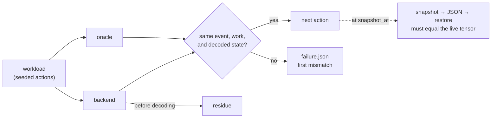
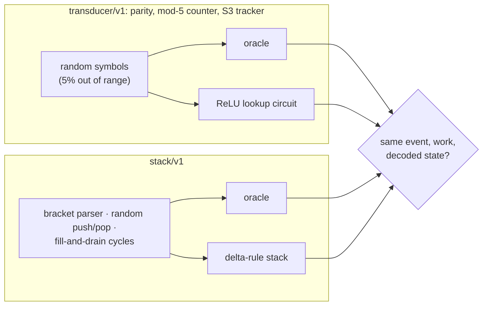
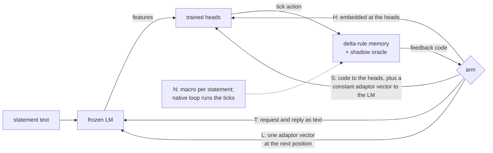
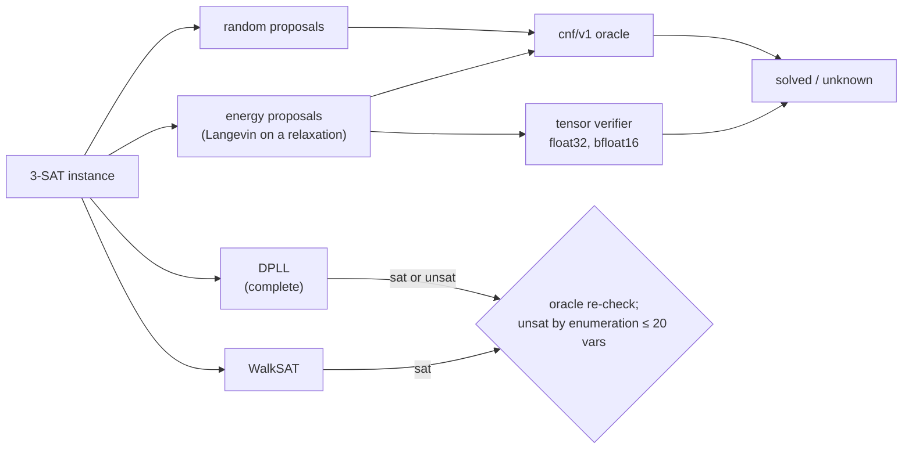

# Experiments

> **TL;DR:** Experiment runners compose machines, backends, and workloads, then record conformance results.

See the [experiment program](../../../EXPERIMENTS.md#experiments) and the [run-record contract](../../../EXPERIMENTS.md#run-records-and-results).

## E00: memory conformance

> **TL;DR:** Run reference and neural memory side by side, and stop at the first disagreement.

[e00.py](e00.py) checks the eager [delta-rule backend](../backends/README.md) against the [`memory/v1`](../machines/README.md#memoryv1) oracle on every [workload](../tasks/memory_workloads.py) and number format, one action at a time.



A variant is one workload in one number format. It is classified `exact` (no mismatch, zero residue), `conforms with residue` (no mismatch, but entries drifted from 0 or 1), or `mismatch` (stopped at the first wrong transition). The run passes only if no variant mismatches and every snapshot restores the live tensor exactly.

```bash
uv run --locked python -m latent_machines.experiments.e00                                    # 10^3 actions per variant
uv run --locked python -m latent_machines.experiments.e00 --horizon 1000000 --jobs 8 --trace-limit 1000
```

Each run writes `runs/e00-<time>-<revision>-<id>/` with `run.json`, `metrics.json`, `trace.jsonl`, `snapshots/`, and, when needed, `failure.json` and `source.patch`. Exit status is 0 on pass, 1 on a mismatch or snapshot disagreement, and 2 if the run failed.

## E01: exact streaming machines

> **TL;DR:** Compare compiled transducers and a delta-rule stack against their integer oracles after each action.

[e01.py](e01.py) uses the same [lockstep check](lockstep.py) as E00:



Variants are named `backend/dtype/machine/workload`, for example `delta-stack/bfloat16/stack/brackets`. Metrics add circuit width, depth, and stored and nonzero weights.

```bash
uv run --locked python -m latent_machines.experiments.e01                                    # 10^3 actions per variant
uv run --locked python -m latent_machines.experiments.e01 --horizon 1000000 --jobs 8 --trace-limit 1000
```

## E03: latent ticks and explicit events

> **TL;DR:** Four ways to return a machine's reply to a frozen model's controller, compared on copies that need the reply.

[e03.py](e03.py) runs record programs with copies ([task](../tasks/copies.py)): `Copy b to e.` is a read of `b`, then a write of the value read to `e`. Trained heads decide one tick at a time (`write`, `read`, or `end`; at most three machine actions per statement), and each tick's action and reply form a feedback code ([interface](../interfaces/ticks.py)). Arms differ only in where that code re-enters:



Arm S is a control for L: the same trained vector slots, trained end to end through the frozen model, but carrying a constant instead of the feedback, which goes to the heads. If S matched L, L's gains would come from trained inputs steering the model rather than from feedback through it.

All arms execute on the delta-rule memory with a shadow oracle. For a sample of programs, each arm is snapshotted between the read and the write of a copy (machine state, controller history, pending work), restored through JSON, and must finish exactly as an uninterrupted run.

```bash
uv run --locked python -m latent_machines.experiments.e03 --model tiny-random   # smoke run
uv run --locked python -m latent_machines.experiments.e03 --device cuda         # recorded configuration
```

## E08: search with an exact verifier

> **TL;DR:** Check the compiled verifier against the oracle, then compare search procedures at the same step budget with every claimed solution re-verified.

[e08.py](e08.py) has two parts. Verifier conformance compares the [tensor CNF verifier](../backends/README.md#tensor-cnf-verifier) with the [`cnf/v1`](../machines/README.md#cnfv1) oracle on every candidate of five [workloads](../tasks/sat_instances.py), in each lowering and dtype. Search runs the [procedures](../controllers/sat_search.py) on four 3-SAT instance classes:



The budget is counted in steps: a variable assignment for DPLL, a flip for WalkSAT, a verified candidate for proposers. Only DPLL can report `unsat`; the others report `unknown` when the budget runs out. The two energy arms see the same proposals, so their accept decisions must be identical and their difference is verification cost alone.

```bash
uv run --locked python -m latent_machines.experiments.e08          # default run, about 3 minutes on 2 threads
uv run --locked python -m latent_machines.experiments.e08 --instances 0 --horizon 10000   # verifier conformance only
```

Each variant records whether its formulas stay within the dtype's exact-integer range for clause counts (`within_declared_limits`). The run passes when every variant within range matches the oracle, every claimed solution is accepted by the oracle, the two energy arms agree, and every checked DPLL unsatisfiability claim is confirmed. Exit status is 0 on pass, 1 on a failed check, and 2 if the run failed.
