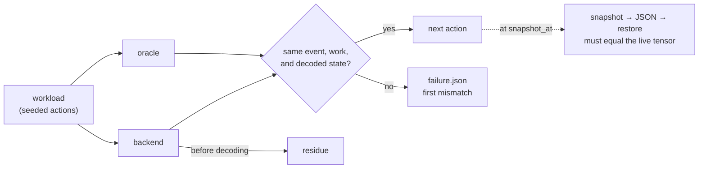

# Experiments

> **TL;DR:** Runnable experiments that tie the parts together and leave a receipt.

Runnable entry points that compose machines, backends, and task generators and write run records. See the [experiment program](../../../EXPERIMENTS.md#experiments) and the [run-record contract](../../../EXPERIMENTS.md#run-records-and-results).

## E00: memory conformance

> **TL;DR:** Run reference and neural memory side by side, and stop at the first disagreement.

[e00.py](e00.py) checks the eager [delta-rule backend](../backends/README.md) against the [`memory/v1`](../machines/README.md#memoryv1) oracle on every [workload](../tasks/memory_workloads.py) and number format, one action at a time.



A variant is one workload in one number format. It is classified `exact` (no mismatch, zero residue), `conforms with residue` (no mismatch, but entries drifted from 0 or 1), or `mismatch` (stopped at the first wrong transition). The run passes only if no variant mismatches and every snapshot restores the live tensor exactly.

```bash
uv run --locked python -m latent_machines.experiments.e00                                    # 10^3 actions per variant
uv run --locked python -m latent_machines.experiments.e00 --horizon 1000000 --jobs 8 --trace-limit 1000
```

Each run writes `runs/e00-<time>-<revision>-<id>/` with `run.json`, `metrics.json`, `trace.jsonl`, `snapshots/`, and, when needed, `failure.json` and `source.patch`. Exit status is 0 on pass, 1 on a mismatch or snapshot disagreement, and 2 if the run failed.
