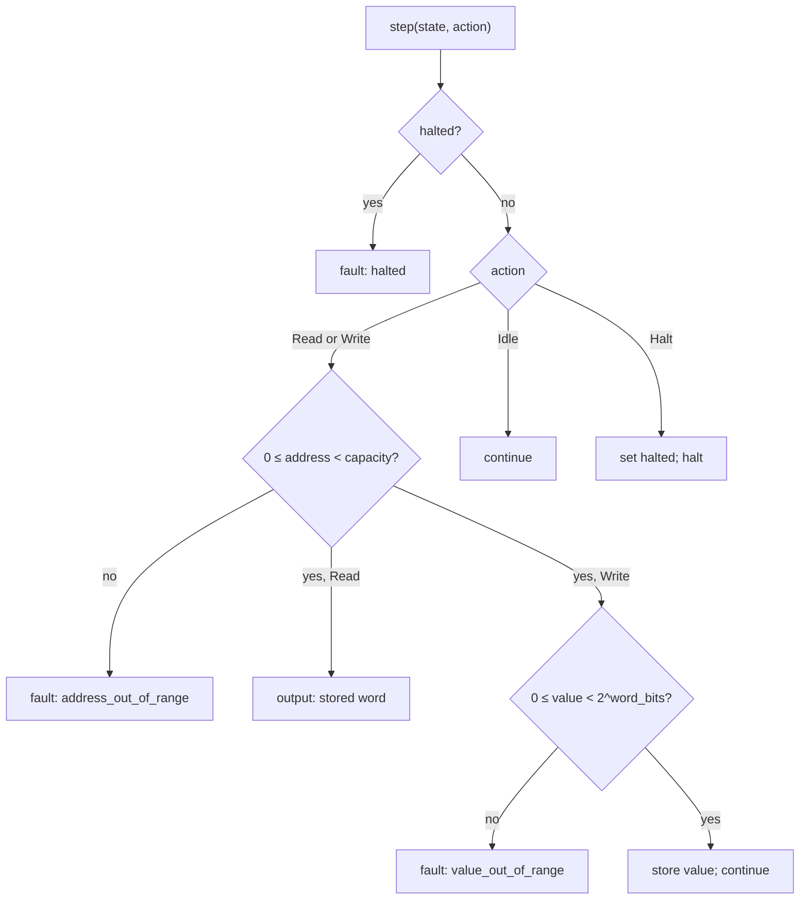

# Machines

> **TL;DR:** Plain-code reference machines that every neural version must match.

Specifications and independent integer oracles. A machine here depends on no model family or tensor backend; backends are validated against it. See [ownership boundaries](../../../EXPERIMENTS.md#ownership-boundaries).

## `memory/v1`

> **TL;DR:** A tiny memory that reads, writes, idles, and halts; bad requests fail without damage.

Fixed-capacity random-access memory of unsigned words, the reference for [E00](../../../EXPERIMENTS.md#e00---memory-and-transition-conformance). The docstring in [memory.py](memory.py) is the authoritative specification; this diagram shows the order of checks in one step.

Every outcome costs one work unit. Faults leave the state unchanged, and an action outside the schema raises `TypeError` before any check.
