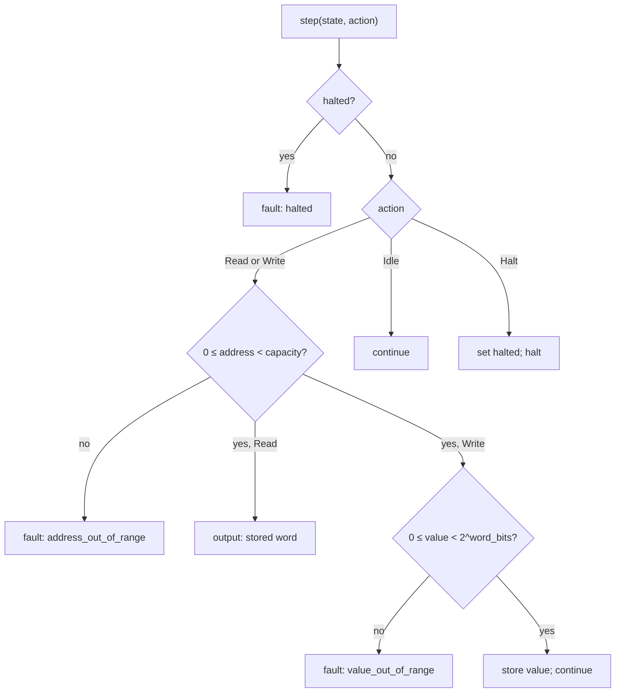
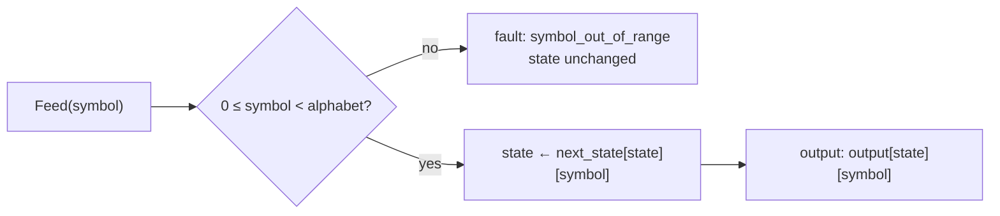
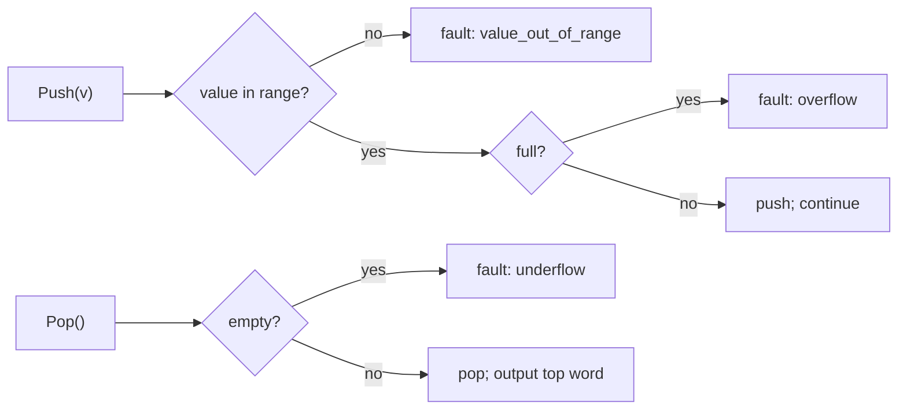
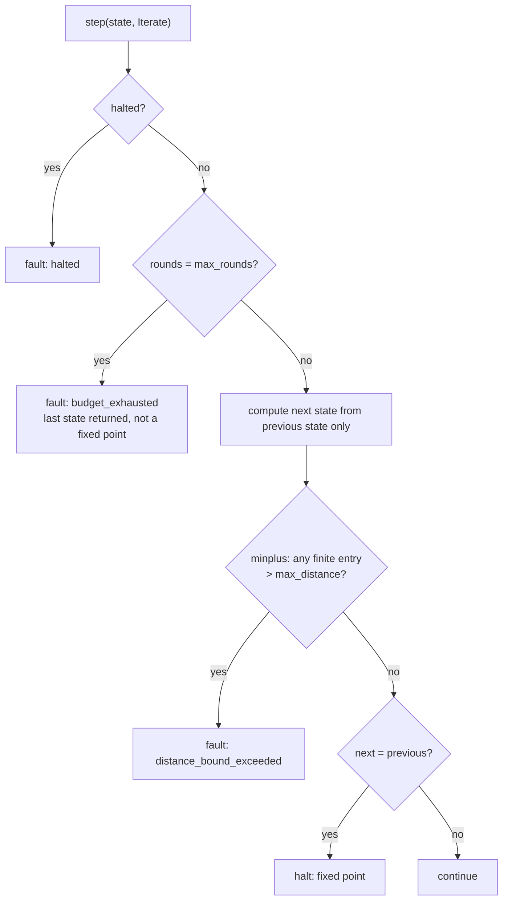

# Machines

> **TL;DR:** Independent integer oracles define the state transitions that backends must match.

Specifications and independent integer oracles. A machine here depends on no model family or tensor backend; backends are validated against it. See [ownership boundaries](../../../EXPERIMENTS.md#ownership-boundaries).

## `memory/v1`

> **TL;DR:** Fixed-capacity memory supports reads, writes, idle, and halt; invalid addresses or values fault without changing state.

Fixed-capacity random-access memory of unsigned words, the reference for [E00](../../../EXPERIMENTS.md#e00---memory-and-transition-conformance). The docstring in [memory.py](memory.py) is the authoritative specification; this diagram shows the order of checks in one step.

Every outcome costs one work unit. Faults leave the state unchanged, and an action outside the schema raises `TypeError` before any check.

## `transducer/v1`

> **TL;DR:** A machine that reads symbols one at a time and looks up its next state and output in a table.

Deterministic finite-state transducer, the reference for [E01](../../../EXPERIMENTS.md#e01---exact-streaming-machines-and-transition-algebras). [transducer.py](transducer.py) is the authoritative specification and builds the E01 targets: running parity, modular counters, and S_n permutation tracking.

Snapshots carry a digest of both tables, so a snapshot cannot be restored into a different transducer.

## `stack/v1`

> **TL;DR:** A bounded last-in, first-out stack faults on overflow or underflow without changing state.

Bounded stack of unsigned words, the reference for E01's stack parser. [stack.py](stack.py) is the authoritative specification.

Every fault leaves the stack unchanged, and every action costs one work unit.

## `reach/v1`, `minplus/v1`, `chain-datalog/v1`

> **TL;DR:** Graph and logic problems run as fixed-point machines: one synchronous round per step until nothing changes.

Three fixed-point machines for [E05](../../../EXPERIMENTS.md#e05---graph-semiring-and-logic-execution), specified in [graph.py](graph.py). Each machine holds one validated problem; its state is a relation or distance table that changes monotonically, one synchronous round per `Iterate` action:

- `reach/v1`: reflexive transitive closure of a directed graph; a round extends every known path by one edge.
- `minplus/v1`: all-pairs shortest paths with integer weights `0..max_weight`; `None` is the infinity sentinel, negative weights are rejected when the problem is built, and any stored distance above `max_distance` faults rather than saturating.
- `chain-datalog/v1`: positive Datalog over binary relations, with chain rules `h(x0, xk) :- r1(x0, x1), ..., rk(x(k-1), xk)` and optional inverted atoms, evaluated naively.

Faults leave the state unchanged and every action costs one work unit. The default `max_rounds` always suffices for a valid problem: `n` for the graph machines and `n² · |IDB| + 1` for Datalog.
