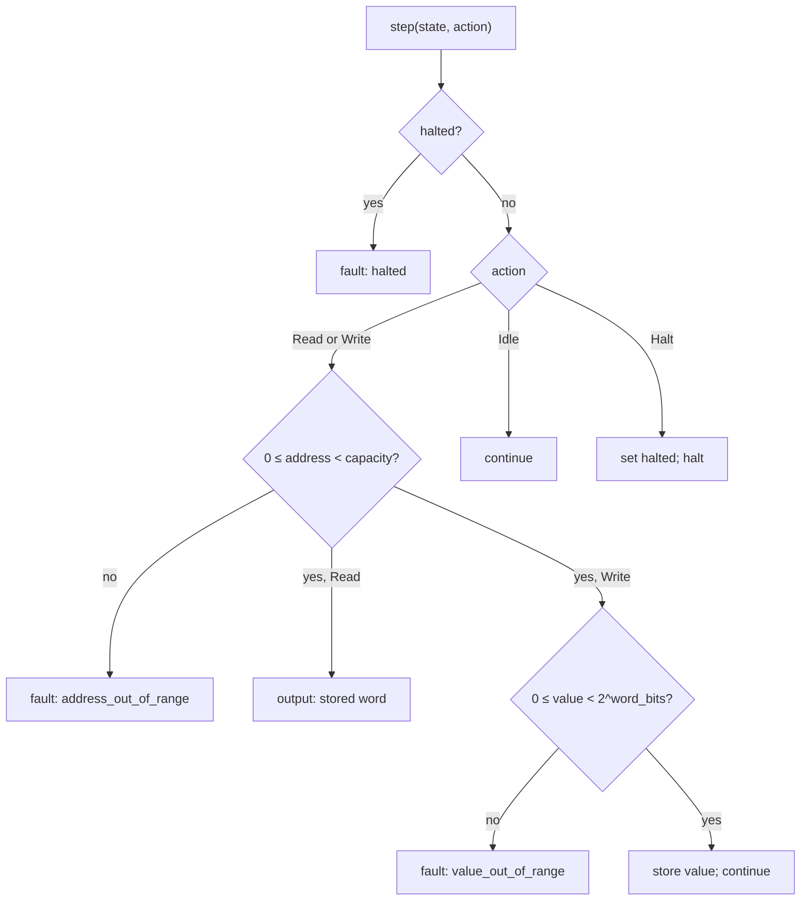
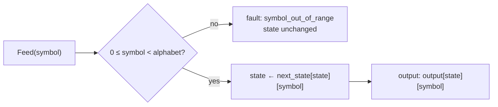
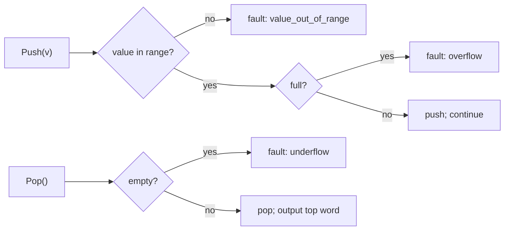
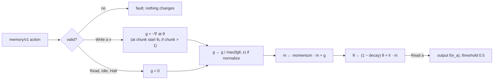

# Machines

> **TL;DR:** Independent integer oracles define the state transitions that backends must match.

Specifications and independent integer oracles. A machine here depends on no model family or tensor backend; backends are validated against it. See [ownership boundaries](../../../EXPERIMENTS.md#ownership-boundaries).

## `memory/v1`

> **TL;DR:** Fixed-capacity memory supports reads, writes, idle, and halt; invalid addresses or values fault without changing state.

Fixed-capacity random-access memory of unsigned words, the reference for [E00](../../../EXPERIMENTS.md#e00---memory-and-transition-conformance). The docstring in [memory.py](memory.py) is the authoritative specification; this diagram shows the order of checks in one step.

Every outcome costs one work unit. Faults leave the state unchanged, and an action outside the schema raises `TypeError` before any check.

## `transducer/v1`

> **TL;DR:** A machine that reads symbols one at a time and looks up its next state and output in a table.

Deterministic finite-state transducer, the reference for [E01](../../../EXPERIMENTS.md#e01---exact-streaming-machines-and-transition-algebras). [transducer.py](transducer.py) is the authoritative specification and builds the E01 targets: running parity, modular counters, and S_n permutation tracking.

Snapshots carry a digest of both tables, so a snapshot cannot be restored into a different transducer.

## `stack/v1`

> **TL;DR:** A bounded last-in, first-out stack faults on overflow or underflow without changing state.

Bounded stack of unsigned words, the reference for E01's stack parser. [stack.py](stack.py) is the authoritative specification.

Every fault leaves the stack unchanged, and every action costs one work unit.

## `optimizer-memory/v1`

> **TL;DR:** A memory written by optimizer steps: one gradient step per action, with the optimizer's settings as the specification.

An associative map `f(k)` updated by one optimizer step per action on `½‖f(k) − y‖²`, the reference for [E07](../../../EXPERIMENTS.md#e07---optimization-defined-state-updates). [optimizer_memory.py](optimizer_memory.py) is the authoritative specification and a plain-Python float64 reference. It fixes what the optimizer does; whether that behaves like `memory/v1` is what E07 measures.

The model is linear, `f(k) = W k`, or a one-hidden-layer ReLU MLP. With a linear model, one-hot keys, `lr = 1`, and every other feature off, a write is delta replacement. Reads, idles, and halts are optimizer steps without a sample, so decay and momentum still act on them.
