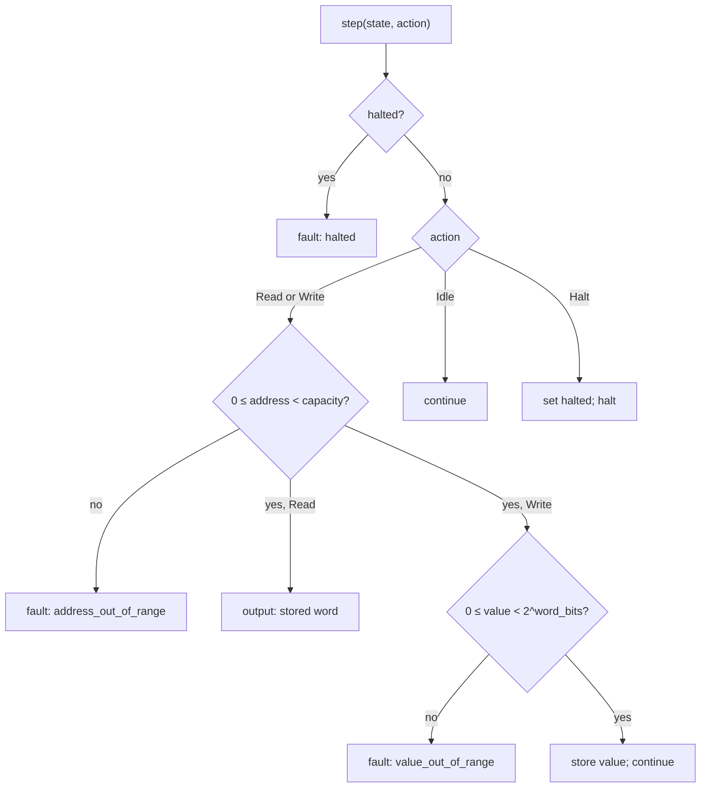
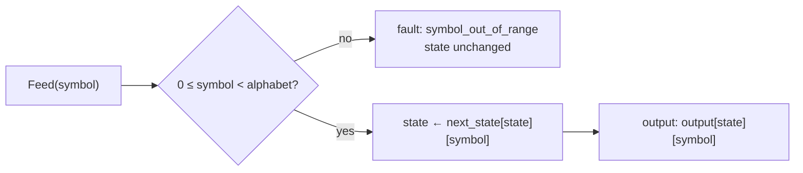
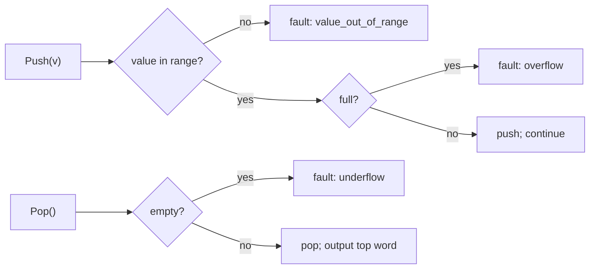
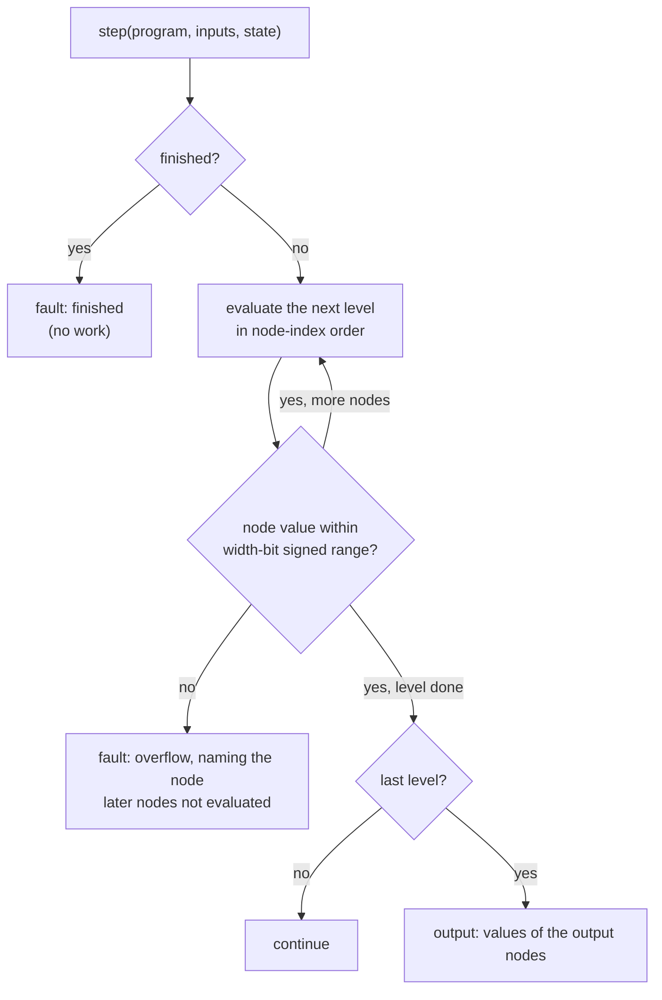
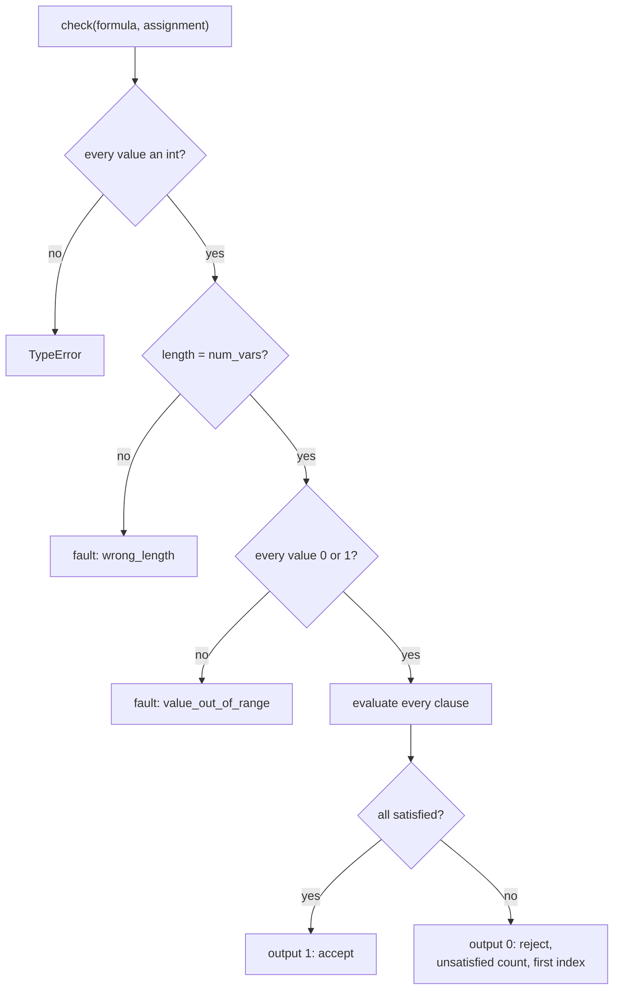
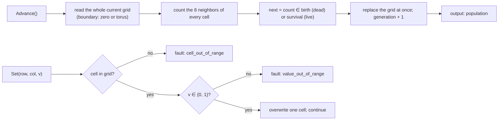

# Machines

> **TL;DR:** Independent integer oracles define the state transitions that backends must match.

Specifications and independent integer oracles. A machine here depends on no model family or tensor backend; backends are validated against it. See [ownership boundaries](../../../EXPERIMENTS.md#ownership-boundaries).

## `memory/v1`

> **TL;DR:** Fixed-capacity memory supports reads, writes, idle, and halt; invalid addresses or values fault without changing state.

Fixed-capacity random-access memory of unsigned words, the reference for [E00](../../../EXPERIMENTS.md#e00---memory-and-transition-conformance). The docstring in [memory.py](memory.py) is the authoritative specification; this diagram shows the order of checks in one step.

Every outcome costs one work unit. Faults leave the state unchanged, and an action outside the schema raises `TypeError` before any check.

## `transducer/v1`

> **TL;DR:** A machine that reads symbols one at a time and looks up its next state and output in a table.

Deterministic finite-state transducer, the reference for [E01](../../../EXPERIMENTS.md#e01---exact-streaming-machines-and-transition-algebras). [transducer.py](transducer.py) is the authoritative specification and builds the E01 targets: running parity, modular counters, and S_n permutation tracking.

Snapshots carry a digest of both tables, so a snapshot cannot be restored into a different transducer.

## `stack/v1`

> **TL;DR:** A bounded last-in, first-out stack faults on overflow or underflow without changing state.

Bounded stack of unsigned words, the reference for E01's stack parser. [stack.py](stack.py) is the authoritative specification.

Every fault leaves the stack unchanged, and every action costs one work unit.

## `dataflow/v1`

> **TL;DR:** A DAG of integer operations evaluated level by level; the first out-of-range node faults, and nothing wraps.

Signed integer dataflow graphs, the reference for [E04](../../../EXPERIMENTS.md#e04---dataflow-specialization-and-conditional-units). Nodes are `input`, `const`, `add`, `sub`, `mul`, `max`, and n-ary `sum`; arguments name earlier nodes. The docstring in [dataflow.py](dataflow.py) is the authoritative specification.

A tick is one level; levels are the safepoints where snapshots are taken. Work is one unit per node evaluated, the faulting node included. A `sum` is checked on its final value only.

## `cnf/v1`

> **TL;DR:** A stateless checker accepts an assignment only when every clause has a true literal; malformed assignments fault.

Assignment verifier for CNF formulas, the reference for [E08](../../../EXPERIMENTS.md#e08---heuristic-search-with-an-exact-verifier). The docstring in [cnf.py](cnf.py) is the authoritative specification.

A valid check costs one work unit per clause; a fault costs none. Accepting is the only claim the verifier makes: a rejection says nothing about whether another assignment satisfies the formula.

## `cellular/v1`

> **TL;DR:** A grid of live and dead cells updates all at once from neighbor counts, with dead or wrapping edges.

Binary outer-totalistic cellular automaton, the exact-branch reference for [E06](../../../EXPERIMENTS.md#e06---spatial-and-structured-dynamical-machines). [cellular.py](cellular.py) is the authoritative specification. A rule such as `B3/S23` lists the neighbor counts that give birth to a dead cell and keep a live one alive.

`Advance` costs one work unit per cell; `Set` costs one, faults included. Snapshots carry a digest of the rule, size, boundary, and starting grid.

## `lds/v1`

> **TL;DR:** A linear filter with a float64 reference, measured under a tolerance rather than checked for exactness.

Single-input, single-output linear dynamical system `y = C x + D u`, `x ← A x + B u`, the reference for E06's numerical branch. [lds.py](lds.py) evaluates it in IEEE double precision and builds the E06 systems: a lightly damped oscillator (pole radius 0.999), a second-order Butterworth low-pass, and a random stable 8-dimensional system. It is a declared numerical reference, not an exact oracle.
